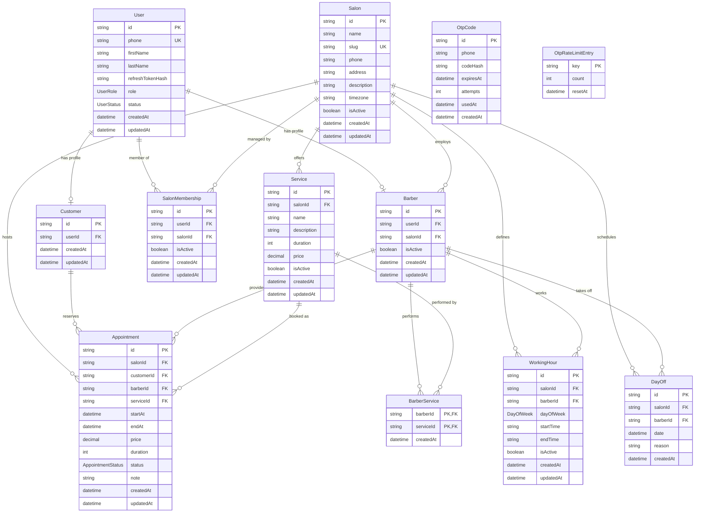

# Barbershop API - مستندات پروژه

سامانه جامع مدیریت و رزرواسیون آرایشگاه بر پایه معماری ماژولار **NestJS** و پایگاه داده **PostgreSQL**.

---

## فهرست مطالب

1. [معرفی](#معرفی)
2. [مشخصات فنی و ساختار برنامه](#مشخصات-فنی-و-ساختار-برنامه)
3. [ماژول‌ها](#ماژولها)
4. [مدل داده‌ها (Data Models)](#مدل-دادهها-data-models)
5. [نمودار روابط موجودیت‌ها (ER Diagram)](#نمودار-روابط-موجودیتها-er-diagram)
6. [اسکریپت‌های اجرایی (Scripts)](#اسکریپتهای-اجرایی-scripts)
7. [متغیرهای محیطی (Environment Variables)](#متغیرهای-محیطی-environment-variables)
8. [معماری و جریان سیستم](system-flow.md)
9. [تست بار و سناریوهای توسعه](load-testing.md)
10. [گزارش درآمد سالن](revenue-reporting.md)
11. [PWA و اعلان‌های Web Push](pwa-notifications.md)

---

## معرفی

این پروژه یک سامانه مدیریت و رزرو آرایشگاه با API مبتنی بر NestJS و پنل وب React + Vite است. هدف آن مدیریت سالن‌ها، آرایشگران، خدمات، برنامه کاری، زمان‌های آزاد و چرخه نوبت‌ها با کنترل دسترسی چندسطحی است.

برای مشاهده ارتباط اجزای سیستم و جریان‌های اصلی رزرو و ورود، از [نمودار معماری و جریان سیستم](system-flow.md) شروع کنید.

### پشته فناوری (Technology Stack)

- **فریم‌ورک سرور**: [NestJS 12](https://nestjs.com/) با پشتیبانی استاندارد از ماژول‌های جاوااسکریپت مدرن (**ESM**)
- **پایگاه داده و ORM**: [PostgreSQL](https://www.postgresql.org/) به همراه [Prisma ORM 7](https://www.prisma.io/) با استفاده از درایور سازگار با ارتباطات مدرن `@prisma/adapter-pg`
- **کش و ذخیره‌سازی موقت**: [Redis](https://redis.io/) از طریق کتابخانه پرسرعت [ioredis](https://github.com/redis/ioredis)
- **احراز هویت و امنیت**: احراز هویت بدون رمز عبور با پیامک (**OTP**) و توکن‌های **JWT** (شامل Access Token و Refresh Token)، به همراه رمزنگاری کدهای حساس با [bcrypt](https://github.com/kelektiv/node.bcrypt.js)
- **موتور تست**: [Vitest](https://vitest.dev/) جهت اجرای سریع تست‌های واحد (Unit Tests) و تست‌های سرتاسری (E2E Tests)
- **کدگذاری و فرمت‌بندی**: [oxlint](https://oxc.rs/) برای اعتبارسنجی سریع کد و [Prettier](https://prettier.io/) برای یکپارچه‌سازی ظاهر کد

---

## مشخصات فنی و ساختار برنامه

برنامه در فایل اصلی `src/main.ts` پیکربندی و راه‌اندازی می‌شود و استانداردهای کلیدی زیر در آن پیاده‌سازی شده‌اند:

1. **پیشوند سراسری روت‌ها (Global Prefix)**:
   - تمام مسیرهای دسترسی به API دارای پیشوند `/api` هستند (`app.setGlobalPrefix('api')`). به عنوان نمونه، مسیر دریافت اطلاعات کاربر جاری به شکل `GET /api/auth/me` خواهد بود.

2. **اعتبارسنجی سخت‌گیرانه داده‌های ورودی (Global ValidationPipe)**:
   - پایپ اعتبارسنجی در سراسر نرم‌افزار با سه پیکربندی اساسی فعال شده است:
     - `whitelist: true`: تمام کلیدها و فیلدهای اضافه که در DTO تعریف نشده‌اند، به صورت خودکار از بدنه درخواست (Payload) حذف می‌شوند.
     - `transform: true`: داده‌های ورودی بر اساس نوع داده‌های تعیین‌شده در DTOها به کلاس‌ها و تایپ‌های متناظر تبدیل می‌شوند.
     - `forbidNonWhitelisted: true`: در صورت ارسال هرگونه فیلد ناشناخته و غیرمجاز، سیستم پاسخ `400 Bad Request` برمی‌گرداند تا از حملات تزریق داده جلوگیری شود.

3. **پشتیبانی از Reverse Proxy و Load Balancer**:
   - به منظور دریافت آدرس IP واقعی کاربران پشت سرورهای واسط مانند Nginx، Cloudflare یا HAProxy، تعداد گام‌های مورد اعتماد از متغیر محیطی `TRUST_PROXY_HOPS` خوانده شده و در آداپتور Express اعمال می‌شود:
   ```typescript
   const trustProxyHops = Number.parseInt(
     process.env.TRUST_PROXY_HOPS ?? '0',
     10,
   );
   if (Number.isInteger(trustProxyHops) && trustProxyHops > 0) {
     app.getHttpAdapter().getInstance().set('trust proxy', trustProxyHops);
   }
   ```
   این قابلیت مانع از دور زدن محدودیت‌های نرخ درخواست (Rate Limiting) در محیط‌های Production می‌شود.

---

## ماژول‌ها

ساختار ماژولار برنامه به تفکیک وظایف و استقلال هر بخش کمک می‌کند. در ادامه لیست ماژول‌های پروژه به همراه عملکرد اصلی و لینک مستندات مربوطه آورده شده است:

| ماژول                    | عملکرد و مسئولیت                                                                                                         | مستند اختصاصی                                      |
| :----------------------- | :----------------------------------------------------------------------------------------------------------------------- | :------------------------------------------------- |
| **PrismaModule**         | مدیریت اتصال پایدار به دیتابیس PostgreSQL با استفاده از Prisma Client، مدیریت چرخه حیات و Pool اتصالات                   | [مستندات ماژول Prisma](prisma.md)                  |
| **RedisModule**          | ماژول سراسری (`@Global`) برای عملیات کشینگ داده‌ها و اجرای اسکریپت‌های اتمیک کنترل نرخ درخواست (Rate Limit) با `ioredis` | [مستندات ماژول Redis](redis.md)                    |
| **HealthModule**         | بررسی وضعیت سلامت سرور و دیتابیس جهت مانیتورینگ سلامت سرویس در کانتینرها و Load Balancerها (`/api/health`)               | [مستندات ماژول Health](health.md)                  |
| **UsersModule**          | مدیریت پروفایل کاربران، مدیریت نقش‌ها، مسدودسازی و جستجوی کاربران                                                        | [مستندات ماژول Users](users.md)                    |
| **OtpModule**            | تولید کدهای یکبار مصرف، هش کردن کدها، اعتبارسنجی مهلت انقضا، ارسال پیامک و اعمال محدودیت تلاش                            | [مستندات ماژول Otp](otp.md)                        |
| **AuthModule**           | ورود و ثبت‌نام با شماره تلفن و OTP، صدور و تجدید توکن‌های JWT، گارد احراز هویت و گارد دسترسی نقش‌ها (RBAC)               | [مستندات ماژول Auth](auth.md)                      |
| **SalonsModule**         | مدیریت مشخصات آرایشگاه‌ها (نام، اسلاگ، آدرس، منطقه زمانی)، عضویت مدیران در سالن‌ها و اعتبارسنجی دسترسی                   | [مستندات ماژول Salons](salons.md)                  |
| **BarbersModule**        | مدیریت آرایشگران هر سالن، اتصال حساب کاربر به آرایشگر سالن و تغییر وضعیت فعال/غیرفعال بودن                               | [مستندات ماژول Barbers](barbers.md)                |
| **ServicesModule**       | تعریف و مدیریت خدمات قابل ارائه در سالن (عنوان، قیمت، مدت‌زمان خدمت به دقیقه و وضعیت فعال)                               | [مستندات ماژول Services](services.md)              |
| **BarberServicesModule** | مدیریت انتساب خدمات سالن به هر آرایشگر (مشخص کردن اینکه کدام آرایشگر چه خدماتی را ارائه می‌دهد)                          | [مستندات ماژول BarberServices](barber-services.md) |
| **SchedulesModule**      | مدیریت ساعات کاری هفتگی آرایشگران بر اساس روزهای هفته و مدیریت روزهای مرخصی و تعطیلات آرایشگران                          | [مستندات ماژول Schedules](schedules.md)            |
| **AppointmentsModule**   | مدیریت کامل چرخه رزرو نوبت‌ها توسط مشتریان و مدیران، ثبت نوبت، لغو، تغییر وضعیت و اعتبارسنجی رزرو                        | [مستندات ماژول Appointments](appointments.md)      |
| **AvailabilityModule**   | محاسبه هوشمند زمان‌های خالی و در دسترس آرایشگران برای رزرو، بر اساس تقویم کاری، مرخصی‌ها و نوبت‌های ثبت‌شده              | [مستندات ماژول Availability](availability.md)      |
| **ReportsModule**        | محاسبه درآمد نوبت‌های تکمیل‌شده، تفکیک درآمد آرایشگرها و ساخت خروجی Excel در محدوده سالن مجاز مدیر                       | [گزارش درآمد سالن](revenue-reporting.md)           |
| **NotificationsModule**  | ثبت subscription مرورگر و ارسال Web Push برای رویدادهای نوبت                                                             | [PWA و اعلان‌ها](pwa-notifications.md)             |

---

## مدل داده‌ها (Data Models)

ساختار داده‌های برنامه به کمک Prisma Schema تعریف شده است و از قابلیت‌های جامع ارتباطی پایگاه داده رابطه‌ای PostgreSQL بهره می‌برد.

### شمارنده‌ها (Enums)

#### ۱. `UserRole`

سطوح دسترسی و نقش کاربران در سیستم:

- `SUPER_ADMIN`: مدیر ارشد سیستم با دسترسی کامل به تمامی سالن‌ها، کاربران و ایجاد آرایشگاه‌های جدید.
- `ADMIN`: مدیر سالن با دسترسی مدیریتی به سالن‌هایی که در آن‌ها عضویت فعال (`SalonMembership`) دارد.
- `BARBER`: آرایشگر سالن با دسترسی به مشاهده و مدیریت برنامه کاری و نوبت‌های خود.
- `CUSTOMER`: مشتری عادی سیستم با قابلیت جستجوی خدمات، بررسی زمان‌های آزاد و ثبت رزرو.

#### ۲. `UserStatus`

وضعیت حساب کاربری:

- `ACTIVE`: کاربر فعال و مجاز به استفاده از سیستم.
- `INACTIVE`: کاربر غیرفعال‌شده.
- `BLOCKED`: کاربر مسدود شده به دلیل تخلف یا مسدودسازی توسط ادمین.

#### ۳. `AppointmentStatus`

مراحل و وضعیت‌های چرخه حیات یک نوبت رزرو شده:

- `PENDING`: نوبت تازه ثبت‌شده و در انتظار تایید.
- `CONFIRMED`: نوبت توسط مدیریت یا سالن تایید شده است.
- `COMPLETED`: خدمت به پایان رسیده و نوبت با موفقیت انجام شده است.
- `CANCELLED`: نوبت توسط مشتری یا سالن لغو شده است.
- `NO_SHOW`: مشتری در زمان تعیین‌شده در آرایشگاه حضور پیدا نکرده است.

#### ۴. `DayOfWeek`

روزهای هفته مطابق با ساختار کاری (از شنبه تا جمعه):

- `SATURDAY`, `SUNDAY`, `MONDAY`, `TUESDAY`, `WEDNESDAY`, `THURSDAY`, `FRIDAY`

---

### جدول‌ها و موجودیت‌ها (Models)

#### ۱. `User`

موجودیت مرکزی ذخیره‌سازی کاربران سیستم:

- `id`: شناسه یکتا از نوع UUID (کلید اصلی).
- `phone`: شماره تلفن همراه کاربر (یکتا، `unique`).
- `firstName`: نام (اختیاری).
- `lastName`: نام خانوادگی (اختیاری).
- `refreshTokenHash`: هش رمزنگاری‌شده Refresh Token جهت مدیریت نشست‌های فعال.
- `role`: نقش کاربر با پیش‌فرض `CUSTOMER` (دارای ایندکس).
- `status`: وضعیت اکانت با پیش‌فرض `ACTIVE` (دارای ایندکس).
- `createdAt` و `updatedAt`: زمان ثبت و آخرین به‌روزرسانی.
- **روابط**:
  - یک‌به‌یک با `Customer`
  - یک‌به‌یک با `Barber`
  - یک‌به‌چند با `SalonMembership`

#### ۲. `OtpCode`

ذخیره‌سازی کدهای تایید موقت ارسالی برای ورود و ثبت‌نام:

- `id`: شناسه یکتا (UUID).
- `phone`: شماره تلفنی که کد برای آن ارسال شده است.
- `codeHash`: هش رمزنگاری‌شده کد ارسالی (جهت جلوگیری از افشای کد در صورت لو رفتن دیتابیس).
- `expiresAt`: زمان انقضای کد (دارای ایندکس).
- `attempts`: شمارنده تعداد تلاش‌های اشتباه با پیش‌فرض 0.
- `usedAt`: زمان مصرف موفق کد (جهت جلوگیری از استفاده مجدد).
- `createdAt`: تاریخ ایجاد کد.
- **ایندکس ترکیبی**: `[phone, createdAt]` برای واکشی سریع آخرین کدهای ارسالی هر شماره.

#### ۳. `Salon`

مشخصات هر شعبه یا آرایشگاه:

- `id`: شناسه یکتا (UUID).
- `name`: نام آرایشگاه.
- `slug`: نام مستعار انگلیسی و یکتا (`unique`) جهت استفاده در URLها.
- `phone`: شماره تلفن سالن.
- `address`: آدرس فیزیکی آرایشگاه.
- `description`: توضیحات درباره خدمات و سالن.
- `timezone`: منطقه زمانی سالن (پیش‌فرض: `Asia/Tehran`).
- `isActive`: وضعیت فعال/غیرفعال بودن سالن (دارای ایندکس).
- **روابط**: با آرایشگران (`Barber`)، خدمات (`Service`)، ساعات کاری (`WorkingHour`)، مرخصی‌ها (`DayOff`)، نوبت‌ها (`Appointment`) و عضویت مدیران (`SalonMembership`).

#### ۴. `SalonMembership`

جدول رابطه جهت انتساب مدیران سالن (`ADMIN`) به آرایشگاه‌های مشخص:

- `id`: شناسه یکتا (UUID).
- `userId`: شناسه کاربری مدیر (`User`).
- `salonId`: شناسه سالن (`Salon`).
- `isActive`: وضعیت فعال بودن عضویت مدیریتی.
- **قوانین و ایندکس‌ها**:
  - کلید یکتای ترکیبی `[userId, salonId]` برای جلوگیری از انتساب تکراری.
  - حذف به صورت `Cascade` با حذف کاربر یا سالن.
  - ایندکس‌های مجزا روی `[salonId, isActive]` و `[userId, isActive]`.

#### ۵. `Customer`

پروفایل مشتریان که به حساب کاربری متصل می‌شود:

- `id`: شناسه یکتا (UUID).
- `userId`: شناسه کاربر در جدول `User` (یکتا، `unique`).
- **روابط**: اتصال به `User` با `onDelete: Cascade` و رابطه یک‌به‌چند با نوبت‌های رزرو شده (`Appointment`).

#### ۶. `Barber`

پروفایل آرایشگر در یک سالن مشخص:

- `id`: شناسه یکتا (UUID).
- `userId`: شناسه کاربری آرایشگر (یکتا، `unique`).
- `salonId`: شناسه سالنی که آرایشگر در آن کار می‌کند.
- `isActive`: وضعیت فعال بودن آرایشگر در سالن.
- **قوانین و ایندکس‌ها**:
  - اتصال به `User` و `Salon` با `onDelete: Cascade`.
  - ایندکس‌های جستجو روی `salonId` و `[salonId, isActive]`.
  - روابط با خدمات ارائه شده (`BarberService`)، ساعات کاری (`WorkingHour`)، مرخصی‌ها (`DayOff`) و نوبت‌ها (`Appointment`).

#### ۷. `Service`

خدمات تعریف شده در هر سالن:

- `id`: شناسه یکتا (UUID).
- `salonId`: سالن ارائه‌دهنده خدمت.
- `name`: عنوان خدمت (مثلاً: اصلاح مو، گریم، پاکسازی پوست).
- `description`: توضیحات تکمیلی.
- `duration`: مدت زمان تخمینی ارائه خدمت به دقیقه (مثلاً 30 یا 45 دقیقه).
- `price`: قیمت خدمت از نوع اعشاری دقیق (`Decimal(12, 2)`).
- `isActive`: وضعیت فعال بودن خدمت.
- **روابط**: اتصال به `Salon` با `onDelete: Cascade` و انتساب به آرایشگران از طریق `BarberService`.

#### ۸. `BarberService`

جدول واسط برای پیاده‌سازی رابطه چندبه‌چند میان آرایشگران و خدمات:

- `barberId`: شناسه آرایشگر.
- `serviceId`: شناسه خدمت.
- **کلید اصلی**: ترکیب `[barberId, serviceId]`.
- **حذف وابسته**: `onDelete: Cascade` برای هر دو سمت.

#### ۹. `WorkingHour`

تنظیم برنامه هفتگی شیفت کاری هر آرایشگر در سالن:

- `id`: شناسه یکتا (UUID).
- `salonId`: شناسه سالن.
- `barberId`: شناسه آرایشگر.
- `dayOfWeek`: روز هفته از نوع اینام `DayOfWeek`.
- `startTime`: ساعت شروع شیفت به صورت رشته (مثلاً `"09:00"`).
- `endTime`: ساعت پایان شیفت به صورت رشته (مثلاً `"18:00"`).
- `isActive`: وضعیت فعال بودن شیفت در آن روز.
- **قوانین**: کلید یکتای ترکیبی `[barberId, dayOfWeek]`؛ هر آرایشگر برای هر روز هفته تنها یک رکورد کاری دارد.

#### ۱۰. `DayOff`

روزهای مرخصی و تعطیلی اختصاصی آرایشگر:

- `id`: شناسه یکتا (UUID).
- `salonId`: شناسه سالن.
- `barberId`: شناسه آرایشگر.
- `date`: تاریخ روز مرخصی.
- `reason`: دلیل مرخصی (اختیاری).
- **قوانین**: کلید یکتای ترکیبی `[barberId, date]` برای جلوگیری از تکرار تاریخ مرخصی برای یک آرایشگر.

#### ۱۱. `Appointment`

هسته اصلی سیستم رزرواسیون:

- `id`: شناسه یکتا (UUID).
- `salonId`: سالن مربوطه.
- `customerId`: مشتری رزروکننده.
- `barberId`: آرایشگر انجام‌دهنده.
- `serviceId`: خدمت انتخابی.
- `startAt`: تاریخ و زمان دقیق شروع نوبت (`DateTime`).
- `endAt`: تاریخ و زمان دقیق پایان نوبت (`DateTime`).
- `price`: قیمت نهایی رزرو (ثبت شده در لحظه رزرو با نوع `Decimal(12, 2)` جهت حفظ صحت تاریخچه مالی).
- `duration`: مدت زمان نوبت به دقیقه.
- `status`: وضعیت نوبت با مقدار پیش‌فرض `PENDING`.
- `note`: یادداشت اختیاری مشتری یا پرسنل سالن.
- **امنیت سوابق و حذف**: تمامی روابط خارجی این جدول از نوع `onDelete: Restrict` هستند تا از حذف ناخواسته یا تصادفی سالن، مشتری، آرایشگر یا خدماتی که دارای نوبت ثبت‌شده هستند جلوگیری شود.
- **ایندکس‌ها**: بهینه‌سازی شده با ایندکس‌های `[salonId, startAt]`, `[barberId, startAt]`, `[barberId, startAt, endAt]`, `[customerId, startAt]` و `[status]` برای جستجوهای هم‌زمانی و تقویم با سرعت بالا.

#### ۱۲. `OtpRateLimitEntry`

مدیریت پشتیبان برای کنترل تعداد تلاش‌ها و محدودیت نرخ ارسال پیامک در سطح دیتابیس:

- `key`: کلید محدودیت (مثلاً ترکیب IP یا شماره تلفن).
- `count`: تعداد دفعات تلاش در بازه زمانی جاری.
- `resetAt`: زمان انقضا و بازنشانی شمارنده (دارای ایندکس).

---

## نمودار روابط موجودیت‌ها (ER Diagram)

نمودار زیر روابط کامل بین مدل‌های Prisma و نوع ارتباطات (یک‌به‌یک، یک‌به‌چند، چندبه‌چند) را نمایش می‌دهد:



---

## اسکریپت‌های اجرایی (Scripts)

تمامی دستورات اجرایی پروژه که در فایل `package.json` تعریف شده‌اند در جدول زیر گردآوری شده‌اند:

| نام اسکریپت            | دستور اجرایی                                    | توضیحات و کاربرد                                                          |
| :--------------------- | :---------------------------------------------- | :------------------------------------------------------------------------ |
| `pnpm run build`       | `nest build`                                    | کامپایل کد تایپ‌اسکریپت و تولید خروجی اجرایی در دایرکتوری `dist`          |
| `pnpm run deploy`      | `nest deploy`                                   | اجرای دستورات مخصوص دیپلوی و استقرار برنامه در محیط پروداکشن              |
| `pnpm run format`      | `prettier --write "src/**/*.ts" "test/**/*.ts"` | فرمت‌بندی استاندارد و مرتب‌سازی خودکار کدهای منبع با Prettier             |
| `pnpm run start`       | `nest start`                                    | اجرای مستقیم نرم‌افزار در محیط توسعه بدون حالت Watch                      |
| `pnpm run start:dev`   | `nest start --watch`                            | اجرای سرور در حالت توسعه با قابلیت Hot Reload و مشاهده تغییرات فایل‌ها    |
| `pnpm run start:debug` | `nest start --debug --watch`                    | اجرای سرور همراه با دیباگر فعال Node.js و حالت Watch                      |
| `pnpm run start:prod`  | `node dist/main`                                | اجرای برنامه در محیط عملیاتی (Production) از روی خروجی بیلد شده           |
| `pnpm run lint`        | `oxlint --type-aware src/ test/`                | اعتبارسنجی سریع کیفیت کد و قوانین تایپ با لینتر مدرن Oxlint               |
| `pnpm run test`        | `vitest run`                                    | اجرای یک‌باره تمامی تست‌های واحد با فریم‌ورک Vitest                       |
| `pnpm run test:watch`  | `vitest`                                        | اجرای مداوم تست‌ها و شنود تغییرات کد (Watch Mode)                         |
| `pnpm run test:cov`    | `vitest run --coverage`                         | اجرای تست‌ها و تولید گزارش جامع پوشش کد (Coverage Report) با v8           |
| `pnpm run test:debug`  | `vitest --inspect-brk --no-file-parallelism`    | اجرای تست‌ها در حالت اشکال‌زدایی ترتیبی با توقف اولیه برای اتصال Debugger |
| `pnpm run test:e2e`    | `vitest run --config ./vitest.config.e2e.ts`    | اجرای تست‌های سرتاسری و یکپارچه‌سازی API با کانفیگ اختصاصی E2E            |
| `postinstall`          | `prisma skills sync \|\| exit 0`                | همگام‌سازی ابزارهای Prisma پس از اتمام نصب پکیج‌ها                        |

---

## متغیرهای محیطی (Environment Variables)

پروژه به وسیله متغیرهای محیطی که در فایل `.env` قرار می‌گیرند پیکربندی می‌شود. نمونه‌ای از این مقادیر در فایل `.env.example` نیز موجود است. جدول زیر متغیرهای محیطی پروژه، وضعیت اجباری بودن، مقادیر پیش‌فرض و کاربرد دقیق هرکدام را نشان می‌دهد:

| متغیر                                      | الزامی / اختیاری         | مقدار پیش‌فرض                  | توضیحات کاربردی                                                                                                           |
| :----------------------------------------- | :----------------------- | :----------------------------- | :------------------------------------------------------------------------------------------------------------------------ |
| `PORT`                                     | اختیاری                  | `3000`                         | پورت گوش دادن وب‌سرور HTTP                                                                                                |
| `TRUST_PROXY_HOPS`                         | اختیاری                  | `0`                            | تعداد پروکسی‌های معکوس مطمئن پشت سرور جهت دریافت IP واقعی کاربر                                                           |
| `DATABASE_URL`                             | **الزامی**               | -                              | آدرس اتصال کامل به دیتابیس PostgreSQL (شامل یوزر، پسورد، پورت و اسکیمای پایگاه داده)                                      |
| `JWT_SECRET` / `JWT_ACCESS_SECRET`         | **الزامی**               | -                              | کلید مخفی و امن جهت امضا و اعتبارسنجی Access Tokenهای ارسالی به کلاینت                                                    |
| `JWT_EXPIRES_IN` / `JWT_ACCESS_EXPIRES_IN` | اختیاری                  | `15m`                          | مدت‌زمان اعتبار توکن دسترسی (مثلاً `15m` برای ۱۵ دقیقه)                                                                   |
| `JWT_REFRESH_SECRET`                       | **الزامی**               | -                              | کلید مخفی مجزا برای امضا و تایید اعتبار Refresh Token                                                                     |
| `JWT_REFRESH_EXPIRES_IN`                   | اختیاری                  | `7d`                           | مدت‌زمان اعتبار توکن تازه‌سازی (مثلاً `7d` برای ۷ روز)                                                                    |
| `REDIS_URL`                                | اختیاری                  | `redis://127.0.0.1:6379/0`     | آدرس رشته‌ای اتصال سریع به ردیس                                                                                           |
| `REDIS_HOST`                               | اختیاری                  | `localhost` / `127.0.0.1`      | هاست یا IP سرور Redis در صورت اتصال مجزا                                                                                  |
| `REDIS_PORT`                               | اختیاری                  | `6379`                         | پورت اتصال به سرور Redis                                                                                                  |
| `REDIS_PASSWORD`                           | اختیاری                  | -                              | رمز عبور احراز هویت برای سرور Redis در صورت فعال بودن AUTH                                                                |
| `SMS_PROVIDER`                             | **الزامی در Production** | `mock` فقط در development/test | ارائه‌دهنده ارسال OTP؛ مقدار production باید `kavenegar` باشد                                                             |
| `KAVENEGAR_API_KEY`                        | برای Kavenegar           | -                              | کلید محرمانه API؛ هرگز commit نشود                                                                                        |
| `KAVENEGAR_VERIFY_TEMPLATE`                | برای Kavenegar           | -                              | نام template تأییدشده Verify Lookup                                                                                       |
| `SMS_CREDENTIALS_ENCRYPTION_KEY`           | **الزامی در Production** | -                              | کلید ۳۲ بایتی base64 برای رمزگذاری کلیدهای کاوه‌نگار سالن‌ها؛ نباید پس از ذخیره credentialها بدون برنامه مهاجرت تغییر کند |
| `POSTGRES_USER`                            | در Docker Compose        | `barbershop`                   | نام کاربری پایگاه داده جهت استقرار داکر                                                                                   |
| `POSTGRES_PASSWORD`                        | در Docker Compose        | -                              | کلمه عبور پایگاه داده جهت استقرار داکر                                                                                    |
| `POSTGRES_DB`                              | در Docker Compose        | `barbershop`                   | نام دیتابیس ایجاد شده در کانتینر داکر                                                                                     |

---

> [!TIP]
> برای اجرای محلی پروژه، ابتدا فایل `.env.example` را به `.env` کپی کنید، متغیرهای دیتابیس و ردیس را تنظیم نمایید و سپس با دستور `pnpm run start:dev` سرور را اجرا کنید.
