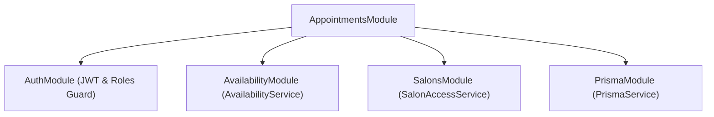
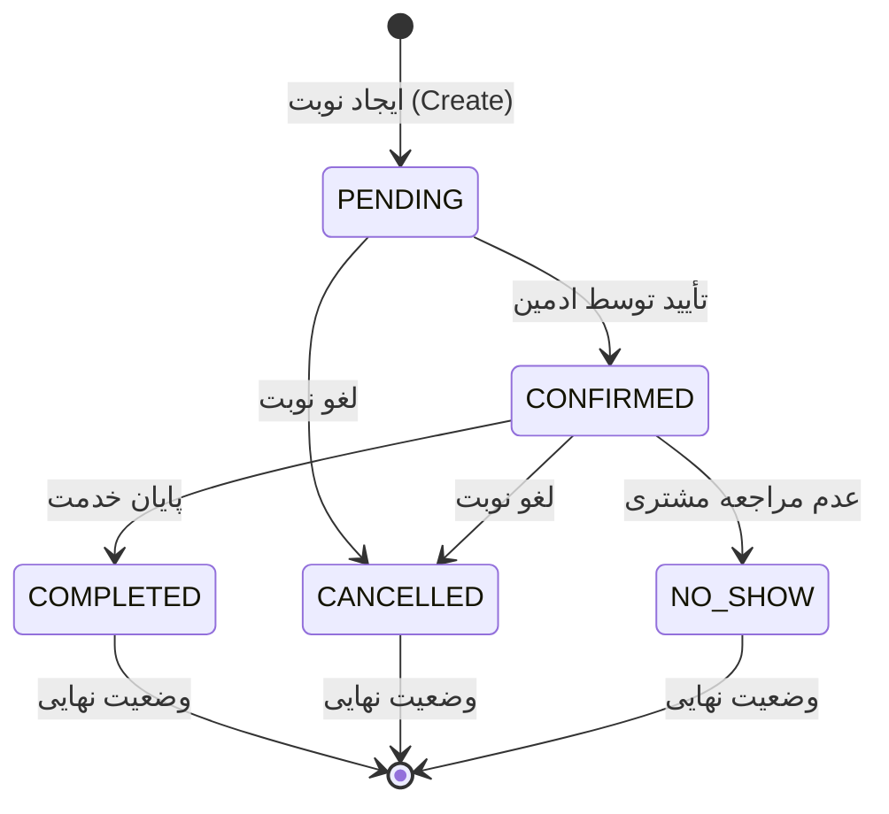

# ماژول نوبت‌دهی (Appointments Module)

## فهرست مطالب
- [معرفی](#معرفی)
- [وابستگی‌ها](#وابستگی‌ها)
- [مدل‌های داده و شمارنده‌ها (Data Models & Enums)](#مدل‌های-داده-و-شمارنده‌ها-data-models--enums)
- [ماشین وضعیت نوبت (Appointment State Machine)](#ماشین-وضعیت-نوبت-appointment-state-machine)
- [اندپوینت‌ها (API Endpoints)](#اندپوینت‌ها-api-endpoints)
  - [خلاصه اندپوینت‌ها](#خلاصه-اندپوینت‌ها)
  - [۱. ثبت نوبت توسط مشتری](#۱-ثبت-نوبت-توسط-مشتری)
  - [۲. ثبت نوبت توسط مدیر سالن](#۲-ثبت-نوبت-توسط-مدیر-سالن)
  - [۳. دریافت لیست نوبت‌ها](#۳-دریافت-لیست-نوبت‌ها)
  - [۴. دریافت جزئیات یک نوبت](#۴-دریافت-جزئیات-یک-نوبت)
  - [۵. ویرایش نوبت](#۵-ویرایش-نوبت)
  - [۶. به‌روزرسانی وضعیت نوبت](#۶-به‌روزرسانی-وضعیت-نوبت)
  - [۷. لغو نوبت](#۷-لغو-نوبت)
- [کلاس‌های انتقال داده (DTOs)](#کلاس‌های-انتقال-داده-dtos)
- [منطق و متدهای سرویس (AppointmentsService)](#منطق-و-متدهای-سرویس-appointmentsservice)
  - [بررسی عمیق منطق تجاری (Business Logic)](#بررسی-عمیق-منطق-تجاری-business-logic)
    - [۱. تشخیص و جلوگیری از تداخل نوبت‌ها (Conflict Detection)](#۱-تشخیص-و-جلوگیری-از-تداخل-نوبت‌ها-conflict-detection)
    - [۲. اعتبارسنجی انتقال وضعیت نوبت (Status Transition Validation)](#۲-اعتبارسنجی-انتقال-وضعیت-نوبت-status-transition-validation)
    - [۳. محاسبه مدت‌زمان، قیمت و زمان پایان (Duration, Price & End Time)](#۳-محاسبه-مدت‌زمان-قیمت-و-زمان-پایان-duration-price--end-time)
    - [۴. کنترل همروندی خوش‌بینانه (Optimistic Concurrency Control)](#۴-کنترل-همروندی-خوش‌بینانه-optimistic-concurrency-control)
    - [۵. تفکیک ویرایش یادداشت و تغییر زمان‌بندی (Note-only vs Reschedule)](#۵-تفکیک-ویرایش-یادداشت-و-تغییر-زمان‌بندی-note-only-vs-reschedule)
    - [۶. امنیت و کنترل دسترسی چندمستأجری (Multi-Tenancy Access Control)](#۶-امنیت-و-کنترل-دسترسی-چندمستأجری-multi-tenancy-access-control)

---

## معرفی

ماژول نوبت‌دهی (`AppointmentsModule`) هسته مرکزی سامانه مدیریت و رزرواسیون آرایشگاه است. این ماژول امکان رزرو نوبت توسط مشتریان (`CUSTOMER`) و ثبت و مدیریت کامل نوبت‌ها توسط مدیران سالن (`ADMIN`) و مدیران ارشد سیستم (`SUPER_ADMIN`) را فراهم می‌کند.

ویژگی‌های کلیدی این ماژول عبارتند از:
- **رزرو نوبت مستقیم توسط مشتری:** تعیین خودکار شناسه مشتری از روی هویت احراز‌شده جهت جلوگیری از رزرو با هویت دیگران.
- **ثبت دستی نوبت توسط ادمین:** امکان ثبت نوبت برای مشتریان سالن با کنترل دسترسی ادمین به سالن مربوطه.
- **محاسبه هوشمند زمان پایان نوبت (`endAt`):** محاسبه بر اساس مدت‌زمان واقعی سرویس تعریف‌شده در پایگاه داده.
- **اعتبارسنجی پیشرفته زمان کاری:** هماهنگی با ساعات کاری آرایشگر (`WorkingHour`)، روزهای مرخصی (`DayOff`) و منطقه زمانی سالن (`timezone`).
- **جلوگیری از همپوشانی و رزرو تکراری:** پیشگیری دو لایه در سطح سرویس و قید پایگاه داده PostgreSQL (`appointment_no_overlap`).
- **کنترل همروندی خوش‌بینانه (Optimistic Concurrency Control):** استفاده از ستون `updatedAt` برای پیشگیری از بروز پدیده بازنویسی همزمان (Lost Update).
- **ماشین وضعیت نوبت (State Machine):** اعتبارسنجی دقیق مراحل تغییر وضعیت نوبت‌ها.

---

## وابستگی‌ها

ماژول `AppointmentsModule` از ماژول‌ها و سرویس‌های زیر استفاده می‌کند:



### ۱. ماژول‌های وارد شده (`imports`)
- `AuthModule`: فراهم‌کننده ابزارهای احراز هویت توکن‌های JWT و محافظت از مسیرها بر اساس نقش کاربر (`JwtAuthGuard`, `RolesGuard`).
- `AvailabilityModule`: فراهم‌کننده سرویس `AvailabilityService` جهت بررسی ساعات کاری آرایشگر، روزهای تعطیل و اعتبارسنجی بازه زمانی درخواستی (`validateBookingSlot`).
- `SalonsModule`: فراهم‌کننده سرویس `SalonAccessService` برای اعتبارسنجی دسترسی ادمین به سالن مورد نظر (`assertCanAccessSalon`).

### ۲. سرویس‌ها و پرووایدرها (`providers`)
- `AppointmentsService`: حاوی تمامی قوانین تجاری، ایجاد، ویرایش، حذف و تغییر وضعیت نوبت‌ها.
- `PrismaService`: دسترسی به پایگاه داده و تعامل با جداول `Appointment`, `Customer`, `Barber`, `Service`, `BarberService`, `SalonMembership`.

### ۳. گاردها و دکوراتورهای استفاده‌شده
- `JwtAuthGuard`: کنترل وجود و اعتبار توکن `Bearer JWT` در سربرگ درخواست.
- `RolesGuard`: اعتبارسنجی نقش کاربری اعلام‌شده با نقش‌های مجاز تعریف‌شده روی کنترلر یا اندپوینت.
- `@Roles(...)`: تعیین نقش‌های مجاز برای متدهای کنترلر (`UserRole.CUSTOMER`, `UserRole.ADMIN`, `UserRole.SUPER_ADMIN`).
- `@CurrentUser()`: استخراج داده‌های کاربر احراز هویت شده (`CurrentUserData` شامل `id`, `phone`, `role`) از شیء درخواست.

---

## مدل‌های داده و شمارنده‌ها (Data Models & Enums)

### ۱. شمارنده `AppointmentStatus`
وضعیت‌های مختلف یک نوبت در چرخه عمر خود:

| وضعیت | مقدار انگلیسی | توضیحات |
| :--- | :--- | :--- |
| در انتظار تأیید | `PENDING` | نوبت ایجاد شده و در انتظار تأیید نهایی توسط سالن است (وضعیت پیش‌فرض). |
| تأیید شده | `CONFIRMED` | نوبت توسط مدیر سالن تأیید شده و زمان برای مشتری رزرو قطعی است. |
| تکمیل شده | `COMPLETED` | خدمت در سالن ارائه شده و نوبت با موفقیت پایان یافته است. |
| لغو شده | `CANCELLED` | نوبت توسط مشتری یا مدیر سالن لغو شده است. |
| عدم مراجعه | `NO_SHOW` | مشتری در زمان مقرر در سالن حاضر نشده است. |

### ۲. مدل `Appointment` در Prisma
ساختار جدول نوبت‌ها به صورت زیر تعریف شده است:

```prisma
model Appointment {
  id         String            @id @default(uuid())
  salonId    String
  customerId String
  barberId   String
  serviceId  String

  salon      Salon             @relation(fields: [salonId], references: [id], onDelete: Restrict)
  customer   Customer          @relation(fields: [customerId], references: [id], onDelete: Restrict)
  barber     Barber            @relation(fields: [barberId], references: [id], onDelete: Restrict)
  service    Service           @relation(fields: [serviceId], references: [id], onDelete: Restrict)

  startAt    DateTime
  endAt      DateTime

  price      Decimal           @db.Decimal(12, 2)
  duration   Int

  status     AppointmentStatus @default(PENDING)
  note       String?

  createdAt  DateTime          @default(now())
  updatedAt  DateTime          @updatedAt

  @@index([salonId, startAt])
  @@index([barberId, startAt])
  @@index([barberId, startAt, endAt])
  @@index([customerId, startAt])
  @@index([status])
}
```

> [!NOTE]
> قیمت (`price`) و مدت زمان خدمت (`duration`) در لحظه ثبت یا ویرایش نوبت به صورت مقادیر مستقل روی رکورد نوبت اسنپ‌شات (Snapshot) می‌شوند. با این کار، در صورتی که بعداً قیمت یا زمان خدمت در آرایشگاه تغییر کند، سوابق نوبت‌های قبلی بدون تغییر و معتبر باقی می‌مانند.

---

## ماشین وضعیت نوبت (Appointment State Machine)

انتقال بین وضعیت‌های مختلف نوبت بر اساس قوانین از پیش تعیین‌شده مدیریت می‌شود:



قوانین انتقال وضعیت (`allowedTransitions`):
- `PENDING` $\rightarrow$ `CONFIRMED`, `CANCELLED`
- `CONFIRMED` $\rightarrow$ `COMPLETED`, `CANCELLED`, `NO_SHOW`
- `COMPLETED` $\rightarrow$ هیچ انتقالی مجاز نیست (پایانه)
- `CANCELLED` $\rightarrow$ هیچ انتقالی مجاز نیست (پایانه)
- `NO_SHOW` $\rightarrow$ هیچ انتقالی مجاز نیست (پایانه)

در صورت تلاش برای تغییر وضعیت به مقدار غیرمجاز، خطای `ConflictException` (کد 409) برگردانده می‌شود.

---

## اندپوینت‌ها (API Endpoints)

تمام اندپوینت‌های این ماژول دارای پیشوند `/appointments` بوده و از دو گارد `JwtAuthGuard` و `RolesGuard` در سطح کنترلر بهره می‌برند؛ بنابراین ارسال سربرگ `Authorization: Bearer <access_token>` برای همه درخواست‌ها الزامی است.

### خلاصه اندپوینت‌ها

| متد | مسیر (Route) | نقش‌های مجاز | شرح عملیات | کد موفقیت |
| :--- | :--- | :--- | :--- | :--- |
| `POST` | `/appointments` | `CUSTOMER` | ثبت نوبت توسط مشتری وارد شده | `201 Created` |
| `POST` | `/appointments/admin` | `ADMIN`, `SUPER_ADMIN` | ثبت نوبت برای مشتری خاص توسط ادمین | `201 Created` |
| `GET` | `/appointments` | `ADMIN`, `SUPER_ADMIN` | دریافت فهرست تمام نوبت‌های سالن(های) مجاز | `200 OK` |
| `GET` | `/appointments/:id` | `ADMIN`, `SUPER_ADMIN` | دریافت جزئیات یک نوبت خاص با شناسه | `200 OK` |
| `PATCH` | `/appointments/:id` | `ADMIN`, `SUPER_ADMIN` | ویرایش مشخصات زمان‌بندی یا یادداشت نوبت | `200 OK` |
| `PATCH` | `/appointments/:id/status` | `ADMIN`, `SUPER_ADMIN` | تغییر وضعیت چرخه عمر نوبت | `200 OK` |
| `DELETE` | `/appointments/:id` | `ADMIN`, `SUPER_ADMIN` | لغو نرم‌افزاری نوبت (`CANCELLED`) | `200 OK` |

---

### ۱. ثبت نوبت توسط مشتری

- **متد و مسیر:** `POST /appointments`
- **سطح دسترسی:** فقط `CUSTOMER`
- **توضیحات:** نوبت جدید برای مشتری واردشده ایجاد می‌شود. سیستم به صورت خودکار شناسه مشتری (`customerId`) را از جدول `Customer` بر اساس `userId` موجود در توکن JWT استخراج می‌کند. این سازوکار از جعل هویت و رزرو نوبت به نام سایر مشتریان جلوگیری می‌نماید.

#### بدنه درخواست (Request Body)
```json
{
  "barberId": "8b08ff28-f14d-4e9e-a8f4-2f2771d9d431",
  "serviceId": "5c1202e8-c513-4e31-8f92-2dfaa7b04961",
  "startAt": "2026-10-15T14:30:00Z",
  "note": "لطفاً مدل سایه کم‌رنگ زده شود"
}
```

#### پاسخ موفق (`201 Created`)
```json
{
  "id": "c1f7a28e-8a21-4f76-bc34-a14fbf867b93",
  "salonId": "1a63c8a9-45d2-43bb-a8d9-22a30bc4a1f2",
  "customerId": "3b16cfd8-041d-40ce-8b77-3e5f228d9c44",
  "barberId": "8b08ff28-f14d-4e9e-a8f4-2f2771d9d431",
  "serviceId": "5c1202e8-c513-4e31-8f92-2dfaa7b04961",
  "startAt": "2026-10-15T14:30:00.000Z",
  "endAt": "2026-10-15T15:15:00.000Z",
  "price": "350000.00",
  "duration": 45,
  "status": "PENDING",
  "note": "لطفاً مدل سایه کم‌رنگ زده شود",
  "createdAt": "2026-10-12T18:30:00.000Z",
  "updatedAt": "2026-10-12T18:30:00.000Z",
  "customer": {
    "id": "3b16cfd8-041d-40ce-8b77-3e5f228d9c44",
    "userId": "9f1165ae-660c-4eb2-a6f7-bf844fcf2df9",
    "user": {
      "id": "9f1165ae-660c-4eb2-a6f7-bf844fcf2df9",
      "phone": "09123456789",
      "firstName": "علی",
      "lastName": "محمدی",
      "role": "CUSTOMER"
    }
  },
  "barber": {
    "id": "8b08ff28-f14d-4e9e-a8f4-2f2771d9d431",
    "salonId": "1a63c8a9-45d2-43bb-a8d9-22a30bc4a1f2",
    "user": {
      "id": "7a353621-39f1-4df2-a392-51f67f6bbcb1",
      "phone": "09129876543",
      "firstName": "رضا",
      "lastName": "حسینی",
      "role": "BARBER"
    }
  },
  "service": {
    "id": "5c1202e8-c513-4e31-8f92-2dfaa7b04961",
    "salonId": "1a63c8a9-45d2-43bb-a8d9-22a30bc4a1f2",
    "name": "کوتاهی و اصلاح مو",
    "description": "اصلاح ژورنالی همراه با شستشو",
    "duration": 45,
    "price": "350000.00",
    "isActive": true
  }
}
```

#### خطاهای محتمل
- `400 Bad Request`: نامعتبر بودن فرمت زمان `startAt`، ثبت نوبت در زمان گذشته، یا تعلق نداشتن آرایشگر و خدمت به یک سالن مشترک.
- `404 Not Found`: عدم یافتن رکورد مشتری، آرایشگر یا خدمت.
- `409 Conflict`: غیرفعال بودن آرایشگر یا خدمت، عدم ارائه خدمت توسط آرایشگر، قرار داشتن ساعت خارج از ساعات کاری آرایشگر، روز تعطیل یا تداخل با نوبت‌های دیگر (`Barber is already booked during this time`).

---

### ۲. ثبت نوبت توسط مدیر سالن

- **متد و مسیر:** `POST /appointments/admin`
- **سطح دسترسی:** `ADMIN`, `SUPER_ADMIN`
- **توضیحات:** ثبت نوبت برای مشتری با ارسال صریح `customerId`. در این متد ابتدا سالن آرایشگر استخراج شده و دسترسی ادمین به آن سالن بررسی می‌شود؛ این تقدم در اعتبارسنجی مانع از بررسی و آزمودن شناسه‌های مشتریان توسط ادمین‌های غیرمجاز می‌شود.

#### بدنه درخواست (Request Body)
```json
{
  "customerId": "3b16cfd8-041d-40ce-8b77-3e5f228d9c44",
  "barberId": "8b08ff28-f14d-4e9e-a8f4-2f2771d9d431",
  "serviceId": "5c1202e8-c513-4e31-8f92-2dfaa7b04961",
  "startAt": "2026-10-16T10:00:00Z",
  "note": "نوبت ثبت‌شده به صورت تلفنی"
}
```

#### پاسخ موفق (`201 Created`)
خروجی مشابه اندپوینت ثبت نوبت مشتری بوده و وضعیت اولیه نوبت `PENDING` است.

#### خطاهای محتمل
- `403 Forbidden`: مدیر به سالن آرایشگر انتخابی دسترسی ندارد.
- `404 Not Found`: مشتری یا آرایشگر یافت نشد.
- `409 Conflict`: عدم تطابق ساعات کاری یا تداخل زمانی با نوبت‌های دیگر آرایشگر.

---

### ۳. دریافت لیست نوبت‌ها

- **متد و مسیر:** `GET /appointments`
- **سطح دسترسی:** `ADMIN`, `SUPER_ADMIN`
- **توضیحات:** دریافت تمامی نوبت‌ها به ترتیب زمان شروع صعودی (`startAt: 'asc'`).
  - کاربر `ADMIN`: تنها نوبت‌های سالن‌هایی را مشاهده می‌کند که در آن‌ها عضویت فعال (`SalonMembership.isActive: true`) دارد.
  - کاربر `SUPER_ADMIN`: به نوبت‌های تمامی سالن‌ها در سراسر سیستم دسترسی دارد.

#### پاسخ موفق (`200 OK`)
```json
[
  {
    "id": "c1f7a28e-8a21-4f76-bc34-a14fbf867b93",
    "salonId": "1a63c8a9-45d2-43bb-a8d9-22a30bc4a1f2",
    "customerId": "3b16cfd8-041d-40ce-8b77-3e5f228d9c44",
    "barberId": "8b08ff28-f14d-4e9e-a8f4-2f2771d9d431",
    "serviceId": "5c1202e8-c513-4e31-8f92-2dfaa7b04961",
    "startAt": "2026-10-15T14:30:00.000Z",
    "endAt": "2026-10-15T15:15:00.000Z",
    "price": "350000.00",
    "duration": 45,
    "status": "CONFIRMED",
    "note": "تأیید شد",
    "customer": { ... },
    "barber": { ... },
    "service": { ... },
    "salon": {
      "id": "1a63c8a9-45d2-43bb-a8d9-22a30bc4a1f2",
      "name": "آرایشگاه کلاسیک",
      "slug": "classic-barbershop"
    }
  }
]
```

---

### ۴. دریافت جزئیات یک نوبت

- **متد و مسیر:** `GET /appointments/:id`
- **سطح دسترسی:** `ADMIN`, `SUPER_ADMIN`
- **توضیحات:** دریافت اطلاعات تفصیلی یک نوبت خاص بر اساس شناسه نوبت. دسترسی کاربر به سالن نوبت مربوطه بررسی می‌شود.

#### پارامترهای مسیر (Route Params)
- `id`: شناسه یکتای نوبت (UUID).

#### پاسخ موفق (`200 OK`)
شیء کامل نوبت شامل اطلاعات مشتری، آرایشگر، خدمت و سالن.

#### خطاهای محتمل
- `404 Not Found`: نوبتی با شناسه وارد شده یافت نشد.
- `403 Forbidden`: مدیر به سالن این نوبت دسترسی ندارد.

---

### ۵. ویرایش نوبت

- **متد و مسیر:** `PATCH /appointments/:id`
- **سطح دسترسی:** `ADMIN`, `SUPER_ADMIN`
- **توضیحات:** تغییر زمان شروع، آرایشگر، خدمت یا یادداشت نوبت.
  - نوبت باید در وضعیت `PENDING` یا `CONFIRMED` باشد. نوبت‌های تکمیل‌شده، لغوشده یا عدم مراجعه قابل ویرایش نیستند.
  - جابجایی نوبت به سالن دیگر ممنوع است.
  - ویرایش زمان یا آرایشگر به زمان‌های گذشته ممنوع است.
  - در صورتی که فقط فیلد `note` تغییر کند، اعتبارسنجی ساعات کاری مجدداً انجام نمی‌شود تا امکان اصلاح یادداشت نوبت‌های گذشته یا تاریخی بدون خطا فراهم باشد.

#### بدنه درخواست (Request Body)
تمامی فیلدها اختیاری هستند:
```json
{
  "barberId": "8b08ff28-f14d-4e9e-a8f4-2f2771d9d431",
  "serviceId": "5c1202e8-c513-4e31-8f92-2dfaa7b04961",
  "startAt": "2026-10-15T16:00:00Z",
  "note": "زمان نوبت تغییر یافت"
}
```

#### پاسخ موفق (`200 OK`)
اطلاعات به‌روزرسانی شده نوبت به همراه مدت زمان و قیمت محاسبه‌شده جدید.

#### خطاهای محتمل
- `400 Bad Request`: درج ساعت در گذشته یا خطای فرمت `startAt` (باید شامل منطقه زمانی معتبر مانند `Z` یا `+03:30` باشد).
- `409 Conflict`: وضعیت نوبت غیرقابل ویرایش است، تداخل زمانی با نوبت دیگر وجود دارد، یا خطای همروندی خوش‌بینانه (`Appointment changed concurrently; refresh and try again`).

---

### ۶. به‌روزرسانی وضعیت نوبت

- **متد و مسیر:** `PATCH /appointments/:id/status`
- **سطح دسترسی:** `ADMIN`, `SUPER_ADMIN`
- **توضیحات:** تغییر وضعیت نوبت در طول چرخه کاری. در صورت انتقال به وضعیت `CONFIRMED`، سیستم بار دیگر عدم تداخل زمانی با سایر نوبت‌ها را چک می‌کند تا از عدم ثبت همزمان نوبت‌ها در بازه معلق اطمینان حاصل شود.

#### بدنه درخواست (Request Body)
```json
{
  "status": "CONFIRMED"
}
```

#### پاسخ موفق (`200 OK`)
رکورد نوبت با وضعیت جدید.

#### خطاهای محتمل
- `400 Bad Request`: ارسال مقداری خارج از مقادیر مجاز انوم `AppointmentStatus`.
- `409 Conflict`: انتقال وضعیت غیرمجاز، تداخل زمانی در هنگام تأیید، یا تغییر همزمان وضعیت توسط کلاینت دیگر.

---

### ۷. لغو نوبت

- **متد و مسیر:** `DELETE /appointments/:id`
- **سطح دسترسی:** `ADMIN`, `SUPER_ADMIN`
- **توضیحات:** نوبت مورد نظر لغو نرم‌افزاری می‌شود (وضعیت آن به `CANCELLED` تغییر می‌یابد).
  - نوبت‌های تکمیل‌شده (`COMPLETED`)، از قبل لغوشده (`CANCELLED`) یا عدم مراجعه (`NO_SHOW`) مجدداً قابل لغو نیستند.

#### پاسخ موفق (`200 OK`)
```json
{
  "message": "Appointment cancelled successfully"
}
```

#### خطاهای محتمل
- `404 Not Found`: نوبت یافت نشد.
- `409 Conflict`: نوبت در وضعیتی است که امکان لغو آن وجود ندارد یا در همان لحظه توسط کلاینت دیگری ویرایش شده است.

---

## کلاس‌های انتقال داده (DTOs)

تمامی کلاس‌های انتقال داده در پوشه `src/appointments/dto/` تعریف شده و با استفاده از دکوراتورهای کتابخانه `class-validator` اعتبارسنجی می‌شوند.

### ۱. `CreateAppointmentDto`
برای ثبت نوبت توسط مشتری:

```typescript
export class CreateAppointmentDto {
  @IsString()
  @IsNotEmpty()
  barberId: string;

  @IsString()
  @IsNotEmpty()
  serviceId: string;

  @IsISO8601()
  startAt: string;

  @IsOptional()
  @IsString()
  note?: string;
}
```

| فیلد | نوع داده | اعتبارسنجی‌ها | الزامی؟ | توضیحات |
| :--- | :--- | :--- | :--- | :--- |
| `barberId` | `string` | `@IsString()`, `@IsNotEmpty()` | بله | شناسه آرایشگر انتخاب‌شده |
| `serviceId` | `string` | `@IsString()`, `@IsNotEmpty()` | بله | شناسه خدمت انتخاب‌شده |
| `startAt` | `string` | `@IsISO8601()` | بله | زمان شروع نوبت در استاندارد ISO 8601 |
| `note` | `string` | `@IsOptional()`, `@IsString()` | خیر | یادداشت یا توضیحات اضافی مشتری |

---

### ۲. `CreateAdminAppointmentDto`
برای ثبت نوبت توسط ادمین برای یک مشتری خاص (ارث‌بری از `CreateAppointmentDto`):

```typescript
export class CreateAdminAppointmentDto extends CreateAppointmentDto {
  @IsString()
  @IsNotEmpty()
  customerId: string;
}
```

| فیلد | نوع داده | اعتبارسنجی‌ها | الزامی؟ | توضیحات |
| :--- | :--- | :--- | :--- | :--- |
| `customerId` | `string` | `@IsString()`, `@IsNotEmpty()` | بله | شناسه رکورد مشتری در دیتابیس |
| سایر فیلدها | - | مشابه `CreateAppointmentDto` | بله/خیر | ارث‌بری شده از `CreateAppointmentDto` |

---

### ۳. `UpdateAppointmentStatusDto`
برای تغییر وضعیت چرخه نوبت:

```typescript
export class UpdateAppointmentStatusDto {
  @IsEnum(AppointmentStatus)
  status: AppointmentStatus;
}
```

| فیلد | نوع داده | اعتبارسنجی‌ها | الزامی؟ | توضیحات |
| :--- | :--- | :--- | :--- | :--- |
| `status` | `AppointmentStatus` | `@IsEnum(AppointmentStatus)` | بله | مقدار معتبر از انوم وضعیت نوبت |

---

### ۴. `UpdateAppointmentDto`
برای ویرایش اطلاعات زمان، آرایشگر، خدمت یا یادداشت نوبت:

```typescript
export class UpdateAppointmentDto {
  @IsOptional()
  @IsString()
  @IsNotEmpty()
  barberId?: string;

  @IsOptional()
  @IsString()
  @IsNotEmpty()
  serviceId?: string;

  @IsOptional()
  @IsISO8601({ strict: true, strictSeparator: true })
  @Matches(/(?:Z|[+-]\d{2}:\d{2})$/i, {
    message: 'startAt must include a timezone (Z or ±HH:mm)',
  })
  startAt?: string;

  @IsOptional()
  @IsString()
  note?: string | null;
}
```

| فیلد | نوع داده | اعتبارسنجی‌ها | الزامی؟ | توضیحات |
| :--- | :--- | :--- | :--- | :--- |
| `barberId` | `string` | `@IsOptional()`, `@IsString()`, `@IsNotEmpty()` | خیر | شناسه آرایشگر جدید |
| `serviceId` | `string` | `@IsOptional()`, `@IsString()`, `@IsNotEmpty()` | خیر | شناسه خدمت جدید |
| `startAt` | `string` | `@IsOptional()`, `@IsISO8601(strict)`, `@Matches(...)` | خیر | زمان شروع نوبت جدید (الزام به درج شناسه منطقه زمانی) |
| `note` | `string \| null` | `@IsOptional()`, `@IsString()` | خیر | متن جدید یادداشت یا حذف آن (`null`) |

---

## منطق و متدهای سرویس (AppointmentsService)

سرویس `AppointmentsService` دارای متدهای زیر است:

### ۱. `create(userId: string, dto: CreateAppointmentDto)`
1. دریافت رکورد `Customer` متصل به `userId` احراز هویت شده.
2. پرتاب `NotFoundException` در صورت عدم وجود پروفایل مشتری.
3. فراخوانی متد مشترک داخلی `createForCustomer`.

### ۲. `createForAdmin(userId: string, role: UserRole, dto: CreateAdminAppointmentDto)`
1. بررسی وجود آرایشگر با `dto.barberId`.
2. بررسی دسترسی ادمین به سالن آرایشگر از طریق `salonAccessService.assertCanAccessSalon(userId, role, barber.salonId)`. (این اعتبارسنجی عامدانه پیش از بررسی `customerId` انجام می‌شود تا از نشت و تست شناسه‌های مشتریان توسط ادمین‌های غیرمجاز جلوگیری شود).
3. بررسی وجود مشتری با `dto.customerId`.
4. فراخوانی متد داخلی `createForCustomer` به همراه ارسال متغیرهای دسترسی امنیتی.

### ۳. `findAll(userId: string, role: UserRole)`
- اگر نقش `SUPER_ADMIN` باشد: تمام نوبت‌های دیتابیس را بدون فیلتر بازمی‌گرداند.
- اگر نقش `ADMIN` باشد: ابتدا شناسه‌های سالن‌هایی که ادمین در آنها عضویت فعال (`isActive: true`) دارد استخراج شده و سپس نوبت‌های آن سالن‌ها بازیابی می‌شوند.
- مرتب‌سازی بر اساس `startAt: 'asc'`.

### ۴. `findById(id: string, userId: string, role: UserRole)`
- بازیابی نوبت همراه با تمام روابط (`customer`, `barber`, `service`, `salon`).
- پرتاب `NotFoundException` در صورت عدم یافتن نوبت.
- بررسی سطح دسترسی کاربر به سالن نوبت از طریق `assertCanAccessSalon`.

### ۵. `update(id: string, dto: UpdateAppointmentDto, userId: string, role: UserRole)`
- بازیابی نوبت و بررسی دسترسی کاربر به سالن نوبت.
- بررسی وضعیت نوبت؛ ویرایش تنها روی وضعیت‌های `PENDING` و `CONFIRMED` مجاز است.
- تشخیص تغییر واقعی زمان‌بندی نوبت (`isScheduleChanged`): مقایسه مقادیر واقعی `startAt`, `barberId`, `serviceId` با مقادیر فعلی.
- **مسیر ویرایش یادداشت (Note-only):** در صورتی که تغییری در زمان‌بندی ایجاد نشده باشد، صرفاً فیلد `note` با بررسی قفل خوش‌بینانه `updatedAt` به‌روزرسانی می‌شود بدون اینکه قوانین ساعات کاری روز برای نوبت‌های تاریخی مجدداً اعمال شوند.
- **مسیر تغییر زمان‌بندی:**
  - جلوگیری از تعیین نوبت در زمان گذشته (`startAt <= new Date()`).
  - بررسی فعال بودن آرایشگر و خدمت و تعلق هر دو به سالن فعلی نوبت (عدم امکان انتقال نوبت به سالن دیگر).
  - بررسی ارائه خدمت توسط آرایشگر در جدول `BarberService`.
  - اعتبارسنجی ساعات کاری و روز مرخصی از طریق `availabilityService.validateBookingSlot`.
  - بررسی تداخل با سایر نوبت‌های آرایشگر به جز نوبت جاری (`id: { not: appointment.id }`).
  - اعمال به‌روزرسانی نوبت با شرط قفل خوش‌بینانه بر اساس `updatedAt`.

### ۶. `updateStatus(id: string, dto: UpdateAppointmentStatusDto, userId: string, role: UserRole)`
- بررسی دسترسی کاربر به سالن.
- بررسی مجاز بودن گذار وضعیت بر اساس ماتریس `allowedTransitions`.
- در صورت تغییر به `CONFIRMED`: بررسی مجدد عدم تداخل با نوبت‌های همزمان آرایشگر.
- اعمال تغییر وضعیت با مکانیسم قفل خوش‌بینانه با مقایسه توکن `updatedAt`.

### ۷. `remove(id: string, userId: string, role: UserRole)`
- بررسی دسترسی کاربر به سالن.
- بررسی وضعیت نوبت: نوبت‌های `COMPLETED`, `CANCELLED`, `NO_SHOW` قابل لغو نیستند.
- ثبت وضعیت `CANCELLED` با رعایت قفل خوش‌بینانه بر اساس `updatedAt`.

---

## بررسی عمیق منطق تجاری (Business Logic)

### ۱. تشخیص و جلوگیری از تداخل نوبت‌ها (Conflict Detection)

سیستم از راهبرد **دفاع دو لایه‌ای (Two-Layer Conflict Prevention)** برای تضمین قطعی عدم تداخل نوبت‌های یک آرایشگر استفاده می‌کند:

#### لایه اول: اعتبارسنجی در سطح نرم‌افزار (Application Layer)
قبل از ثبت یا ویرایش هر نوبت، کوئری زیر روی دیتابیس اجرا می‌شود:

```typescript
const overlappingAppointment = await this.prisma.appointment.findFirst({
  where: {
    barberId: barber.id,
    status: {
      in: [AppointmentStatus.PENDING, AppointmentStatus.CONFIRMED],
    },
    startAt: {
      lt: endAt,
    },
    endAt: {
      gt: startAt,
    },
  },
});
```

فرمول ریاضی همپوشانی دو بازه زمانی $[S_1, E_1)$ و $[S_2, E_2)$:
$$S_1 < E_2 \quad \text{AND} \quad E_1 > S_2$$

نوبت‌های لغوشده (`CANCELLED`)، تکمیل‌شده (`COMPLETED`) یا غیبت خورده (`NO_SHOW`) تداخل به حساب نمی‌آیند.

#### لایه دوم: قید انحصاری در سطح پایگاه داده PostgreSQL (Database Exclusion Constraint)
در شرایط همروندی بالا (High Concurrency)، ممکن است دو تراکنش همزمان لایه اول را بدون خطا رد کنند (Race Condition). برای جلوگیری از این حالت، یک قید انحصاری در سطح دیتابیس (`appointment_no_overlap`) با استفاده از اکستنشن `btree_gist` تعریف شده است.

در صورت بروز خطای همروندی، متد `isAppointmentOverlapConstraintError` خطای درایور را تشخیص داده و آن را به یک خطای خوانا و کنترل‌شده تبدیل می‌کند:

```typescript
if (this.isAppointmentOverlapConstraintError(error)) {
  throw new ConflictException('Barber is already booked during this time');
}
```

---

### ۲. اعتبارسنجی انتقال وضعیت نوبت (Status Transition Validation)

چرخه عمر نوبت‌ها یکطرفه و تحت کنترل ماشین وضعیت است:
1. نوبت با وضعیت اولیه `PENDING` ایجاد می‌شود.
2. مدیر سالن می‌تواند نوبت را `CONFIRMED` یا `CANCELLED` کند.
3. نوبت تأیید‌شده می‌تواند پس از اتمام به `COMPLETED`، در صورت انصراف به `CANCELLED` و در صورت نیامدن مشتری به `NO_SHOW` تبدیل شود.
4. وضعیت‌های `COMPLETED`, `CANCELLED` و `NO_SHOW` پایانه‌های قطعی هستند و هیچ گذار دیگری از آن‌ها پذیرفته نیست.

```typescript
const allowedTransitions: Record<AppointmentStatus, AppointmentStatus[]> = {
  [AppointmentStatus.PENDING]: [
    AppointmentStatus.CONFIRMED,
    AppointmentStatus.CANCELLED,
  ],
  [AppointmentStatus.CONFIRMED]: [
    AppointmentStatus.COMPLETED,
    AppointmentStatus.CANCELLED,
    AppointmentStatus.NO_SHOW,
  ],
  [AppointmentStatus.COMPLETED]: [],
  [AppointmentStatus.CANCELLED]: [],
  [AppointmentStatus.NO_SHOW]: [],
};
```

---

### ۳. محاسبه مدت‌زمان، قیمت و زمان پایان (Duration, Price & End Time)

- **محاسبه خودکار `endAt`:**
  کاربر یا ادمین فقط `startAt` را ارسال می‌کنند. زمان پایان (`endAt`) توسط سرور از فرمول زیر محاسبه می‌شود:
  $$\text{endAt} = \text{startAt} + (\text{service.duration} \times 60 \times 1000 \text{ ms})$$
  این محاسبه در دل `AvailabilityService.validateBookingSlot` انجام شده و تطابق بازه کامل نوبت با ساعات کاری تعریف‌شده آرایشگر (`WorkingHour.startTime` تا `WorkingHour.endTime`) سنجیده می‌شود.

- **اسنپ‌شات قیمت و مدت زمان:**
  مقادیر `price` و `duration` مستقیماً از موجودیت `Service` خوانده شده و در نوبت ذخیره می‌شوند. کلاینت هیچ امکانی برای تزریق دستی قیمت یا زمان ندارد.

---

### ۴. کنترل همروندی خوش‌بینانه (Optimistic Concurrency Control)

برای جلوگیری از بازنویسی ناخواسته اطلاعات در شرایطی که دو مدیر سالن همزمان نوبت را ویرایش می‌کنند، از الگوی **Compare-And-Set** با استفاده از ستون `updatedAt` استفاده می‌شود:

```typescript
const result = await this.prisma.appointment.updateMany({
  where: {
    id,
    updatedAt: appointment.updatedAt,
    status: appointment.status,
  },
  data: {
    // داده‌های جدید
  },
});

if (result.count === 0) {
  throw new ConflictException(
    'Appointment changed concurrently; refresh and try again',
  );
}
```

اگر نوبت در فاصله بین خواندن و نوشتن تغییر کرده باشد، `result.count` برابر ۰ شده و خطای `409 Conflict` به کاربر اعلام می‌کند که داده‌ها تغییر کرده و باید صفحه را رفرش کند.

---

### ۵. تفکیک ویرایش یادداشت و تغییر زمان‌بندی (Note-only vs Reschedule)

در متد `update`، سیستم بین تغییر در ساختار زمان‌بندی نوبت و تغییر صرفاً یادداشت تمایز قائل می‌شود:

```typescript
const isScheduleChanged =
  startAt.getTime() !== appointment.startAt.getTime() ||
  barberId !== appointment.barberId ||
  serviceId !== appointment.serviceId;
```

- اگر `isScheduleChanged === true`:
  - الزامات زمانی آینده‌نگر بررسی می‌شوند (`startAt > new Date()`).
  - ساعات کاری و عدم تداخل مجدداً اعتبارسنجی می‌شوند.
- اگر `isScheduleChanged === false`:
  - تنها فیلد `note` تغییر می‌کند.
  - اعتبارسنجی‌های مربوط به تاریخ گذشته یا ساعات کاری امروز دور زده می‌شوند تا امکان ویرایش یادداشت نوبت‌های ثبت‌شده در گذشته نیز وجود داشته باشد.

---

### ۶. امنیت و کنترل دسترسی چندمستأجری (Multi-Tenancy Access Control)

سیستم بر پایه معماری چندمستأجری (چند سالنه) پیاده‌سازی شده است:
1. **جلوگیری از خزش مشتریان (Customer ID Probing Prevention):** در متد `createForAdmin`، ابتدا بررسی می‌شود که آیا ادمین به سالن آرایشگر انتخابی دسترسی دارد یا خیر. تنها در صورت احراز دسترسی، بررسی وجود شناسه مشتری انجام می‌شود.
2. **جداسازی سالن‌ها:** هر کاربر `ADMIN` تنها نوبت‌های سالن‌هایی را می‌بیند و ویرایش می‌کند که در آن‌ها عضویت فعال دارد. نوبت‌ها نمی‌توانند به سالن دیگری جابجا شوند و آرایشگر و سرویس انتخابی باید حتماً متعلق به همان سالن باشند.
