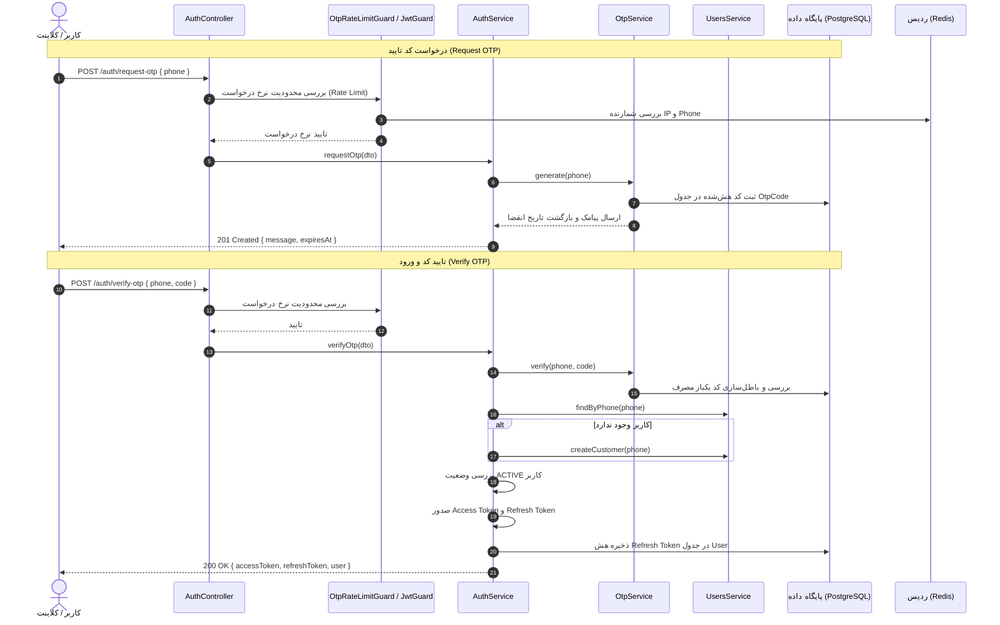

# ماژول احراز هویت (Auth Module)

## معرفی

ماژول احراز هویت (`AuthModule`) در این پروژه وظیفه مدیریت ورود، ثبت‌نام و شناسایی کاربران را بر عهده دارد. معماری احراز هویت در این سامانه مبتنی بر شماره موبایل و کد یکبار مصرف پیامکی (**OTP** یا One-Time Password) بوده و نیازی به رمز عبور سنتی ندارد (Passwordless Authentication).

پس از تایید موفقیت‌آمیز کد OTP، توکن‌های دسترسی با استفاده از ساختار استاندارد **JWT (JSON Web Token)** صادر می‌شوند:
- **Access Token**: توکن کوتاه‌مدت برای اعتبارسنجی درخواست‌های ارسالی به اندپوینت‌های محافظت‌شده.
- **Refresh Token**: توکن بلندمدت جهت دریافت Access Token جدید بدون نیاز به احراز هویت مجدد، با قابلیت ابطال و چرخش توکن (Token Rotation).

### جریان احراز هویت (Authentication Flow)



---

## وابستگی‌ها

ماژول `AuthModule` برای انجام وظایف خود به ماژول‌ها و سرویس‌های زیر وابسته است:

| ماژول / پکیج | نحوه تزریق / استفاده | هدف و توضیحات |
| :--- | :--- | :--- |
| **`ConfigModule`** | `imports` | دسترسی به متغیرهای محیطی سیستم نظیر کلیدهای امضای توکن و مدت زمان انقضا. |
| **`UsersModule`** | `imports` | جستجوی کاربران، ثبت‌نام خودکار مشتریان جدید (`createCustomer`) و ثبت هش رفرش توکن. |
| **`OtpModule`** | `imports` | تولید کد OTP، ارسال از طریق پیامک و اعتبارسنجی کد ارسالی کاربر. |
| **`JwtModule`** | `registerAsync` | امضا و اعتبارسنجی Access Token و Refresh Token با خواندن پیکربندی به صورت Async از `ConfigService`. |
| **`PassportModule`** | استراتژی | پیاده‌سازی زیرساخت استراتژی اعتبارسنجی با `passport-jwt` در `JwtStrategy`. |
| **`RedisModule`** | گلوبال / سرویس | اعمال محدودیت نرخ درخواست (Rate Limiting) در `OtpRateLimitGuard`. |

### پیکربندی JwtModule

پیکربندی `JwtModule` به صورت نامتقارن و ناهمگام (Async) با استفاده از `ConfigService` انجام می‌شود:

```typescript
JwtModule.registerAsync({
  imports: [ConfigModule],
  inject: [ConfigService],
  useFactory: (config: ConfigService) => ({
    secret: config.getOrThrow<string>('JWT_ACCESS_SECRET'),
    signOptions: {
      expiresIn: config.getOrThrow<string>('JWT_ACCESS_EXPIRES_IN') as JwtExpiresIn,
    },
  }),
})
```

---

## مدل‌های داده و نقش‌ها

اطلاعات کاربر در جدول `User` در پایگاه داده مدیریت می‌شود.

### نقش‌های کاربری (`UserRole`)
- `SUPER_ADMIN`: مدیر ارشد کل سیستم
- `ADMIN`: مدیر سالن
- `BARBER`: آرایشگر
- `CUSTOMER`: مشتری عادی

### وضعیت‌های حساب کاربری (`UserStatus`)
- `ACTIVE`: کاربر فعال و مجاز به استفاده از سیستم
- `INACTIVE`: کاربر غیرفعال
- `BLOCKED`: کاربر مسدود شده (در صورت تلاش برای ورود با خطای ۴۰۱ مواجه می‌شود)

---

## اندپوینت‌ها (Endpoints)

پیشوند تمام مسیرهای کنترلر `/auth` است.

| متد | مسیر | گاردها | بدنه درخواست (Body) | وضعیت پاسخ | شرح عملکرد |
| :--- | :--- | :--- | :--- | :--- | :--- |
| `POST` | `/auth/request-otp` | `OtpRateLimitGuard` | `RequestOtpDto` | `201 Created` | ارسال کد یکبار مصرف به شماره موبایل |
| `POST` | `/auth/verify-otp` | `OtpRateLimitGuard` | `VerifyOtpDto` | `201 Created` | تایید کد، ثبت‌نام یا ورود و دریافت جفت‌توکن |
| `GET` | `/auth/me` | `JwtAuthGuard` | _ندارد_ | `200 OK` | دریافت اطلاعات کاربری احرازهویت‌شده جاری |
| `POST` | `/auth/refresh` | _ندارد (اعتبارسنجی داخلی)_ | `RefreshTokenDto` | `201 Created` | تمدید Access Token با Refresh Token معتبر |
| `POST` | `/auth/logout` | `JwtAuthGuard` | _ندارد_ | `201 Created` | خروج از سیستم و باطل‌سازی رفرش‌توکن |

---

### ۱. درخواست کد تایید (`POST /auth/request-otp`)

کد یکبار مصرف ۶ رقمی ایجاد شده و پیامک می‌شود.

- **گارد:** `OtpRateLimitGuard`
- **Request Body:**

```json
{
  "phone": "09123456789"
}
```

- **Response (محیط پروداکشن):**

```json
{
  "message": "OTP sent successfully",
  "expiresAt": "2026-10-12T18:30:00.000Z"
}
```

> [!NOTE]
> در محیط توسعه (`NODE_ENV === 'development'`) در صورتی که متغیر `OTP_EXPOSE_CODE === 'true'` باشد، فیلد `otp` نیز جهت تسهیل تست در پاسخ بازگردانده می‌شود:
> ```json
> {
>   "message": "OTP sent successfully",
>   "expiresAt": "2026-10-12T18:30:00.000Z",
>   "otp": "123456"
> }
> ```

---

### ۲. تایید کد و ورود (`POST /auth/verify-otp`)

کد ارسالی بررسی شده و در صورت صحت، کاربر لاگین می‌کند. در صورتی که کاربر قبلاً در سیستم ثبت‌نام نکرده باشد، به صورت خودکار به عنوان مشتری (`CUSTOMER`) ایجاد می‌شود.

- **گارد:** `OtpRateLimitGuard`
- **Request Body:**

```json
{
  "phone": "09123456789",
  "code": "123456"
}
```

- **Response:**

```json
{
  "accessToken": "eyJhbGciOiJIUzI1NiIsInR5cCI6IkpXVCJ9...",
  "refreshToken": "eyJhbGciOiJIUzI1NiIsInR5cCI6IkpXVCJ9...",
  "user": {
    "id": "e4b6c321-789a-4bc3-9821-654321fedcba",
    "phone": "09123456789",
    "role": "CUSTOMER"
  }
}
```

- **خطاهای احتمالی:**
  - `400 Bad Request`: کد نامعتبر یا منقضی شده است، یا بیش از ۵ بار تلاش ناموفق انجام شده است.
  - `401 Unauthorized`: وضعیت کاربر `ACTIVE` نیست (`User is not active`).

---

### ۳. دریافت پروفایل کاربر جاری (`GET /auth/me`)

اطلاعات استخراج شده از توکن احراز هویت‌شده را برمی‌گرداند.

- **گارد:** `JwtAuthGuard`
- **Headers:** `Authorization: Bearer <accessToken>`
- **Response:**

```json
{
  "id": "e4b6c321-789a-4bc3-9821-654321fedcba",
  "phone": "09123456789",
  "role": "CUSTOMER"
}
```

---

### ۴. تمدید توکن دسترسی (`POST /auth/refresh`)

با ارسال `refreshToken` معتبر، جفت‌توکن جدید صادر شده و هش توکن در دیتابیس جایگزین می‌شود (Token Rotation).

- **گارد:** بدون گارد مسیر (اعتبارسنجی در `AuthService` با استفاده از `JWT_REFRESH_SECRET` و مقایسه هش دیتابیس با bcrypt صورت می‌پذیرد).
- **Request Body:**

```json
{
  "refreshToken": "eyJhbGciOiJIUzI1NiIsInR5cCI6IkpXVCJ9..."
}
```

- **Response:**

```json
{
  "accessToken": "eyJhbGciOiJIUzI1NiIsInR5cCI6IkpXVCJ9...",
  "refreshToken": "eyJhbGciOiJIUzI1NiIsInR5cCI6IkpXVCJ9...",
  "user": {
    "id": "e4b6c321-789a-4bc3-9821-654321fedcba",
    "phone": "09123456789",
    "role": "CUSTOMER"
  }
}
```

- **خطاهای احتمالی:**
  - `401 Unauthorized`: در صورت منقضی بودن یا معتبر نبودن امضای رفرش توکن، مسدود بودن کاربر، ابطال توکن (`refreshTokenHash` در دیتابیس خالی باشد)، یا عدم تطابق هش با دیتابیس.

---

### ۵. خروج از حساب کاربری (`POST /auth/logout`)

با فراخوانی این اندپوینت، مقدار `refreshTokenHash` کاربر در پایگاه داده به `null` تغییر یافته و نشست کاربری باطل می‌شود.

- **گارد:** `JwtAuthGuard`
- **Headers:** `Authorization: Bearer <accessToken>`
- **Response:**

```json
{
  "message": "Logged out successfully"
}
```

---

## DTOها (Data Transfer Objects)

### ۱. `RequestOtpDto`
جهت اعتبارسنجی شماره موبایل در مرحله درخواست کد تایید به کار می‌رود.

```typescript
export class RequestOtpDto {
  @Transform(({ value }) =>
    typeof value === 'string' ? normalizeIranianPhone(value) : value,
  )
  @IsString()
  @IsNotEmpty()
  @Matches(/^09\d{9}$/, {
    message: 'phone must be a valid Iranian mobile number',
  })
  phone: string;
}
```

- فیلد `phone`:
  - ترانسفورم خودکار با تابع `normalizeIranianPhone` جهت تبدیل ارقام فارسی/عربی و پیش‌شماره‌های مختلف به فرمت استاندارد.
  - رشته‌ای، غیرخالی و منطبق بر الگوی شماره‌های همراه ایران (`/^09\d{9}$/`).

---

### ۲. `VerifyOtpDto`
جهت ارسال همزمان شماره موبایل و کد ۶ رقمی تایید دریافت شده از طریق پیامک.

```typescript
export class VerifyOtpDto {
  @Transform(({ value }) =>
    typeof value === 'string' ? normalizeIranianPhone(value) : value,
  )
  @IsString()
  @IsNotEmpty()
  @Matches(/^09\d{9}$/, {
    message: 'phone must be a valid Iranian mobile number',
  })
  phone: string;

  @IsString()
  @IsNotEmpty()
  @Matches(/^\d{6}$/, { message: 'code must be a 6-digit OTP' })
  code: string;
}
```

- فیلد `phone`: همانند `RequestOtpDto`.
- فیلد `code`: رشته ۶ رقمی عددی (`/^\d{6}$/`).

---

### ۳. `RefreshTokenDto`
جهت ارسال رفرش‌توکن برای دریافت توکن جدید.

```typescript
export class RefreshTokenDto {
  @IsString()
  @IsNotEmpty()
  refreshToken: string;
}
```

- فیلد `refreshToken`: رشته غیرخالی حاوی JWT معتبر.

---

## سرویس احراز هویت (`AuthService`)

کلاس `AuthService` مغز متفکر منطق احراز هویت در پروژه است و متدهای زیر را پیاده‌سازی می‌کند:

### ۱. `requestOtp(dto: RequestOtpDto)`
- شماره موبایل را به `otpService.generate` ارسال می‌کند تا کد یکبار مصرف ساخته و ذخیره شود.
- تاریخ انقضای کد را در آبجکت خروجی قرار می‌دهد.
- در محیط `development` و با تنظیم `OTP_EXPOSE_CODE === 'true'`، کد خام را نیز در فیلد `otp` برمی‌گرداند.

### ۲. `verifyOtp(dto: VerifyOtpDto)`
- متد `otpService.verify(dto.phone, dto.code)` را فراخوانی می‌کند.
- کاربر را از جدول کاربران جستجو می‌کند (`usersService.findByPhone`).
- اگر کاربر وجود نداشته باشد، به عنوان مشتری ثبت‌نام می‌شود (`usersService.createCustomer`).
- وضعیت کاربر را بررسی می‌کند؛ اگر `user.status !== 'ACTIVE'` باشد، استثنای `UnauthorizedException('User is not active')` پرتاب می‌شود.
- در نهایت متد کمکی `generateTokens` فراخوانی و جفت‌توکن‌ها برگشت داده می‌شوند.

### ۳. `refresh(refreshToken: string)`
- توکن ورودی را با استفاده از `JWT_REFRESH_SECRET` بررسی و بازگشایی می‌کند (`jwtService.verifyAsync`).
- در صورت عدم اعتبار، خطای `UnauthorizedException('Invalid refresh token')` پرتاب می‌کند.
- کاربر را بر اساس شناسه مندرج در `payload.sub` می‌یابد.
- وضعیت فعال بودن کاربر و وجود `user.refreshTokenHash` را بررسی می‌کند. اگر قبلاً خروج صورت گرفته باشد، خطای `UnauthorizedException('Refresh token is revoked')` صادر می‌شود.
- با `bcrypt.compare` بررسی می‌کند که آیا توکن ورودی با هش ذخیره‌شده در دیتابیس مطابقت دارد یا خیر.
- در صورت صحت، متد `generateTokens` را اجرا کرده و رفرش‌توکن جدیدی را هش و ذخیره می‌کند (مکانیسم خودکار Token Rotation جهت امنیت بیشتر).

### ۴. `logout(userId: string)`
- فیلد `refreshTokenHash` کاربر را در دیتابیس به `null` تغییر می‌دهد تا هیچ رفرش‌توکن قبلی قابل استفاده نباشد.
- پیام موفقیت‌آمیز `{ message: 'Logged out successfully' }` را بازمی‌گرداند.

### ۵. متد کمکی `generateTokens(user)` (Private)
- پی‌لود توکن را تشکیل می‌دهد:
  ```typescript
  const payload = {
    sub: user.id,
    phone: user.phone,
    role: user.role,
  };
  ```
- `accessToken` را با استفاده از کلید پیش‌فرض ماژول (`JWT_ACCESS_SECRET`) امضا می‌کند.
- `refreshToken` را با استفاده از `JWT_REFRESH_SECRET` و زمان انقضای `JWT_REFRESH_EXPIRES_IN` امضا می‌کند.
- مقدار `refreshToken` را با هزینه ۱۰ (`bcrypt.hash(refreshToken, 10)`) هش می‌کند.
- هش حاصل را در دیتابیس کاربر ذخیره می‌نماید (`usersService.updateRefreshToken`).
- آبجکت نهایی شامل توکن‌ها و اطلاعات پایه کاربر را بازمی‌گرداند.

---

## گاردها (Guards)

### ۱. `JwtAuthGuard`
- از `AuthGuard('jwt')` متعلق به `@nestjs/passport` ارث‌بری می‌کند.
- هدر `Authorization: Bearer <token>` را ارزیابی کرده و کاربر تاییدشده را به آبجکت `request.user` الصاق می‌کند.

```typescript
@Injectable()
export class JwtAuthGuard extends AuthGuard('jwt') {}
```

---

### ۲. `OtpRateLimitGuard`
این گارد امنیت سرویس ارسال پیامک را در برابر حملات منع سرویس (DoS/Brute Force) و هزینه‌های پیامکی بالا تضمین می‌کند.

- **پنجره زمانی (Window):** ۱۵ دقیقه (`15 * 60 * 1000` میلی‌ثانیه).
- **محدودیت بر اساس شماره موبایل:** حداکثر ۵ درخواست در هر بازه (`maxPerPhone = 5`).
- **محدودیت بر اساس آدرس IP:** حداکثر ۲۰ درخواست در هر بازه (`maxPerIp = 20`).
- **نحوه عملکرد در Redis:**
  - شماره موبایل ارسالی را ابتدا با `normalizeIranianPhone` یکدست می‌کند.
  - کلیدهای ردیس را به صورت هش امن SHA-256 ذخیره می‌نماید:
    - `otp:rate:${route}:ip:${ip}`
    - `otp:rate:${route}:phone:${phone}`
  - با استفاده از متد اتمیک `redis.incrementWithExpiry` شمارنده را افزایش داده و در صورت ثبت اولین درخواست، زمان انقضا (TTL) تنظیم می‌شود.
  - در صورت تجاوز از حد مجاز، خطای کد ۴۲۹ (`HttpStatus.TOO_MANY_REQUESTS`) با پیام `'Too many OTP requests; try again later'` ارسال می‌شود.
  - در صورت قطعی یا خطای ردیس، خطای کد ۵۰۳ (`HttpStatus.SERVICE_UNAVAILABLE`) با پیام `'OTP service temporarily unavailable'` صادر می‌شود.

---

### ۳. `RolesGuard`
پیاده‌سازی مکانیزم کنترل دسترسی بر مبنای نقش (Role-Based Access Control یا RBAC).

- از `Reflector` در NestJS برای واکشی متادیتای نقش‌های مجاز (`ROLES_KEY`) از سطح متد یا کنترلر استفاده می‌کند.
- در صورتی که نقشی مشخص نشده باشد، دسترسی به صورت پیش‌فرض آزاد است (`return true`).
- در صورت تعیین نقش‌ها، `request.user` را بررسی کرده و در صورتی که نقش کاربر در لیست نقش‌های مجاز باشد، مجوز دسترسی صادر می‌گردد.

```typescript
const requiredRoles = this.reflector.getAllAndOverride<UserRole[]>(
  ROLES_KEY,
  [context.getHandler(), context.getClass()],
);
if (!requiredRoles?.length) return true;
const request = context.switchToHttp().getRequest();
const user = request.user;
if (!user) return false;
return requiredRoles.includes(user.role);
```

---

## دکوراتورها (Decorators)

### ۱. `@CurrentUser()`
یک پارامتر دکوراتور اختصاصی ساخته شده با `createParamDecorator` که آبجکت کاربر احراز هویت‌شده را مستقیماً از شیء `request` استخراج می‌کند.

```typescript
export const CurrentUser = createParamDecorator(
  (_data: unknown, ctx: ExecutionContext): CurrentUserData => {
    const request = ctx.switchToHttp().getRequest();
    return request.user;
  },
);
```

**نحوه استفاده در کنترلرها:**

```typescript
@Get('profile')
@UseGuards(JwtAuthGuard)
getProfile(@CurrentUser() user: CurrentUserData) {
  return user;
}
```

---

### ۲. `@Roles(...roles: UserRole[])`
جهت محدود کردن دسترسی اندپوینت‌ها به نقش‌های خاص کاربری به کار می‌رود:

```typescript
export const ROLES_KEY = 'roles';
export const Roles = (...roles: UserRole[]) => SetMetadata(ROLES_KEY, roles);
```

**نحوه استفاده در کنترلرها:**

```typescript
@Delete(':id')
@UseGuards(JwtAuthGuard, RolesGuard)
@Roles(UserRole.ADMIN, UserRole.SUPER_ADMIN)
deleteItem(@Param('id') id: string) {
  // فقط مدیران مجاز هستند
}
```

---

## استراتژی JWT (`JwtStrategy`)

کلاس `JwtStrategy` از `PassportStrategy(Strategy)` ارث‌بری کرده و تنظیمات استخراج و اعتبارسنجی توکن‌های Bearer را مشخص می‌کند:

- **نحوه استخراج توکن:** `ExtractJwt.fromAuthHeaderAsBearerToken()`
- **بررسی زمان انقضا:** `ignoreExpiration: false` (توکن‌های منقضی بلافاصله رد می‌شوند)
- **کلید اعتبارسنجی:** متغیر محیطی `JWT_ACCESS_SECRET`

### متد `validate(payload)`
پس از تایید امضا و زمان انقضای توکن توسط پاسپورت، این متد فراخوانی می‌شود:

1. با استفاده از شناسه `payload.sub`، کاربر را از دیتابیس استعلام می‌کند (`usersService.findById`).
2. اگر کاربری یافت نشود، خطای `UnauthorizedException('User not found')` صادر می‌شود.
3. اگر وضعیت کاربر `ACTIVE` نباشد، خطای `UnauthorizedException('User is not active')` پرتاب می‌شود.
4. در نهایت آبجکت زیر برگردانده شده و به `req.user` متصل می‌گردد:

```typescript
return {
  id: user.id,
  phone: user.phone,
  role: user.role,
};
```

---

## توابع کمکی شماره موبایل (`phone.util.ts`)

این ماژول شامل توابع کاربردی جهت نرمال‌سازی و بررسی صحت شماره‌های موبایل ایران است:

### ۱. `normalizeIranianPhone(value: string): string`
این تابع عملیات‌های زیر را به ترتیب انجام می‌دهد:
- تبدیل تمامی ارقام فارسی (`۰۱۲۳۴۵۶۷۸۹`) و عربی (`٠١٢٣٤٥٦٧٨٩`) به ارقام انگلیسی.
- حذف کاراکترهای فاصله، خط تیره و پرانتز (`[\s()-]`).
- تبدیل پیش‌شماره‌های بین‌المللی و گوناگون به فرمت استاندارد ۱۱ رقمی ایرانی (`09...`):
  - `+989123456789` $\rightarrow$ `09123456789`
  - `00989123456789` $\rightarrow$ `09123456789`
  - `989123456789` $\rightarrow$ `09123456789`
  - `09123456789` $\rightarrow$ `09123456789`

### ۲. `isValidIranianPhone(value: string): boolean`
ابتدا مقدار را با استفاده از `normalizeIranianPhone` تمیز کرده و سپس با عبارت باقاعده `/^09\d{9}$/` بررسی می‌کند که آیا دقیقا یک شماره معتبر ۱۱ رقمی همراه اول، ایرانسل، رایتل و... است یا خیر.

---

## تایپ‌ها و اینترفیس‌ها (Types & Interfaces)

### `JwtExpiresIn`
تعریف فرمت‌های مجاز برای تعیین مدت زمان انقضای توکن‌های JWT بر اساس قرارداد `ms` / `jsonwebtoken`:

```typescript
export type JwtExpiresIn =
  | `${number}s`
  | `${number}m`
  | `${number}h`
  | `${number}d`
  | `${number}w`
  | `${number}y`;
```

### `CurrentUserData`
داده‌های کاربر که پس از تایید هویت به `request.user` اضافه می‌شوند:

```typescript
export interface CurrentUserData {
  id: string;
  phone: string;
  role: UserRole;
}
```

### `JwtPayload`
ساختار داده‌های ذخیره‌شده در داخل توکن JWT:

```typescript
interface JwtPayload {
  sub: string;    // شناسه اختصاصی کاربر (User ID)
  phone: string;  // شماره موبایل نرمال‌شده
  role: string;   // نقش کاربر در سیستم
}
```
