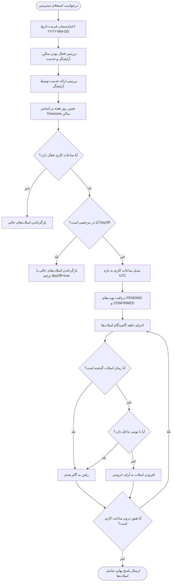

# ماژول در دسترس بودن (Availability Module)

## فهرست مطالب
- [معرفی](#معرفی)
- [وابستگی‌ها و معماری ماژول](#وابستگیها-و-معماری-ماژول)
- [مدل‌های داده مرتبط (Prisma Models)](#مدلهای-داده-مرتبط-prisma-models)
- [اندپوینت‌ها (Endpoints)](#اندپوینتها)
  - [دریافت اسلات‌های زمانی در دسترس](#دریافت-اسلاتهای-زمانی-در-دسترس-get-availability)
- [کلاس‌های انتقال داده (DTOs)](#کلاسهای-انتقال-داده-dtos)
- [سرویس و منطق تجاری (AvailabilityService)](#سرویس-و-منطق-تجاری-availabilityservice)
  - [متد getAvailability](#متد-getavailability)
  - [الگوریتم محاسبه و تولید اسلات‌ها (generateSlots)](#الگوریتم-محاسبه-و-تولید-اسلاتها-generateslots)
  - [متد validateBookingSlot](#متد-validatebookingslot)
  - [متدهای کمکی و مدیریت Timezone](#متدهای-کمکی-و-مدیریت-timezone)
- [نمودار جریان محاسبات](#نمودار-جریان-محاسبات)

---

## معرفی

ماژول [AvailabilityModule](file:///c:/Users/amoha/Documents/barbershop-api/src/availability/availability.module.ts#L6-L11) وظیفه بررسی و محاسبه زمان‌های خالی و قابل رزرو آرایشگران را در یک سالن و تاریخ مشخص بر عهده دارد. این ماژول یکی از هسته‌های اصلی چرخه رزرو نوبت در سامانه نوبت‌دهی آرایشگاه است و با در نظر گرفتن متغیرهای متعدد، بازه‌های زمانی آزاد را با دقت بالا استخراج می‌کند.

نقش‌های کلیدی این ماژول عبارتند از:
1. **محاسبه اسلات‌های خالی برای رزرو**: ارائه زمان‌های قابل رزرو بر اساس ساعات کاری آرایشگر، مرخصی‌ها، نوبت‌های از پیش ثبت‌شده و مدت زمان خدمت مورد نظر مشتری.
2. **پشتیبانی کامل از مناطق زمانی مختلف (Timezones)**: سالن‌ها می‌توانند در مناطق زمانی متفاوتی (مانند `Asia/Tehran` یا سایر مناطق استاندارد IANA) فعالیت کنند. محاسبات این ماژول تغییر ساعت تابستانی/زمستانی (DST) و نگاشت روزهای کاری هفته را به‌صورت دقیق مدیریت می‌کند.
3. **اعتبارسنجی اسلات نوبت برای رزرو**: ارائه متد کمکی جهت اعتبارسنجی قطعی اسلات انتخابی پیش از نهایی‌سازی رزرو در [AppointmentsService](file:///c:/Users/amoha/Documents/barbershop-api/src/appointments/appointments.service.ts#L18-L23).

---

## وابستگی‌ها و معماری ماژول

ماژول [AvailabilityModule](file:///c:/Users/amoha/Documents/barbershop-api/src/availability/availability.module.ts#L6-L11) به شکل زیر تعریف شده است:

```typescript
@Module({
  controllers: [AvailabilityController],
  providers: [AvailabilityService],
  exports: [AvailabilityService],
})
export class AvailabilityModule {}
```

### اجزای داخلی
- **کنترلر**: [`AvailabilityController`](file:///c:/Users/amoha/Documents/barbershop-api/src/availability/availability.controller.ts#L10-L24) وظیفه دریافت درخواست‌های HTTP و ارائه اسلات‌ها را دارد.
- **سرویس**: [`AvailabilityService`](file:///c:/Users/amoha/Documents/barbershop-api/src/availability/availability.service.ts#L23-L836) هسته محاسباتی و منطق دسترسی زمانی است.
- **خروجی (Exports)**: [`AvailabilityService`](file:///c:/Users/amoha/Documents/barbershop-api/src/availability/availability.service.ts#L23-L836) به عنوان یک ارائه‌دهنده صادر شده است تا ماژول‌هایی مانند [AppointmentsModule](file:///c:/Users/amoha/Documents/barbershop-api/src/appointments/appointments.service.ts#L9) بتوانند برای بررسی در دسترس بودن و سلامت بازه زمانی نوبت پیش از ایجاد یا ویرایش آن استفاده کنند.

### وابستگی‌های بیرونی
- [`PrismaService`](file:///c:/Users/amoha/Documents/barbershop-api/src/prisma/prisma.service.ts): جهت دسترسی به پایگاه‌داده و اجرای کوئری‌های مربوط به سالن، آرایشگر، ساعات کاری، مرخصی‌ها و نوبت‌ها.
- `class-validator`: جهت اعتبارسنجی مقادیر فیلدهای ورودی در DTO.
- `Intl.DateTimeFormat`: رابط جاوااسکریپت برای مدیریت دقیق Timezone سالن‌ها بدون وابستگی به پکیج‌های سنگین جانبی.

---

## مدل‌های داده مرتبط (Prisma Models)

ماژول دسترسی با موجودیت‌های زیر در [schema.prisma](file:///c:/Users/amoha/Documents/barbershop-api/prisma/schema.prisma) تعامل مستقیم دارد:

| مدل | جدول معادل | توضیحات و فیلدهای کلیدی مورد استفاده |
| :--- | :--- | :--- |
| `Salon` | `Salon` | سالن آرایشگاه؛ فیلدهای `isActive` و `timezone` (منطقه زمانی پیش‌فرض: `Asia/Tehran`). |
| `Barber` | `Barber` | آرایشگر؛ فیلدهای `isActive` و `salonId` جهت اطمینان از عضویت آرایشگر در سالن اعلام‌شده. |
| `Service` | `Service` | خدمت مورد نظر؛ فیلدهای `isActive`، `salonId` و `duration` (مدت زمان خدمت به دقیقه). |
| `BarberService` | `BarberService` | جدول رابطه چندبه‌چند آرایشگر و خدمات؛ تضمین می‌کند آرایشگر انتخاب‌شده توانایی ارائه خدمت مورد نظر را دارد. |
| `WorkingHour` | `WorkingHour` | ساعات کاری آرایشگر به تفکیک روز هفته (`dayOfWeek`)؛ شامل `startTime` و `endTime` و `isActive`. |
| `DayOff` | `DayOff` | روزهای تعطیل یا مرخصی‌های مقطعی آرایشگر بر اساس تاریخ محلی (`date`). |
| `Appointment` | `Appointment` | نوبت‌های ثبت‌شده موجود با وضعیت‌های `PENDING` و `CONFIRMED` که باعث پر شدن بازه‌های زمانی می‌شوند. |

---

## اندپوینت‌ها

اندپوینت‌های این ماژول در فایل [`AvailabilityController`](file:///c:/Users/amoha/Documents/barbershop-api/src/availability/availability.controller.ts#L10-L24) پیاده‌سازی شده‌اند:

### جدول مشخصات اندپوینت‌ها

| متد HTTP | مسیر (Path) | احراز هویت | نقش‌ها / گاردها | شرح عملکرد |
| :---: | :--- | :---: | :---: | :--- |
| `GET` | `/availability` | عمومی (Public) | ندارد | دریافت لیست اسلات‌های زمانی در دسترس و آزاد برای یک آرایشگر در یک تاریخ معین |

> [!NOTE]
> اندپوینت `/availability` عمومی بوده و نیازی به ارسال توکن Bearer JWT ندارد. این ویژگی به کاربران مهمان و بازدیدکنندگان وب‌سایت یا اپلیکیشن اجازه می‌دهد بدون نیاز به ثبت‌نام یا ورود قبلی، بازه‌های خالی آرایشگران را مشاهده کنند.

---

### دریافت اسلات‌های زمانی در دسترس (`GET /availability`)

این اندپوینت ورودی‌های خود را از طریق Query Parameters دریافت کرده و فهرست زمان‌های آزاد را همراه با جزییات ساعات کاری برمی‌گرداند.

#### پارامترهای درخواست (Query Parameters)
- `salonId` (رشته، اجباری): شناسه یکتای سالن.
- `barberId` (رشته، اجباری): شناسه یکتای آرایشگر.
- `serviceId` (رشته، اجباری): شناسه خدمت مورد نظر (مدت زمان خدمت از این موجودیت خوانده می‌شود).
- `date` (رشته، اجباری): تاریخ مورد نظر با فرمت تقویمی استاندارد `YYYY-MM-DD`.
- `slotIntervalMinutes` (عدد صحیح، اختیاری): گام زمانی تولید اسلات‌ها (بین ۵ تا ۱۲۰ دقیقه، پیش‌فرض: ۱۵ دقیقه).

#### نمونه درخواست (Request Example)
```http
GET /availability?salonId=9b1deb4d-3b7d-4bad-9bdd-2b0d7b3dcb6d&barberId=6c9a4411-b0d2-446a-a82f-287895e3f32e&serviceId=3c8d1973-1025-41e1-8843-157945d8b7b2&date=2026-10-15&slotIntervalMinutes=15 HTTP/1.1
Host: api.barbershop.local
```

#### نمونه پاسخ موفق با اسلات‌های آزاد (200 OK)
```json
{
  "salonId": "9b1deb4d-3b7d-4bad-9bdd-2b0d7b3dcb6d",
  "barberId": "6c9a4411-b0d2-446a-a82f-287895e3f32e",
  "serviceId": "3c8d1973-1025-41e1-8843-157945d8b7b2",
  "date": "2026-10-15",
  "timezone": "Asia/Tehran",
  "dayOfWeek": "THURSDAY",
  "serviceDurationMinutes": 45,
  "slotIntervalMinutes": 15,
  "workingHours": {
    "startTime": "10:00",
    "endTime": "18:00"
  },
  "dayOff": false,
  "slots": [
    {
      "startAt": "2026-10-15T06:30:00.000Z",
      "endAt": "2026-10-15T07:15:00.000Z",
      "localStart": "2026-10-15T10:00",
      "localEnd": "2026-10-15T10:45"
    },
    {
      "startAt": "2026-10-15T06:45:00.000Z",
      "endAt": "2026-10-15T07:30:00.000Z",
      "localStart": "2026-10-15T10:15",
      "localEnd": "2026-10-15T11:00"
    }
  ]
}
```

#### نمونه پاسخ در حالت روز مرخصی آرایشگر (200 OK)
```json
{
  "salonId": "9b1deb4d-3b7d-4bad-9bdd-2b0d7b3dcb6d",
  "barberId": "6c9a4411-b0d2-446a-a82f-287895e3f32e",
  "serviceId": "3c8d1973-1025-41e1-8843-157945d8b7b2",
  "date": "2026-10-16",
  "timezone": "Asia/Tehran",
  "dayOfWeek": "FRIDAY",
  "serviceDurationMinutes": 45,
  "slotIntervalMinutes": 15,
  "workingHours": {
    "startTime": "10:00",
    "endTime": "18:00"
  },
  "dayOff": true,
  "slots": []
}
```

#### خطاهای احتمالی (Error Responses)
- **`400 Bad Request`**:
  - `Date must use YYYY-MM-DD format` یا `Invalid calendar date` (فرمت تاریخ نامعتبر است).
  - `Barber does not belong to this salon` (آرایشگر عضو این سالن نیست).
  - `Service does not belong to this salon` (خدمت تعریف‌شده متعلق به این سالن نیست).
  - `Invalid working hours` (ساعت پایان کاری کمتر یا مساوی ساعت شروع کاری است).
  - `Invalid local date or time for the salon timezone` (تاریخ محلی در تغییر ساعت DST وجود ندارد).
- **`404 Not Found`**:
  - `Salon not found` (سالن یافت نشد).
  - `Barber not found` (آرایشگر یافت نشد).
  - `Service not found` (خدمت یافت نشد).
- **`409 Conflict`**:
  - `Salon is inactive` (سالن غیرفعال است).
  - `Barber is inactive` (آرایشگر غیرفعال است).
  - `Service is inactive` (خدمت غیرفعال است).
  - `Barber does not provide this service` (آرایشگر این خدمت را ارائه نمی‌دهد).
  - `Service duration must be greater than zero` (مدت زمان خدمت نامعتبر است).

---

## کلاس‌های انتقال داده (DTOs)

کلاس [`GetAvailabilityDto`](file:///c:/Users/amoha/Documents/barbershop-api/src/availability/dto/get-availability.dto.ts#L11-L32) ساختار و اعتبارسنجی پارامترهای ورودی اندپوینت استعلام دسترسی را تعریف می‌کند:

```typescript
export class GetAvailabilityDto {
  @IsString()
  @IsNotEmpty()
  salonId: string;

  @IsString()
  @IsNotEmpty()
  barberId: string;

  @IsString()
  @IsNotEmpty()
  serviceId: string;

  @IsDateString()
  date: string;

  @IsOptional()
  @IsInt()
  @Min(5)
  @Max(120)
  slotIntervalMinutes?: number;
}
```

### جدول مشخصات فیلدهای DTO

| نام فیلد | نوع داده (Type) | وضعیت | دکوراتورهای اعتبارسنجی | پیش‌فرض | توضیحات |
| :--- | :--- | :---: | :--- | :---: | :--- |
| `salonId` | `string` | اجباری | `@IsString()`, `@IsNotEmpty()` | - | شناسه یکتای سالن |
| `barberId` | `string` | اجباری | `@IsString()`, `@IsNotEmpty()` | - | شناسه یکتای آرایشگر مورد نظر |
| `serviceId` | `string` | اجباری | `@IsString()`, `@IsNotEmpty()` | - | شناسه خدمتی که مشتری مایل به رزرو آن است |
| `date` | `string` | اجباری | `@IsDateString()` | - | تاریخ مورد نظر به فرمت تقویمی استاندارد `YYYY-MM-DD` |
| `slotIntervalMinutes` | `number` | اختیاری | `@IsOptional()`, `@IsInt()`, `@Min(5)`, `@Max(120)` | `15` | گام حرکت اسلات‌ها به دقیقه (حداقل ۵ و حداکثر ۱۲۰ دقیقه) |

---

## سرویس و منطق تجاری (AvailabilityService)

کلاس [`AvailabilityService`](file:///c:/Users/amoha/Documents/barbershop-api/src/availability/availability.service.ts#L23-L836) هسته مرکزی ماژول است و تمام منطق اعتبارسنجی، محاسبات ریاضی زمان، مدیریت Timezone و الگوریتم فیلتر نوبت‌ها را در بر دارد.

### متد `getAvailability`

این متد فرایند کامل استخراج اسلات‌ها را مدیریت می‌کند:

#### مراحل و زنجیره بررسی‌ها (Step-by-step Workflow):
1. **اعتبارسنجی اولیه فرمت تقویمی**: متد `validateDateString` ساختار `YYYY-MM-DD` و واقعی بودن روز در ماه را بررسی می‌کند (مثلاً مانع از ارسال روز ۳۱ فوریه می‌شود).
2. **بررسی صحت موجودیت‌ها و وابستگی‌های سالن**:
   - سالن باید وجود داشته باشد و فعال (`isActive: true`) باشد.
   - آرایشگر باید وجود داشته باشد، فعال باشد و فیلد `salonId` آن با سالن ورودی مطابقت کند.
   - خدمت باید وجود داشته باشد، فعال باشد و متعلق به همان سالن باشد.
   - رکورد جدول واسط `BarberService` استعلام می‌شود تا مطمئن شویم آرایشگر این خدمت را ارائه می‌دهد.
   - مدت زمان خدمت (`service.duration`) باید بزرگتر از صفر باشد.
3. **تشخیص روز هفته محلی سالن**:
   - بر اساس منطقه زمانی سالن (`salon.timezone`) و نیمروز تاریخ مورد نظر (`12:00`)، روز هفته در تایم‌زون سالن استخراج شده و به اینام `DayOfWeek` (مانند `SATURDAY` تا `FRIDAY`) نگاشت می‌شود.
4. **بررسی ساعات کاری آرایشگر (`WorkingHour`)**:
   - ساعت کاری آرایشگر برای روز به دست آمده استعلام می‌شود. اگر رکوردی ثبت نشده باشد یا `isActive: false` باشد، بلافاصله پاسخ خالی (`slots: []`) بازگردانده می‌شود.
5. **بررسی مرخصی آرایشگر (`DayOff`)**:
   - متد `findDayOff` بررسی می‌کند که آیا در بازه ۲۴ ساعته روز محلی آرایشگر رکوردی در جدول `DayOff` وجود دارد یا خیر. در صورت وجود مرخصی، اسلات‌ها خالی برگردانده شده و پرچم `dayOff: true` تنظیم می‌شود.
6. **تبدیل ساعات کاری به زمان استاندارد جهانی UTC**:
   - ساعت شروع (`startTime`) و ساعت پایان (`endTime`) که به‌صورت رشته‌های محلی مانند `10:00` و `18:00` هستند، بر اساس تایم‌زون سالن به شیء `Date` در UTC تبدیل می‌شوند.
   - اگر ساعت شروع بزرگتر یا مساوی ساعت پایان باشد، خطای `BadRequestException('Invalid working hours')` صادر می‌شود.
7. **استخراج نوبت‌های موجود و فعال آرایشگر**:
   - تمام نوبت‌های ثبت‌شده آرایشگر که با بازه کاری روز هم‌پوشانی دارند و وضعیت آن‌ها `PENDING` یا `CONFIRMED` است، از جدول `Appointment` دریافت و مرتب‌سازی زمانی می‌شوند (`orderBy: { startAt: 'asc' }`).
8. **اجرای الگوریتم تولید اسلات‌ها**:
   - متد کمکی `generateSlots` فراخوانی شده و خروجی نهایی تشکیل می‌شود.

---

### الگوریتم محاسبه و تولید اسلات‌ها (`generateSlots`)

الگوریتم تولید اسلات‌های آزاد زمان را به صورت بازه‌های پیوسته پیمایش می‌کند.

#### ورودی‌های الگوریتم:
- `timezone`: منطقه زمانی سالن
- `workingStart`: شیء `Date` زمان شروع کار آرایشگر در قالب UTC
- `workingEnd`: شیء `Date` زمان پایان کار آرایشگر در قالب UTC
- `serviceDurationMinutes`: مدت زمان خدمت انتخابی به دقیقه
- `slotIntervalMinutes`: گام حرکت اسلات‌ها به دقیقه (پیش‌فرض ۱۵ دقیقه)
- `existingAppointments`: لیست نوبت‌های از پیش رزرو شده فعال آرایشگر

#### منطق حلقه پیمایش (Sliding Window Algorithm):
```typescript
const serviceDurationMs = serviceDurationMinutes * 60 * 1000;
const intervalMs = slotIntervalMinutes * 60 * 1000;
const now = Date.now();

for (
  let startMs = workingStart.getTime();
  startMs + serviceDurationMs <= workingEnd.getTime();
  startMs += intervalMs
) {
  const endMs = startMs + serviceDurationMs;

  // ۱. بررسی عدم قرارگیری در زمان گذشته
  if (startMs < now) {
    continue;
  }

  // ۲. بررسی تداخل با نوبت‌های موجود
  const hasConflict = existingAppointments.some(
    (appointment) =>
      startMs < appointment.endAt.getTime() &&
      endMs > appointment.startAt.getTime(),
  );

  if (hasConflict) {
    continue;
  }

  // ۳. افزودن اسلات معتبر به لیست نهایی
  slots.push({
    startAt: new Date(startMs).toISOString(),
    endAt: new Date(endMs).toISOString(),
    localStart: this.formatLocalDateTime(new Date(startMs), timezone),
    localEnd: this.formatLocalDateTime(new Date(endMs), timezone),
  });
}
```

#### شرایط و فیلترهای الگوریتم:
1. **پایان خدمت درون ساعت کاری**: شرط حلقه `startMs + serviceDurationMs <= workingEnd.getTime()` تضمین می‌کند که انجام خدمت قبل از پایان ساعت کاری روزانه آرایشگر به اتمام برسد.
2. **فیلتر زمان‌های گذشته**: اگر `startMs < now` باشد، اسلات رد می‌شود تا امکان رزرو نوبت در گذشته وجود نداشته باشد.
3. **فرمول بررسی تداخل زمانی (Interval Overlap Condition)**:
   یک اسلات فرضی `[startMs, endMs]` با یک نوبت رزرو شده موجود `[appointment.startAt, appointment.endAt]` تداخل دارد اگر و تنها اگر:
   $$\text{startMs} < \text{appointment.endAt} \quad \text{و} \quad \text{endMs} > \text{appointment.startAt}$$
   اگر تداخلی شناسایی شود، اسلات مورد نظر نادیده گرفته می‌شود.
4. **تولید نمایش دوگانه (UTC و محلی)**: هر اسلات شامل فرمت استاندارد بین‌المللی UTC (`ISO 8601`) برای ارتباط با دیتابیس و فرمت محلی محاوره‌ای سالن (`localStart` و `localEnd` مانند `2026-10-15T10:00`) جهت نمایش به کاربران در فرانت‌اند است.

---

### متد `validateBookingSlot`

این متد برای استفاده توسط سایر سرویس‌ها (به‌ویژه [AppointmentsService](file:///c:/Users/amoha/Documents/barbershop-api/src/appointments/appointments.service.ts#L21)) پیاده‌سازی شده است تا هنگام ثبت یا تغییر نوبت، اعتبار دقیق زمان انتخاب‌شده به شکل زیر تضمین گردد:

#### پارامترهای ورودی:
- `salonId`: شناسه سالن
- `barberId`: شناسه آرایشگر
- `serviceId`: شناسه خدمت
- `startAt`: شیء `Date` زمان درخواستی شروع نوبت

#### گام‌های اعتبارسنجی:
1. ارزیابی معتبر بودن شیء `Date` مربوط به `startAt`.
2. بررسی فعال بودن سالن، آرایشگر و خدمت و تایید پیوند آن‌ها با سالن.
3. اطمینان از ارائه خدمت توسط آرایشگر در جدول `BarberService`.
4. تبدیل `startAt` به تاریخ و ساعت محلی سالن و استخراج روز هفته.
5. بررسی فعال بودن ساعات کاری آرایشگر در آن روز هفته (`WorkingHour`).
6. اطمینان از عدم وجود مرخصی آرایشگر در آن روز (`DayOff`).
7. محاسبه زمان پایان خدمت درخواستی:
   $$\text{requestedEnd} = \text{requestedStart} + (\text{service.duration} \times 60 \times 1000)$$
8. اطمینان از قرار گرفتن کامل بازه درخواستی درون ساعات کاری آرایشگر:
   $$\text{requestedStart} \ge \text{workingStart} \quad \text{و} \quad \text{requestedEnd} \le \text{workingEnd}$$
9. در صورت موفقیت، اطلاعات سالن، آرایشگر، خدمت، روز هفته، ساعات محلی و زمان پایان محاسبه‌شده (`endAt`) بازگردانده می‌شود.

---

### متدهای کمکی و مدیریت Timezone

برای حفظ دقت بالا و جلوگیری از خطاهای ناشی از تغییر ساعت تابستانی/زمستانی (Daylight Saving Time - DST)، سرویس از مجموعه‌ای از متدهای اختصاصی استفاده می‌کند:

| نام متد | پارامترها | خروجی | شرح وظیفه |
| :--- | :--- | :---: | :--- |
| `validateDateString` | `date: string` | `void` | بررسی فرمت رگولار `YYYY-MM-DD` و تطابق اجزای تاریخ در تقویم گریگوری (رد روزهای غیرمجاز مانند ۲۹ فوریه در سال‌های غیرکبیسه). |
| `localDateTimeToUtc` | `date: string, time: string, timezone: string` | `Date` | محاسبه دقیق زمان UTC متناظر با زمان محلی. با بررسی رفت‌وبرگشت اطمینان حاصل می‌کند که زمان محلی ورودی در شکاف پرش زمانی بهار (DST Spring-forward gap) قرار نداشته باشد. |
| `getTimezoneOffset` | `date: Date, timezone: string` | `number` | محاسبه دقیق انحراف زمانی (اختلاف به میلی‌ثانیه) در منطقه زمانی هدف در یک لحظه مشخص با استفاده از `Intl.DateTimeFormat`. |
| `formatLocalDateTime` | `date: Date, timezone: string` | `string` | تبدیل زمان UTC به رشته استاندارد زمان محلی با فرمت `YYYY-MM-DDTHH:mm`. |
| `formatLocalDate` | `date: Date, timezone: string` | `string` | استخراج تاریخ محلی سالن به فرمت `YYYY-MM-DD`. |
| `formatLocalTime` | `date: Date, timezone: string` | `string` | استخراج زمان محلی سالن به فرمت `HH:mm`. |
| `addDays` | `date: string, days: number` | `string` | افزودن تعداد مشخصی روز به یک تاریخ تقویمی بدون وابستگی به تایم‌زون سیستم میزبان سرور. |
| `validateTimezone` | `timezone: string` | `void` | بررسی پشتیبانی شدن نام تایم‌زون توسط استاندارد جهانی جاوااسکریپت `Intl`. |
| `getDayOfWeek` | `date: string, timezone: string` | `DayOfWeek` | استخراج نام روز هفته در نیمروز تاریخ محلی و نگاشت آن به اینام‌های `DayOfWeek` دیتابیس. |
| `findDayOff` | `barberId, date, timezone` | `Promise<DayOff \| null>` | جستجوی مرخصی آرایشگر در بازه ۲۴ ساعته روز محلی از نیمه‌شب تا آغاز روز بعد. |
| `emptyAvailability` | `params` | `object` | ساختاربندی پاسخ استاندارد در حالتی که آرایشگر در مرخصی بوده یا ساعت کاری فعالی ندارد. |

---

## نمودار جریان محاسبات

نمودار زیر روند اعتبارسنجی و تولید اسلات‌های آزاد را در [AvailabilityService](file:///c:/Users/amoha/Documents/barbershop-api/src/availability/availability.service.ts#L27-L249) نمایش می‌دهد:


