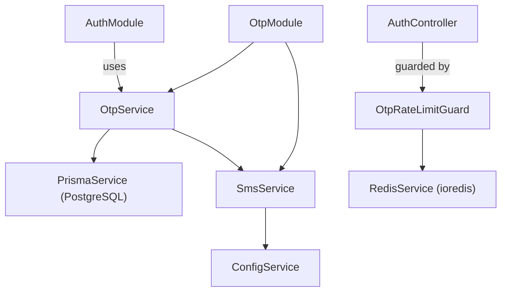

# ماژول OTP (رمز عبور یک‌بارمصرف)

## معرفی

ماژول OTP مسئولیت چرخه حیات کدهای یک‌بارمصرف احراز هویت شامل **تولید (Generation)**، **اعتبارسنجی (Verification)**، **مدیریت انقضا و تلاش‌ها**، و **ارسال پیامک (SMS Delivery)** را بر عهده دارد.

این ماژول به عنوان یک لایه سرویس زیرساختی و امنیتی در پروژه طراحی شده است. ماژول OTP کنترلر مستقیمی ندارد و قابلیت‌های آن توسط [`AuthModule`](file:///c:/Users/amoha/Documents/barbershop-api/src/auth/auth.module.ts) و کنترلر [`AuthController`](file:///c:/Users/amoha/Documents/barbershop-api/src/auth/auth.controller.ts) جهت ورود و ثبت‌نام کاربران در اختیار کلاینت‌ها قرار می‌گیرد.

### مسئولیت‌های کلیدی
* تولید کدهای امن ۶ رقمی با استفاده از مولد تصادفی کریپتوگرافیک.
* رمزنگاری یک‌طرفه (Hash) کدهای تولیدشده با استفاده از الگوریتم `bcrypt`.
* اعمال قفل مشاوره‌ای تراکنشی (PostgreSQL Advisory Lock) برای جلوگیری از رقابت همزمان (Race Condition) در تولید کد برای یک شماره تلفن.
* ابطال خودکار (Invalidation) کدهای پیشین فعال به ازای هر درخواست جدید.
* بررسی صحت کد، تاریخ انقضا و محدودیت تعداد تلاش‌های ناموفق.
* مصرف اتمیک (Atomic Consumption) کد پس از اعتبارسنجی موفقیت‌آمیز برای ممانعت از استفاده مجدد.
* ارتباط با ارائه‌دهنده پیامک در محیط عملیاتی با مدیریت تایم‌اوت و استثنائات.

---

## ساختار و وابستگی‌های ماژول

ماژول در مسیر [`src/otp/otp.module.ts`](file:///c:/Users/amoha/Documents/barbershop-api/src/otp/otp.module.ts) تعریف شده است:

```typescript
import { Module } from '@nestjs/common';
import { ConfigModule } from '@nestjs/config';

import { OtpService } from './otp.service.js';
import { SmsService } from './sms.service.js';

@Module({
  imports: [ConfigModule],
  providers: [OtpService, SmsService],
  exports: [OtpService],
})
export class OtpModule {}
```

### نمودار وابستگی‌ها



* **وابستگی به [`ConfigModule`](file:///c:/Users/amoha/Documents/barbershop-api/src/otp/otp.module.ts#L8)**: دریافت آدرس و توکن سرویس پیامک و تنظیمات محیط اجرا.
* **وابستگی به [`PrismaService`](file:///c:/Users/amoha/Documents/barbershop-api/src/prisma/prisma.service.ts)**: دسترسی به پایگاه‌داده جهت اجرای تراکنش‌ها، قفل دیتابیس و مدیریت رکوردهای جدول `OtpCode`.
* **صادرات [`OtpService`](file:///c:/Users/amoha/Documents/barbershop-api/src/otp/otp.service.ts)**: ارائه سرویس به سایر بخش‌های برنامه نظیر [`AuthService`](file:///c:/Users/amoha/Documents/barbershop-api/src/auth/auth.service.ts).

---

## سرویس‌ها

ماژول شامل دو سرویس اصلی است:

### ۱. سرویس [`OtpService`](file:///c:/Users/amoha/Documents/barbershop-api/src/otp/otp.service.ts)

این سرویس در مسیر [`src/otp/otp.service.ts`](file:///c:/Users/amoha/Documents/barbershop-api/src/otp/otp.service.ts) قرار دارد و منطق اصلی تولید و بررسی کدها را بر عهده دارد.

#### ثابت‌ها و تنظیمات داخلی:
* `otpExpiresInMs = 2 * 60 * 1000`: مدت زمان اعتبار هر کد (۲ دقیقه).
* `maxAttempts = 5`: حداکثر تعداد مجاز تلاش‌های اشتباه برای هر کد.

#### متدها:

##### `generate(phone: string): Promise<{ code: string; expiresAt: Date }>`
کد جدیدی برای شماره تلفن مشخص تولید می‌کند:
1. **نرمال‌سازی شماره**: شماره تلفن با متد [`normalizeIranianPhone`](file:///c:/Users/amoha/Documents/barbershop-api/src/auth/phone.util.ts) استانداردسازی می‌شود (تبدیل ارقام فارسی/عربی به انگلیسی، حذف پیشوندهای ۹۸+، ۰۰۹۸ و پیشوند ۹۸ و یکپارچه‌سازی به قالب `09xxxxxxxxx`).
2. **تولید کد امن**: ایجاد عدد ۶ رقمی در بازه ۱۰۰,۰۰۰ تا ۱,۰۰۰,۰۰۰ با متد `randomInt` از پکیج توکار `node:crypto`.
3. **محاسبه هش**: هش کردن کد تولید شده با `bcrypt.hash(code, 10)`.
4. **محاسبه زمان انقضا**: اضافه کردن ۲ دقیقه به زمان فعلی سرور.
5. **تراکنش ایزوله پایگاه‌داده (`$transaction`)**:
   - **قفل مشاوره‌ای PostgreSQL**: اجرای دستور `SELECT 1 WHERE pg_advisory_xact_lock(hashtextextended(${phone}, 0)) IS NULL`. این قفل انحصاری تا پایان تراکنش (Commit یا Rollback) برقرار بوده و از شرایط رقابتی چند فراخوانی همزمان روی یک شماره در کلاسترهای مختلف جلوگیری می‌کند.
   - **ابطال کدهای قبلی**: به‌روزرسانی رکوردهای پیشین با `usedAt: null` و ست کردن زمان جاری در `usedAt`.
   - **ثبت کد جدید**: ذخیره رکورد در مدل `OtpCode`.
6. **ارسال پیامک در Production**: در صورتی که متغیر `NODE_ENV === 'production'` باشد، متد [`smsService.sendOtp(phone, code)`](file:///c:/Users/amoha/Documents/barbershop-api/src/otp/sms.service.ts#L8) فراخوانی می‌شود.
7. **خروجی**: بازگرداندن کد خام و زمان انقضا.

##### `verify(phone: string, code: string): Promise<void>`
اعتبارسنجی کد ارسالی کاربر را انجام می‌دهد:
1. **نرمال‌سازی شماره**: شماره تلفن نرمال‌سازی می‌شود.
2. **جستجوی کد فعال**: واکشی جدیدترین رکورد با شرایط `usedAt: null` و `expiresAt > now` با مرتب‌سازی نزولی بر اساس `createdAt`. در صورت عدم وجود، خطای `BadRequestException('OTP not found or expired')` صادر می‌شود.
3. **بررسی تلاش‌ها**: اگر مقدار `attempts >= maxAttempts` (۵ بار) باشد، خطای `BadRequestException('Too many attempts')` صادر می‌شود.
4. **مقایسه هش**: بررسی تطابق کد ورودی با هش ذخیره‌شده از طریق `bcrypt.compare(code, otp.codeHash)`.
5. **مدیریت کد نادرست**:
   - در صورت عدم تطابق، فیلد `attempts` با شرط اتمیک (`attempts < maxAttempts` و عدم مصرف و عدم انقضا) یک واحد افزایش می‌یابد (`increment: 1`).
   - در صورتی که تعداد رکوردهای به‌روزرسانی شده ۰ باشد یا تلاش‌ها به پایان رسیده باشد، خطای متناسب و در غیر این صورت خطای `BadRequestException('Invalid OTP')` پرتاب می‌شود.
6. **مصرف اتمیک کد صحیح**:
   - در صورت صحت کد، رکورد با دستور شرطی `updateMany` و شرط `usedAt: null` به‌روزرسانی شده و فیلد `usedAt = new Date()` پر می‌شود. این به‌روزرسانی شرطی تضمین می‌کند که از میان چند اعتبارسنجی همزمان، تنها یک درخواست موفق خواهد شد (Race condition protection).
   - در صورت تغییر نکردن دقیقاً یک رکورد (`count !== 1`)، خطای `BadRequestException('OTP is no longer valid')` پرتاب می‌شود.

##### `private generateCode(): string`
تولید رشته تصادفی ۶ رقمی با تابع امن `randomInt(100_000, 1_000_000).toString()`.

---

### ۲. سرویس [`SmsService`](file:///c:/Users/amoha/Documents/barbershop-api/src/otp/sms.service.ts)

این سرویس در مسیر [`src/otp/sms.service.ts`](file:///c:/Users/amoha/Documents/barbershop-api/src/otp/sms.service.ts) وظیفه برقراری ارتباط با درگاه ارائه‌دهنده پیامک را به عهده دارد.

```typescript
@Injectable()
export class SmsService {
  constructor(private readonly configService: ConfigService) {}

  async sendOtp(phone: string, code: string): Promise<void> { ... }
}
```

#### سازوکار ارسال:
* دریافت متغیرهای محیطی `SMS_API_URL` و `SMS_API_TOKEN` از [`ConfigService`](file:///c:/Users/amoha/Documents/barbershop-api/src/otp/sms.service.ts#L9-L10).
* اعتبارسنجی تنظیمات: در صورت عدم تعریف متغیرها، خطای `ServiceUnavailableException('SMS delivery is not configured')` رخ می‌دهد.
* ارسال درخواست HTTP POST با هدر `Authorization: Bearer ${token}` و بدنه JSON حاوی شماره تلفن و متن پیام:
  ```json
  {
    "phone": "09123456789",
    "message": "Your verification code is 123456"
  }
  ```
* کنترل زمان درنگ: استفاده از سیگنال لغو `AbortSignal.timeout(10_000)` (۱۰ ثانیه مهلت پاسخ‌دهی).
* مدیریت خطاها: در صورت بروز خطای شبکه یا در دسترس نبودن ارائه‌دهنده، خطای `ServiceUnavailableException('SMS provider is unavailable')` و در صورت بازگشت کد وضعیت ناموفق (`!response.ok`)، خطای `ServiceUnavailableException('SMS delivery failed')` ایجاد می‌شود.

---

## امنیت و سیاست‌های حفاظتی

ماژول OTP دارای تمهیدات دفاعی چندلایه در برابر تهدیدات امنیتی است:

### ۱. محدودسازی نرخ درخواست (Rate Limiting با Redis)
برای جلوگیری از حملات محروم‌سازی از سرویس (DoS)، ارسال انبوه پیامک (SMS Flooding) و Brute Force، از گارد [`OtpRateLimitGuard`](file:///c:/Users/amoha/Documents/barbershop-api/src/auth/guards/otp-rate-limit.guard.ts) مبتنی بر Redis استفاده می‌شود:
* **پنجره زمانی**: ۱۵ دقیقه (`windowMs = 15 * 60 * 1000`).
* **محدودیت بر اساس شماره تلفن**: حداکثر ۵ درخواست در هر ۱۵ دقیقه به ازای هر شماره (`maxPerPhone = 5`).
* **محدودیت بر اساس آدرس IP**: حداکثر ۲۰ درخواست در هر ۱۵ دقیقه به ازای هر IP (`maxPerIp = 20`).
* **هش‌سازی کلیدها**: تمامی کلیدهای ذخیره‌سازی ردیس پیش از ثبت، با الگوریتم SHA-256 هش می‌شوند تا اطلاعات حساسی چون شماره تلفن و آدرس IP به صورت خام ذخیره نگردند.
* **سیاست Fail-Closed**: در صورت بروز اختلال در سرویس Redis، دسترسی به اندپوینت‌ها به دلایل امنیتی قطع شده و وضعیت خطای 503 (`ServiceUnavailableException`) برگردانده می‌شود.

### ۲. قفل همزمانی مشاوره‌ای (PostgreSQL Advisory Locks)
برای خنثی‌سازی حملات Concurrency و درخواست‌های همزمان میلی‌ثانیه‌ای، از قفل در سطح دیتابیس استفاده می‌شود:
```sql
SELECT 1 WHERE pg_advisory_xact_lock(hashtextextended(${phone}, 0)) IS NULL
```
این دستور مانع از تداخل تراکنش‌ها روی یک شماره موبایل مشخص می‌شود و تا پایان ثبت رکورد و کامیت تراکنش، هیچ نخ (Thread) یا پردازش دیگری نمی‌تواند برای آن شماره رکورد جدید ثبت کند.

### ۳. ذخیره‌سازی امن و یک‌طرفه (Hash Storage)
* مقدار واقعی کد هیچ‌گاه به صورت متن آشکار (Plaintext) در پایگاه‌داده ثبت نمی‌شود.
* از کتابخانه امن `bcrypt` با ضریب پیچیدگی ۱۰ برای تولید و مقایسه سالت و هش استفاده می‌شود.
* نشت احتمالی دیتابیس آسیبی به کدهای معتبر فعال وارد نمی‌کند.

### ۴. عمر مفید محدود (Expiration)
* مدت زمان اعتبار هر کد فقط **۲ دقیقه** است.
* کدهای گذشته از این زمان به صورت خودکار رد می‌شوند.

### ۵. محدودیت تلاش‌ها و ابطال اتمیک
* حداکثر ۵ بار امکان ورود اشتباه کد وجود دارد و پس از آن کد بلااستفاده خواهد شد.
* با صدور کد جدید برای یک شماره، تمام کدهای قبلی مصرف‌نشده سریعاً باطل می‌شوند.
* مصرف کد در اعتبارسنجی با کوئری اتمیک شرطی صورت می‌پذیرد تا امکان استفاده همزمان با یک کد واحد میسر نباشد.

### ۶. عدم افشای کد در پاسخ API در Production
کد تولیدشده در پاسخ اندپوینت `request-otp` به کاربر برگردانده نمی‌شود؛ تنها در محیط توسعه و با فعال بودن متغیرهای زیر در فایل `.env`، فیلد `otp` در پاسخ نمایش داده می‌شود:
```env
NODE_ENV=development
OTP_EXPOSE_CODE=true
```

---

## مدل داده‌ای (Data Model)

کدهای یک‌بارمصرف در جدول `OtpCode` در PostgreSQL ذخیره می‌شوند. تعریف مدل در فایل [`prisma/schema.prisma`](file:///c:/Users/amoha/Documents/barbershop-api/prisma/schema.prisma#L61-L72):

```prisma
model OtpCode {
  id        String    @id @default(uuid())
  phone     String
  codeHash  String
  expiresAt DateTime
  attempts  Int       @default(0)
  usedAt    DateTime?
  createdAt DateTime  @default(now())

  @@index([phone, createdAt])
  @@index([expiresAt])
}
```

### مشخصات فیلدها:

| فیلد | نوع داده | توضیحات |
| :--- | :--- | :--- |
| `id` | `String (UUID)` | شناسه یکتای رکورد کد OTP |
| `phone` | `String` | شماره تلفن نرمال‌شده کاربر |
| `codeHash` | `String` | نسخه هش‌شده کد با الگوریتم `bcrypt` |
| `expiresAt` | `DateTime` | زمان دقیق پایان اعتبار کد (۲ دقیقه پس از تولید) |
| `attempts` | `Int` | تعداد دفعات تلاش ناموفق برای اعتبارسنجی (پیش‌فرض: ۰) |
| `usedAt` | `DateTime?` | زمان مصرف موفق یا ابطال کد (مقدار `null` به معنی مصرف‌نشده است) |
| `createdAt` | `DateTime` | زمان ثبت رکورد |

### ایندکس‌ها:
* `@@index([phone, createdAt])`: جهت بهینه‌سازی سرعت جستجوی آخرین کدهای صادرشده برای یک شماره تلفن.
* `@@index([expiresAt])`: جهت تسریع عملیات فیلتر کدهای منقضی‌شده و پاک‌سازی‌های دوره‌ای.

---

## اندپوینت‌ها (API Endpoints)

اندپوینت‌های OTP در کنترلر [`AuthController`](file:///c:/Users/amoha/Documents/barbershop-api/src/auth/auth.controller.ts) در مسیر `src/auth/auth.controller.ts` تعریف شده‌اند:

| متد HTTP | مسیر | احراز هویت | گاردها | شرح |
| :--- | :--- | :--- | :--- | :--- |
| `POST` | `/api/auth/request-otp` | ندارد (عمومی) | [`OtpRateLimitGuard`](file:///c:/Users/amoha/Documents/barbershop-api/src/auth/guards/otp-rate-limit.guard.ts) | درخواست صدور و ارسال کد یک‌بارمصرف |
| `POST` | `/api/auth/verify-otp` | ندارد (عمومی) | [`OtpRateLimitGuard`](file:///c:/Users/amoha/Documents/barbershop-api/src/auth/guards/otp-rate-limit.guard.ts) | اعتبارسنجی کد، ورود یا ثبت‌نام کاربر و صدور JWT |

---

### ۱. درخواست کد یک‌بارمصرف (`POST /api/auth/request-otp`)

کلاینت شماره موبایل خود را ارسال کرده و کد جدید تولید و ارسال می‌شود.

#### ساختار DTO ورودی: [`RequestOtpDto`](file:///c:/Users/amoha/Documents/barbershop-api/src/auth/dto/request-otp.dto.ts)
* `phone`: رشته، اجباری، تبدیل خودکار به فرمت استاندارد، تطابق با الگوی `^09\d{9}$`.

#### نمونه درخواست:
```http
POST /api/auth/request-otp HTTP/1.1
Host: localhost:3000
Content-Type: application/json

{
  "phone": "09121234567"
}
```

#### نمونه پاسخ موفق در Production:
```http
HTTP/1.1 201 Created
Content-Type: application/json

{
  "message": "OTP sent successfully",
  "expiresAt": "2026-10-12T18:15:00.000Z"
}
```

#### نمونه پاسخ در محیط توسعه (با `OTP_EXPOSE_CODE=true`):
```json
{
  "message": "OTP sent successfully",
  "expiresAt": "2026-10-12T18:15:00.000Z",
  "otp": "834921"
}
```

---

### ۲. اعتبارسنجی کد یک‌بارمصرف (`POST /api/auth/verify-otp`)

کلاینت شماره موبایل و کد ۶ رقمی دریافتی را ارسال می‌کند. در صورت موفقیت، اطلاعات کاربر و توکن‌های احراز هویت بازگردانده می‌شوند.

#### ساختار DTO ورودی: [`VerifyOtpDto`](file:///c:/Users/amoha/Documents/barbershop-api/src/auth/dto/verify-otp.dto.ts)
* `phone`: رشته، اجباری، نرمال‌سازی شماره، تطابق با `^09\d{9}$`.
* `code`: رشته، ۶ رقمی، عددی (`^\d{6}$`).

#### نمونه درخواست:
```http
POST /api/auth/verify-otp HTTP/1.1
Host: localhost:3000
Content-Type: application/json

{
  "phone": "09121234567",
  "code": "834921"
}
```

#### نمونه پاسخ موفق:
```http
HTTP/1.1 201 Created
Content-Type: application/json

{
  "accessToken": "eyJhbGciOiJIUzI1NiIsInR5cCI6IkpXVCJ9...",
  "refreshToken": "eyJhbGciOiJIUzI1NiIsInR5cCI6IkpXVCJ9...",
  "user": {
    "id": "e30e14c5-381a-45c1-8ce5-5a2307efea14",
    "phone": "09121234567",
    "role": "CUSTOMER"
  }
}
```

---

## سناریوهای خطا (Error Responses)

| کد وضعیت | پیام خطا | علت |
| :--- | :--- | :--- |
| `400 Bad Request` | `phone must be a valid Iranian mobile number` | فرمت نامعتبر شماره تلفن در اعتبارسنجی DTO |
| `400 Bad Request` | `code must be a 6-digit OTP` | کد واردشده ۶ رقمی عددی نیست |
| `400 Bad Request` | `OTP not found or expired` | هیچ کد فعال یا منقضی‌نشده‌ای برای این شماره یافت نشد |
| `400 Bad Request` | `Invalid OTP` | کد واردشده با هش ذخیره‌شده تطابق ندارد |
| `400 Bad Request` | `Too many attempts` | بیش از ۵ بار تلاش ناموفق انجام شده است |
| `400 Bad Request` | `OTP is no longer valid` | کد قبلاً مصرف شده یا به دلیل تلاش همزمان باطل گشته است |
| `429 Too Many Requests` | `Too many OTP requests; try again later` | عبور از سقف مجاز Rate Limiting (۵ بار برای شماره، ۲۰ بار برای IP در ۱۵ دقیقه) |
| `503 Service Unavailable` | `OTP service temporarily unavailable` | عدم دسترسی به ردیس یا قطعی سرویس زیرساخت |
| `503 Service Unavailable` | `SMS delivery is not configured` | عدم تنظیم مقادیر `SMS_API_URL` یا `SMS_API_TOKEN` در سرور |
| `503 Service Unavailable` | `SMS provider is unavailable` | بروز تایم‌اوت یا عدم پاسخ‌گویی ارائه‌دهنده پیامک |
