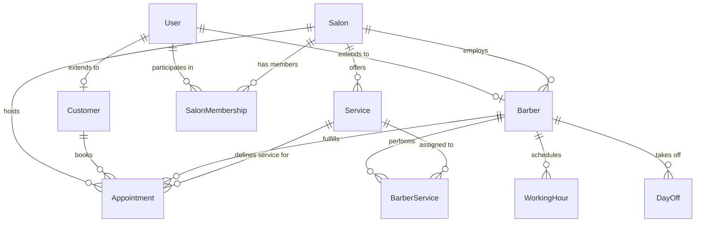

# ماژول Prisma (ارتباط با پایگاه‌داده)

## معرفی

ماژول Prisma وظیفه مدیریت ارتباط با پایگاه‌داده رابطه‌ای PostgreSQL و ارائه لایه نگاشت شیء-رابطه‌ای (ORM) تایپ‌سیف (Type-safe) در پروژه را بر عهده دارد.

در این پروژه از **Prisma ORM 7** به همراه آداپتور درایور مدرن **`@prisma/adapter-pg` (`PrismaPg`)** استفاده شده است. این شیوه معماری، کوئری‌های دیتابیس را به جای تکیه بر باینری‌های سنگین موتور سراسری، مستقیماً از طریق درایور بومی Node.js به پایگاه‌داده PostgreSQL هدایت می‌کند که منجر به بهبود چشمگیر سرعت، کاهش مصرف حافظه و سازگاری بالا با محیط‌های Cloud و Container می‌شود.

### مزایای کلیدی معماری Prisma در پروژه
* **تایپ‌سیف کامل (End-to-End Type Safety)**: کلیه مدل‌ها، فیلدها و روابط به صورت تایپ‌های TypeScript از فایل اسکیما در مسیر `src/generated/prisma` جنریت می‌شوند.
* **آداپتور درایور PostgreSQL (`PrismaPg`)**: بهره‌گیری از آداپتور رسمی `@prisma/adapter-pg` به همراه رشته اتصال استاندارد `DATABASE_URL`.
* **ماژول سراسری (Global Module)**: دسترسی بدون نیاز به ایمپورت مکرر در ماژول‌های مختلف سیستم.
* **مدیریت چرخه حیات (Lifecycle Hooks)**: اتصال خودکار به دیتابیس در زمان راه‌اندازی و آزادسازی ایمن اتصالات (Graceful Disconnect) در زمان خاموش شدن سرور.

---

## پیکربندی ماژول و سرویس

### ۱. ماژول سراسری ([`PrismaModule`](file:///c:/Users/amoha/Documents/barbershop-api/src/prisma/prisma.module.ts))

ماژول Prisma در مسیر [`src/prisma/prisma.module.ts`](file:///c:/Users/amoha/Documents/barbershop-api/src/prisma/prisma.module.ts) تعریف شده است:

```typescript
import { Global, Module } from '@nestjs/common';

import { PrismaService } from './prisma.service.js';

@Global()
@Module({
  providers: [PrismaService],
  exports: [PrismaService],
})
export class PrismaModule {}
```

دکوراتور `@Global()` باعث می‌شود که [`PrismaService`](file:///c:/Users/amoha/Documents/barbershop-api/src/prisma/prisma.service.ts) به عنوان یک پرووایدر در تمام ماژول‌های برنامه (نظیر `UsersModule`، `OtpModule`، `HealthModule`، `SalonsModule`، و ...) بدون نیاز به ثبت در آرایه `imports` هر ماژول قابل تزریق باشد.

---

### ۲. سرویس دیتابیس ([`PrismaService`](file:///c:/Users/amoha/Documents/barbershop-api/src/prisma/prisma.service.ts))

سرویس دیتابیس در مسیر [`src/prisma/prisma.service.ts`](file:///c:/Users/amoha/Documents/barbershop-api/src/prisma/prisma.service.ts) قرار دارد:

```typescript
import {
  Injectable,
  OnModuleDestroy,
  OnModuleInit,
} from '@nestjs/common';

import { PrismaPg } from '@prisma/adapter-pg';
import { PrismaClient } from '../generated/prisma/client.js';

@Injectable()
export class PrismaService
  extends PrismaClient
  implements OnModuleInit, OnModuleDestroy
{
  constructor() {
    const adapter = new PrismaPg({
      connectionString: process.env.DATABASE_URL,
    });

    super({ adapter });
  }

  async onModuleInit(): Promise<void> {
    await this.$connect();
  }

  async onModuleDestroy(): Promise<void> {
    await this.$disconnect();
  }
}
```

#### جزئیات عملکردی سرویس:
* **وراثت از [`PrismaClient`](file:///c:/Users/amoha/Documents/barbershop-api/src/generated/prisma/client.js)**: امکان دسترسی مستقیم به تمام مدل‌های دیتابیس نظیر `this.user`, `this.salon`, `this.appointment` و متدهای تراکنشی نظیر `this.$transaction` و `this.$queryRaw`.
* **پیکربندی آداپتور در سازنده (`constructor`)**: ساخت نمونه از `PrismaPg` با دریافت رشته اتصال از متغیر محیطی `DATABASE_URL` و ارسال آن به `super({ adapter })`.
* **هوک `onModuleInit`**: به محض بالا آمدن ماژول در آغاز اجرای برنامه، متد `await this.$connect()` اجرا شده و پایداری اتصال به PostgreSQL تضمین می‌گردد.
* **هوک `onModuleDestroy`**: در زمان خاموش شدن برنامه یا دریافت سیگنال‌های توقف سرور (مانند SIGINT / SIGTERM)، متد `await this.$disconnect()` اتصالات باز پاول دیتابیس را به طور ایمن قطع می‌کند.

---

## پیکربندی فایل اسکیما (`schema.prisma`)

تعریف تنظیمات کلاینت و دیتابیس در بالای فایل [`prisma/schema.prisma`](file:///c:/Users/amoha/Documents/barbershop-api/prisma/schema.prisma#L1-L8):

```prisma
generator client {
  provider = "prisma-client"
  output   = "../src/generated/prisma"
}

datasource db {
  provider = "postgresql"
}
```

* خروجی جنریتور تایپ‌ها در مسیر محلی `src/generated/prisma` ذخیره می‌شود تا در محیط‌های ساخت و تست سریعاً بارگذاری گردد.

---

## مدل‌ها و ساختار پایگاه‌داده (Database Models)

اسکیمای پروژه شامل **۱۲ مدل داده‌ای** و **۴ نوع انوم (Enum)** است که ساختار کامل سیستم نوبت‌دهی سالن‌های آرایشگاهی را پوشش می‌دهند:

### جدول خلاصه مدل‌ها

| نام مدل | جدول معادل در DB | شرح موجودیت | روابط اصلی |
| :--- | :--- | :--- | :--- |
| [`User`](file:///c:/Users/amoha/Documents/barbershop-api/prisma/schema.prisma#L41-L59) | `User` | هویت و اعتبارسنجی کلیه کاربران سامانه | `Customer`, `Barber`, `SalonMembership` |
| [`OtpCode`](file:///c:/Users/amoha/Documents/barbershop-api/prisma/schema.prisma#L61-L72) | `OtpCode` | کدهای یک‌بارمصرف صادرشده جهت ورود و ثبت‌نام | مستقل (ایندکس‌شده بر اساس شماره موبایل) |
| [`Salon`](file:///c:/Users/amoha/Documents/barbershop-api/prisma/schema.prisma#L74-L95) | `Salon` | مشخصات شعبه یا سالن آرایشی | `Barber`, `Service`, `WorkingHour`, `DayOff`, `Appointment`, `SalonMembership` |
| [`SalonMembership`](file:///c:/Users/amoha/Documents/barbershop-api/prisma/schema.prisma#L97-L113) | `SalonMembership` | وابستگی و نقش پرسنل/ادمین در سالن | `User`, `Salon` |
| [`Customer`](file:///c:/Users/amoha/Documents/barbershop-api/prisma/schema.prisma#L115-L125) | `Customer` | پروفایل تکمیلی مشتری سامانه | `User`, `Appointment` |
| [`Barber`](file:///c:/Users/amoha/Documents/barbershop-api/prisma/schema.prisma#L127-L147) | `Barber` | پروفایل تکمیلی آرایشگر شاغل در یک سالن | `User`, `Salon`, `BarberService`, `WorkingHour`, `DayOff`, `Appointment` |
| [`Service`](file:///c:/Users/amoha/Documents/barbershop-api/prisma/schema.prisma#L149-L169) | `Service` | خدمات ارائه‌شده در سالن (مدت زمان و هزینه) | `Salon`, `BarberService`, `Appointment` |
| [`BarberService`](file:///c:/Users/amoha/Documents/barbershop-api/prisma/schema.prisma#L171-L183) | `BarberService` | جدول واسط مهارت‌ها و خدمات اختصاصی هر آرایشگر | `Barber`, `Service` |
| [`WorkingHour`](file:///c:/Users/amoha/Documents/barbershop-api/prisma/schema.prisma#L184-L203) | `WorkingHour` | ساعات کاری منظم هفتگی آرایشگر | `Salon`, `Barber` |
| [`DayOff`](file:///c:/Users/amoha/Documents/barbershop-api/prisma/schema.prisma#L205-L221) | `DayOff` | روزهای تعطیل و مرخصی موردی آرایشگر | `Salon`, `Barber` |
| [`Appointment`](file:///c:/Users/amoha/Documents/barbershop-api/prisma/schema.prisma#L223-L253) | `Appointment` | نوبت‌های رزرو نهایی شده مشتریان | `Salon`, `Customer`, `Barber`, `Service` |
| [`OtpRateLimitEntry`](file:///c:/Users/amoha/Documents/barbershop-api/prisma/schema.prisma#L255-L261) | `OtpRateLimitEntry` | ثبت سوابق محدودیت درخواست OTP در سطح پایگاه‌داده | مستقل (کلیدهای ریت‌لیمیت) |

---

### نمودار رابطه موجودیت‌ها (ER Diagram)



---

### جزئیات مدل‌ها

#### ۱. مدل `User`
جدول اصلی کاربران سیستم.
* `id`: شناسه یکتا (UUID).
* `phone`: شماره همراه یکتا (`@unique`).
* `firstName`, `lastName`: مشخصات فردی اختیاری.
* `refreshTokenHash`: هش ذخیره‌شده رفرش‌توکن.
* `role`: نقش کاربر با انوم `UserRole` (پیش‌فرض: `CUSTOMER`).
* `status`: وضعیت با انوم `UserStatus` (پیش‌فرض: `ACTIVE`).
* ایندکس‌ها: ایندکس روی `role` و `status`.

#### ۲. مدل `OtpCode`
نگهداری کدهای یک‌بارمصرف.
* `id`: شناسه یکتا (UUID).
* `phone`: شماره دریافت‌کننده کد.
* `codeHash`: هش رمزعبور تولیدشده با `bcrypt`.
* `expiresAt`: زمان پایان اعتبار.
* `attempts`: شمارنده تلاش‌های ناموفق (حداکثر ۵).
* `usedAt`: تاریخ مصرف یا ابطال کد.
* ایندکس‌ها: ایندکس ترکیبی `[phone, createdAt]` و ایندکس انفرادی روی `[expiresAt]`.

#### ۳. مدل `Salon`
مشخصات سالن‌ها و شعبات.
* `id`: شناسه یکتا (UUID).
* `name`: نام تجاری سالن.
* `slug`: شناسه متنی منحصر‌به‌فرد URL (`@unique`).
* `phone`, `address`, `description`: مشخصات تماس و آدرس.
* `timezone`: منطقه زمانی (پیش‌فرض: `"Asia/Tehran"`).
* `isActive`: وضعیت فعالیت سالن (بولین).
* ایندکس‌ها: ایندکس روی `isActive`.

#### ۴. مدل `SalonMembership`
جدول ارتباطی اعضای مدیریتی یا اجرایی سالن.
* `userId`, `salonId`: کلیدهای خارجی با حذف آبشاری (`Cascade`).
* `isActive`: وضعیت فعال بودن عضویت.
* کلید یکتا: ترکیب `[userId, salonId]` منحصر‌به‌فرد است.

#### ۵. مدل `Customer`
پروفایل خریداران خدمت و مشتریان.
* `id`: شناسه یکتا.
* `userId`: کلید خارجی یکتا به جدول `User` (`@unique`).
* ارتباط با `Appointment[]`: تاریخچه نوبت‌های رزرو شده توسط مشتری.

#### ۶. مدل `Barber`
پروفایل آرایشگران شاغل در سالن‌ها.
* `id`: شناسه یکتا.
* `userId`: ارجاع یکتا به `User`.
* `salonId`: ارجاع به `Salon`.
* `isActive`: وضعیت فعالیت کاری آرایشگر.
* ایندکس‌ها: ایندکس روی `salonId` و ایندکس ترکیبی روی `[salonId, isActive]`.

#### ۷. مدل `Service`
خدمات ارائه‌شده در سالن.
* `id`: شناسه یکتا.
* `salonId`: کلید خارجی سالن.
* `name`: نام خدمت (مانند کوتاهی مو، اصلاح ریش، گریم و ...).
* `duration`: مدت زمان تخمینی خدمت به دقیقه (عدد صحیح).
* `price`: قیمت خدمت با دقت اعشاری (`Decimal(12, 2)`).
* `isActive`: امکان فعال/غیرفعال کردن خدمت.

#### ۸. مدل `BarberService`
تخصیص خدمات به آرایشگران (رابطه چندبه‌چند میان `Barber` و `Service`).
* `barberId`, `serviceId`: کلیدهای خارجی با حذف آبشاری.
* کلید اصلی ترکیبی: `@@id([barberId, serviceId])`.

#### ۹. مدل `WorkingHour`
جدول ساعات کاری هفتگی منظم هر آرایشگر در سالن.
* `barberId`, `salonId`: ارتباط با آرایشگر و سالن.
* `dayOfWeek`: روز هفته با انوم `DayOfWeek`.
* `startTime`, `endTime`: زمان آغاز و پایان شیفت کاری به صورت رشته زمان (مثلاً `"09:00"` و `"18:00"`).
* `isActive`: فعال بودن روز کاری.
* قید یکتایی: `@@unique([barberId, dayOfWeek])` (هر آرایشگر برای هر روز هفته حداکثر یک ردیف برنامه دارد).

#### ۱۰. مدل `DayOff`
ثبت مرخصی‌ها یا تعطیلات اختصاصی آرایشگر.
* `barberId`, `salonId`: ارجاع به آرایشگر و سالن.
* `date`: تاریخ دقیق روز تعطیل.
* `reason`: دلیل مرخصی (اختیاری).
* قید یکتایی: `@@unique([barberId, date])`.

#### ۱۱. مدل `Appointment`
هسته اصلی رزرو نوبت‌ها در سیستم.
* `id`: شناسه یکتا (UUID).
* `salonId`, `customerId`, `barberId`, `serviceId`: کلیدهای خارجی به سالن، مشتری، آرایشگر و نوع خدمت با رفتار حفاظتی `onDelete: Restrict` جهت جلوگیری از حذف سوابق رزرو مالی و اجرایی.
* `startAt`, `endAt`: زمان دقیق شروع و پایان نوبت.
* `price`: قیمت نهایی رزرو (`Decimal(12, 2)`).
* `duration`: مدت زمان نوبت (دقیقه).
* `status`: وضعیت نوبت با انوم `AppointmentStatus` (پیش‌فرض: `PENDING`).
* `note`: یادداشت یا توضیحات رزرو.
* ایندکس‌ها: ایندکس‌های بهینه‌سازی تقویم نوبت‌ها بر روی `[salonId, startAt]`، `[barberId, startAt]`، `[barberId, startAt, endAt]`، `[customerId, startAt]` و `[status]`.

#### ۱۲. مدل `OtpRateLimitEntry`
مدل ذخیره‌سازی داده‌های سقف درخواست OTP.
* `key`: کلید شناسایی یکتا (کلید اصلی).
* `count`: شمارنده تعداد درخواست‌های ثبت شده.
* `resetAt`: زمان انقضا و ریست شمارنده.

---

## انواع انوم‌ها (Enums)

چهار انوم اصلی در اسکیمای دیتابیس تعریف شده است:

### ۱. نقش‌های کاربری ([`UserRole`](file:///c:/Users/amoha\Documents/barbershop-api/prisma/schema.prisma#L10-L15))
```prisma
enum UserRole {
  SUPER_ADMIN // دسترسی کلان مدیریتی
  ADMIN       // مدیر سالن
  BARBER      // پرسنل آرایشگر
  CUSTOMER    // مشتری سامانه
}
```

### ۲. وضعیت حساب کاربری ([`UserStatus`](file:///c:/Users/amoha/Documents/barbershop-api/prisma/schema.prisma#L17-L21))
```prisma
enum UserStatus {
  ACTIVE   // حساب فعال و عادی
  INACTIVE // حساب غیرفعال
  BLOCKED  // حساب مسدودشده
}
```

### ۳. وضعیت نوبت ([`AppointmentStatus`](file:///c:/Users/amoha/Documents/barbershop-api/prisma/schema.prisma#L23-L29))
```prisma
enum AppointmentStatus {
  PENDING   // در انتظار تایید یا پرداخت
  CONFIRMED // نوبت تایید شده و قطعی
  COMPLETED // نوبت با موفقیت انجام شد
  CANCELLED // نوبت لغو شده
  NO_SHOW   // عدم حضور مشتری در سالن
}
```

### ۴. روزهای هفته ([`DayOfWeek`](file:///c:/Users/amoha/Documents/barbershop-api/prisma/schema.prisma#L31-L39))
منطبق با تقویم استاندارد کاری ایران:
```prisma
enum DayOfWeek {
  SATURDAY  // شنبه
  SUNDAY    // یکشنبه
  MONDAY    // دوشنبه
  TUESDAY   // سه‌شنبه
  WEDNESDAY // چهارشنبه
  THURSDAY  // پنج‌شنبه
  FRIDAY    // جمعه
}
```

---

## الگوهای کاربرد در سرویس‌های سیستم

### ۱. تراکنش‌های اتمیک (`$transaction`)
در عملیات حساس نظیر صدور OTP و جلوگیری از Concurrency:
```typescript
await this.prisma.$transaction(async (tx) => {
  await tx.$queryRaw`SELECT 1 WHERE pg_advisory_xact_lock(hashtextextended(${phone}, 0)) IS NULL`;
  await tx.otpCode.updateMany({
    where: { phone, usedAt: null },
    data: { usedAt: new Date() },
  });
  await tx.otpCode.create({
    data: { phone, codeHash, expiresAt },
  });
});
```

### ۲. کوئری‌های خام (`$queryRaw`)
جهت بررسی سلامت ارتباط با دیتابیس در [`HealthService`](file:///c:/Users/amoha/Documents/barbershop-api/src/health/health.service.ts):
```typescript
await this.prisma.$queryRaw`SELECT 1`;
```
