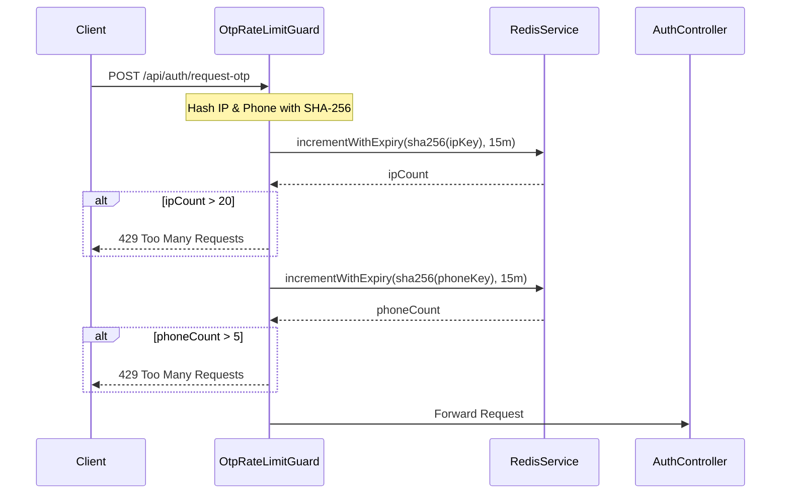

# ماژول Redis (مدیریت کش و نرخ درخواست)

## معرفی

ماژول Redis وظیفه مدیریت اتصالات و ارتباط با سرور کلید-مقدار (In-Memory Data Store) ردیس را با بهره‌گیری از کتابخانه پیشرفته **`ioredis`** بر عهده دارد.

این ماژول به صورت سراسری (`@Global()`) پیاده‌سازی شده است و زیرساختی حیاتی برای عملیات با سرعت و کارایی بالا فراهم می‌آورد. کاربردهای اصلی این ماژول در سامانه عبارتند از:
* **محدودسازی نرخ درخواست‌ها (Rate Limiting)** با دقت میلی‌ثانیه‌ای و اسکریپت‌های اتمیک Lua.
* **حفاظت در برابر حملات Brute Force و Flooding** در جریان‌های احراز هویت و ارسال پیامک OTP.
* **مدیریت کشینگ داده‌ها (Data Caching)** با قابلیت سریال‌سازی خودکار و اعتبارسنجی زمان انقضا.
* **آزادسازی منابع و اتصالات** هنگام توقف برنامه (Graceful Shutdown).

---

## ساختار ماژول

ماژول در مسیر [`src/redis/redis.module.ts`](file:///c:/Users/amoha/Documents/barbershop-api/src/redis/redis.module.ts) تعریف شده است:

```typescript
import { Global, Module } from '@nestjs/common';
import { RedisService } from './redis.service.js';

@Global()
@Module({
  providers: [RedisService],
  exports: [RedisService],
})
export class RedisModule {}
```

با توجه به دکوراتور `@Global()`، سرویس [`RedisService`](file:///c:/Users/amoha/Documents/barbershop-api/src/redis/redis.service.ts) در کلیه ماژول‌های پروژه از جمله ماژول احراز هویت بدون نیاز به ایمپورت اختصاصی در دسترس است.

---

## پیکربندی سرویس ([`RedisService`](file:///c:/Users/amoha/Documents/barbershop-api/src/redis/redis.service.ts))

سرویس در مسیر [`src/redis/redis.service.ts`](file:///c:/Users/amoha/Documents/barbershop-api/src/redis/redis.service.ts) قرار دارد:

```typescript
@Injectable()
export class RedisService implements OnModuleDestroy {
  private readonly logger = new Logger(RedisService.name);
  private readonly client: Redis;

  constructor() {
    this.client = new Redis(process.env.REDIS_URL ?? 'redis://127.0.0.1:6379/0', {
      lazyConnect: true,
      enableReadyCheck: true,
      maxRetriesPerRequest: 1,
      retryStrategy: (attempt) => Math.min(attempt * 250, 3000),
    });

    this.client.on('error', (error: Error) => {
      this.logger.error(`Redis connection error: ${error.message}`);
    });
  }
  ...
}
```

### تنظیمات اتصال (Connection Config):

* **متغیر محیطی `REDIS_URL`**: آدرس سرور ردیس از متغیر محیطی خوانده می‌شود؛ در صورت عدم تنظیم، مقدار پیش‌فرض `redis://127.0.0.1:6379/0` استفاده می‌گردد.
* **`lazyConnect: true`**: اتصال به سرور ردیس تا قبل از صدور اولین دستور به تعویق می‌افتد (Lazy Connection). این ویژگی تضمین می‌کند که راه‌اندازی و بالا آمدن سرور NestJS به در دسترس بودن ردیس وابسته نبوده و در محیط‌های CI/CD یا زمان استارت اولیه دچار وقفه نشود.
* **`enableReadyCheck: true`**: اطمینان از آماده بودن نهایی سرور ردیس قبل از ارسال دستورات.
* **`maxRetriesPerRequest: 1`**: محدود کردن دفعات تلاش برای هر دستور ناموفق به ۱ بار، تا صف درخواست‌های مسدودشده تشکیل نشود.
* **استراتژی تلاش مجدد (`retryStrategy`)**: زمان تاخیر بین تلاش‌ها با ضریب افزایشی محاسبه می‌شود (`Math.min(attempt * 250, 3000)`، حداکثر ۳ ثانیه).
* **شنود خطاهای اتصال (`client.on('error')`)**: خطاهای قطع اتصال توسط لاگر استاندارد NestJS ثبت می‌شوند تا جریان عملکرد اپلیکیشن کرش نکند.

### آزادسازی اتصالات (`OnModuleDestroy`)

برای جلوگیری از باز ماندن سوکت‌ها در زمان توقف برنامه:
```typescript
async onModuleDestroy(): Promise<void> {
  if (this.client.status === 'end') return;
  if (this.client.status === 'wait') {
    this.client.disconnect();
    return;
  }
  await this.client.quit().catch(() => this.client.disconnect());
}
```
در زمان دریافت سیگنال خروج سرور، ابتدا درخواست بستن مرتب (`quit`) ارسال می‌شود و در صورت بروز خطا، اتصال فوراً قطع (`disconnect`) می‌گردد.

---

## متدهای سرویس [`RedisService`](file:///c:/Users/amoha/Documents/barbershop-api/src/redis/redis.service.ts)

### ۱. متد `incrementWithExpiry` (افزایش اتمیک با انقضا)

این متد هسته اصلی قابلیت Rate Limiting در پروژه است:

```typescript
const incrementScript = `
local count = redis.call('INCR', KEYS[1])
if count == 1 then
  redis.call('PEXPIRE', KEYS[1], ARGV[1])
end
return count
`;

async incrementWithExpiry(key: string, ttlMs: number): Promise<number> {
  const result = await this.client.eval(incrementScript, 1, key, String(ttlMs));
  return Number(result);
}
```

#### چرا از اسکریپت Lua استفاده شده است؟
در شیوه سنتی، اجرای دو دستور مجزای `INCR` و سپس `EXPIRE` می‌تواند به دلیل خطای شبکه یا کرش سرور در لحظه میانی منجر به ایجاد کلیدهایی بدون زمان انقضا (Zombie Keys) در ردیس شود که هیچ‌گاه پاک نمی‌شوند. اجرای اسکریپت Lua در ردیس **اتمیک (Atomic)** است و تضمین می‌کند که اگر کلید برای بار اول ایجاد شد (`count == 1`)، حتماً دستور `PEXPIRE` با دقت میلی‌ثانیه بر روی آن اعمال شود.

---

### ۲. متدهای عمومی کشینگ (Cache Management)

برای ذخیره و بازیابی اطلاعات پرکاربرد در حافظه نهان:

#### الف) `getCache<T>(key: string): Promise<T | null>`
* کلید ورودی را با پیشوند `cache:${key}` جستجو می‌کند.
* در صورت وجود مقدار، آن را با `JSON.parse` به تایپ دلخواه `T` تبدیل می‌کند.
* در صورتی که داده داخل کش آسیب‌دیده یا نامعتبر باشد، کلید را پاک کرده و `null` برمی‌گرداند (Self-healing cache).

#### ب) `setCache(key: string, value: unknown, ttlSeconds: number): Promise<void>`
* مقدار ورودی را به رشته JSON تبدیل و با پیشوند `cache:${key}` ذخیره می‌کند.
* زمان انقضا (`ttlSeconds`) را بر حسب ثانیه با دستور `EX` ست می‌کند.
* مدت زمان انقضا اعتبارسنجی شده و باید عدد مثبت باشد.

#### ج) `deleteCache(key: string): Promise<void>`
* کلید مورد نظر را از ردیس حذف می‌نماید.

---

## موارد استفاده در پروژه

### ۱. کنترل نرخ درخواست کدهای یک‌بارمصرف ([`OtpRateLimitGuard`](file:///c:/Users/amoha/Documents/barbershop-api/src/auth/guards/otp-rate-limit.guard.ts))

گارد [`OtpRateLimitGuard`](file:///c:/Users/amoha/Documents/barbershop-api/src/auth/guards/otp-rate-limit.guard.ts) روی اندپوینت‌های حساس احراز هویت اعمال شده است:
* `POST /api/auth/request-otp`
* `POST /api/auth/verify-otp`



#### سازوکار عملکرد گارد:
1. **پنجره زمانی**: ۱۵ دقیقه (`windowMs = 15 * 60 * 1000`).
2. **سقف درخواست بر اساس شماره تلفن**: حداکثر ۵ درخواست (`maxPerPhone = 5`).
3. **سقف درخواست بر اساس IP**: حداکثر ۲۰ درخواست (`maxPerIp = 20`).
4. **تولید کلید با هش SHA-256**:
   ```typescript
   private key(value: string): string {
     return createHash('sha256').update(value).digest('hex');
   }
   ```
   فرمت کلیدها به صورت `otp:rate:${route}:ip:${ip}` و `otp:rate:${route}:phone:${phone}` است که هش آن به عنوان کلید ردیس ثبت می‌شود. این کار مانع از افشای شماره تلفن یا IP در مانیتورینگ ردیس می‌گردد.
5. **رفتار Fail-Closed برای امنیت بیشتر**:
   در صورت قطعی ردیس یا بروز خطای غیرمنتظره، دسترسی به سرویس OTP با کد وضعیت `503 Service Unavailable` موقتاً مسدود می‌شود تا سامانه در برابر حملات انبوه بی‌دفاع نماند.

---

### ۲. تفکیک نقش Redis و PostgreSQL در مدیریت قفل‌ها و همزمانی

در این معماری تفکیک دقیقی میان سطوح کنترل همزمانی انجام شده است:

| بعد مقایسه | ردیس ([`RedisService`](file:///c:/Users/amoha/Documents/barbershop-api/src/redis/redis.service.ts)) | پستگرس ([`PrismaService`](file:///c:/Users/amoha/Documents/barbershop-api/src/prisma/prisma.service.ts)) |
| :--- | :--- | :--- |
| **وظیفه اصلی** | کنترل نرخ درخواست (Rate Limiting) و ممانعت از اسپم | قفل تراکنشی دیتابیس (Advisory Lock) |
| **مکانیسم** | اسکریپت اتمیک Lua با دستورات `INCR` و `PEXPIRE` | دستور `pg_advisory_xact_lock(hashtextextended(${phone}, 0))` |
| **عمر قفل** | دارای زمان انقضای زمانی مشخص (مثلاً ۱۵ دقیقه) | وابسته به چرخه حیات تراکنش (آزادسازی آنی پس از Commit یا Rollback) |
| **هدف** | کاهش بار شبکه و مهار ترافیک غیرمجاز پیش از ورود به دیتابیس | جلوگیری از درج رکوردهای تکراری همزمان برای یک شماره تلفن در دیتابیس |

این تفکیک تضمین می‌کند که پردازش‌های سبک و مکرر بررسی سقف درخواست در حافظه ردیس انجام شده و فشاری به دیتابیس وارد نمی‌کنند؛ در حالی که قفل‌های یکپارچگی داده مستقیماً توسط دیتابیس مدیریت می‌شوند.
