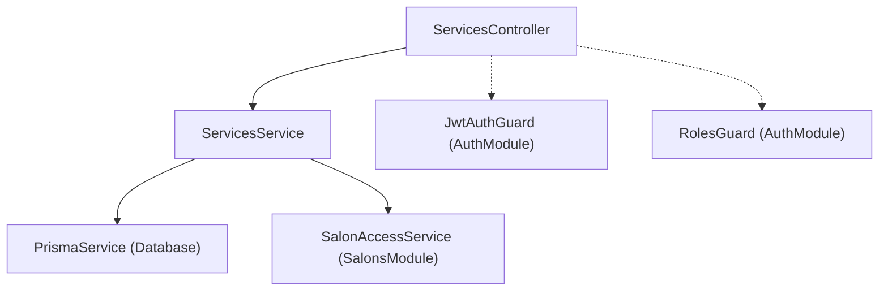

# ماژول خدمات (Services Module)

## فهرست مطالب
- [معرفی](#معرفی)
- [معماری و وابستگی‌ها](#وابستگیها)
- [مدل داده (Data Model)](#مدل-داده-data-model)
- [گاردها و کنترل دسترسی](#گاردها-و-کنترل-دسترسی)
- [اندپوینت‌ها (Endpoints)](#اندپوینتها)
  - [دریافت لیست خدمات (GET /services)](#1-دریافت-لیست-خدمات)
  - [دریافت جزئیات یک خدمت (GET /services/:id)](#2-دریافت-جزئیات-یک-خدمت)
  - [ایجاد خدمت جدید (POST /services)](#3-ایجاد-خدمت-جدید)
  - [ویرایش مشخصات خدمت (PATCH /services/:id)](#4-ویرایش-مشخصات-خدمت)
  - [حذف نرم یا غیرفعال‌سازی خدمت (DELETE /services/:id)](#5-حذف-نرم-خدمت)
- [دی‌تی‌اوها (DTOs)](#dtos)
  - [CreateServiceDto](#createservicedto)
  - [UpdateServiceDto](#updateservicedto)
- [سرویس (ServicesService)](#سرویس)
  - [متد create](#متد-create)
  - [متد findAll](#متد-findall)
  - [متد findById](#متد-findbyid)
  - [متد update](#متد-update)
  - [متد remove](#متد-remove)

---

## معرفی

ماژول [`ServicesModule`](file:///c:/Users/amoha/Documents/barbershop-api/src/services/services.module.ts) مسئولیت مدیریت خدمات ارائه‌شده در سالن‌های آرایشگاه (مانند انواع اصلاح مو، اصلاح صورت، رنگ، پاکسازی پوست، خدمات ویژه و پکیج‌های داماد) را بر عهده دارد.

ویژگی‌های کلیدی این ماژول عبارتند از:
- **مدیریت کامل چرخه حیات خدمت (CRUD):** ایجاد، مشاهده، ویرایش و غیرفعال‌سازی خدمات هر سالن.
- **چندمستأجری و تفکیک دسترسی سالن‌ها (Multi-tenant Isolation):** هر خدمت به یک سالن مشخص تعلق دارد و مدیران سالن‌ها (`ADMIN`) تنها به خدمات سالن‌های تحت مدیریت خود دسترسی دارند، در حالی که مدیران ارشد سیستم (`SUPER_ADMIN`) به تمام سالن‌ها دسترسی نامحدود دارند.
- **اعتبارسنجی وضعیت سالن:** عدم امکان ثبت خدمت جدید برای سالن‌های غیرفعال (`isActive: false`).
- **حذف نرم (Soft Delete):** متد حذف فیزیکی انجام نمی‌دهد؛ بلکه خدمت را از طریق پرچم `isActive: false` غیرفعال می‌کند تا تاریخچه نوبت‌های رزرو‌شده در مدل `Appointment` آسیب نبیند.
- **همبستگی با آرایشگران و نوبت‌دهی:** امکان بارگذاری آرایشگران ارائه‌دهنده خدمت از طریق جدول واسط `BarberService`.

---

## وابستگی‌ها

ماژول [`ServicesModule`](file:///c:/Users/amoha/Documents/barbershop-api/src/services/services.module.ts) با سایر بخش‌های سیستم دارای روابط و وابستگی‌های زیر است:

### وابستگی‌های ماژول (`ServicesModule`)
- **[`AuthModule`](file:///c:/Users/amoha/Documents/barbershop-api/src/auth/auth.module.ts):** جهت فراهم‌سازی زیرساخت احراز هویت توکن‌های JWT و محافظت از مسیرها از طریق گاردها (`JwtAuthGuard` و `RolesGuard`).
- **[`SalonsModule`](file:///c:/Users/amoha/Documents/barbershop-api/src/salons/salons.module.ts):** جهت دسترسی به [`SalonAccessService`](file:///c:/Users/amoha/Documents/barbershop-api/src/salons/salon-access.service.ts) به منظور بررسی سطوح دسترسی کاربران به سالن‌های مربوطه.

### ارائه‌دهندگان و صادرشده‌ها (Providers & Exports)
- **کنترلر:** [`ServicesController`](file:///c:/Users/amoha/Documents/barbershop-api/src/services/services.controller.ts)
- **سرویس:** [`ServicesService`](file:///c:/Users/amoha/Documents/barbershop-api/src/services/services.service.ts) (این سرویس همچنین به صورت `exports` در دسترس سایر ماژول‌ها قرار گرفته است تا در صورت نیاز بتوانند از متدهای آن استفاده کنند).

### دیاگرام جریان وابستگی‌ها



---

## مدل داده (Data Model)

ساختار داده خدمات در فایل Prisma Schema تعریف شده است:

```prisma
model Service {
  id          String   @id @default(uuid())
  salonId     String

  salon       Salon    @relation(fields: [salonId], references: [id], onDelete: Cascade)

  name        String
  description String?
  duration    Int
  price       Decimal  @db.Decimal(12, 2)
  isActive    Boolean  @default(true)

  barbers      BarberService[]
  appointments Appointment[]

  createdAt DateTime @default(now())
  updatedAt DateTime @updatedAt

  @@index([salonId])
  @@index([salonId, isActive])
}
```

### شرح فیلدهای مدل `Service`:
| فیلد | نوع داده | وضعیت | پیش‌فرض | توضیحات |
| :--- | :--- | :--- | :--- | :--- |
| `id` | `String` (UUID) | اجباری | `uuid()` | شناسه یکتای خدمت |
| `salonId` | `String` | اجباری | - | شناسه سالنی که این خدمت به آن تعلق دارد |
| `name` | `String` | اجباری | - | نام یا عنوان خدمت (مثلاً "کوتاهی و فرم‌دهی مو") |
| `description` | `String?` | اختیاری | `null` | توضیحات تکمیلی یا جزئیات اجرایی خدمت |
| `duration` | `Int` | اجباری | - | مدت زمان لازم برای انجام خدمت بر حسب دقیقه |
| `price` | `Decimal(12, 2)` | اجباری | - | قیمت خدمت با دقت اعشاری |
| `isActive` | `Boolean` | اجباری | `true` | وضعیت فعال بودن خدمت برای نوبت‌دهی |
| `createdAt` | `DateTime` | خودکار | `now()` | تاریخ و زمان ثبت رکورد |
| `updatedAt` | `DateTime` | خودکار | - | تاریخ و زمان آخرین به‌روزرسانی رکورد |

---

## گاردها و کنترل دسترسی

تمامی اندپوینت‌های [`ServicesController`](file:///c:/Users/amoha/Documents/barbershop-api/src/services/services.controller.ts) در سطح کلاس تحت حفاظت گاردهای زیر هستند:

```typescript
@Controller('services')
@UseGuards(JwtAuthGuard, RolesGuard)
export class ServicesController { ... }
```

1. **[`JwtAuthGuard`](file:///c:/Users/amoha/Documents/barbershop-api/src/auth/guards/jwt-auth.guard.ts):** بررسی می‌کند که کلاینت یک توکن معتبر در هدر Authorization به‌صورت `Bearer <token>` ارسال کرده باشد.
2. **[`RolesGuard`](file:///c:/Users/amoha/Documents/barbershop-api/src/auth/guards/roles.guard.ts):** اعتبارسنجی می‌کند که نقش کاربر موجود در پی‌لود توکن با نقش‌های مجاز تعریف‌شده توسط دکوراتور `@Roles(...)` همخوانی داشته باشد. تمامی مسیرهای ماژول خدمات به نقش‌های `ADMIN` و `SUPER_ADMIN` محدود شده‌اند:
   ```typescript
   @Roles(UserRole.ADMIN, UserRole.SUPER_ADMIN)
   ```
3. **بررسی عضویت سالن ([`SalonAccessService`](file:///c:/Users/amoha/Documents/barbershop-api/src/salons/salon-access.service.ts)):** علاوه بر گارد نقشی، در لایه سرویس بررسی می‌شود که اگر نقش کاربر `ADMIN` باشد، آیا در سالن مدنظر عضویت فعال (`SalonMembership.isActive = true`) دارد یا خیر. در غیر این صورت استثنای `ForbiddenException` ایجاد می‌شود. (کاربران `SUPER_ADMIN` به همه سالن‌ها دسترسی دارند).

---

## اندپوینت‌ها

جدول خلاصه اندپوینت‌های کنترلر خدمات:

| متد | مسیر (Route) | احراز هویت و دسترسی | پارامترها / بدنه | خروجی موفق | شرح عملیات |
| :--- | :--- | :--- | :--- | :--- | :--- |
| `GET` | `/services` | JWT / `ADMIN`, `SUPER_ADMIN` | `Query: salonId` (رشته، اختیاری برای SUPER_ADMIN) | `200 OK` (آرایه‌ای از Service) | دریافت لیست خدمات سالن |
| `GET` | `/services/:id` | JWT / `ADMIN`, `SUPER_ADMIN` | `Param: id` (شناسه خدمت) | `200 OK` (شیء Service به همراه آرایشگران) | دریافت جزئیات یک خدمت |
| `POST` | `/services` | JWT / `ADMIN`, `SUPER_ADMIN` | `Body: CreateServiceDto` | `201 Created` (شیء Service ایجادشده) | ایجاد یک خدمت جدید در سالن |
| `PATCH` | `/services/:id` | JWT / `ADMIN`, `SUPER_ADMIN` | `Param: id`<br>`Body: UpdateServiceDto` | `200 OK` (شیء Service به‌روزشده) | ویرایش اطلاعات یک خدمت |
| `DELETE` | `/services/:id` | JWT / `ADMIN`, `SUPER_ADMIN` | `Param: id` | `200 OK` (شیء Service با `isActive: false`) | حذف نرم (غیرفعال‌سازی) خدمت |

---

### ۱. دریافت لیست خدمات

دریافت تمامی خدمات مربوط به یک سالن (یا در صورت سوپرادمین بودن و عدم ارسال `salonId`، دریافت تمامی خدمات کل سیستم).

- **متد:** `GET`
- **مسیر:** `/services`
- **نقش‌های مجاز:** `ADMIN`, `SUPER_ADMIN`
- **پارامترهای Query:**
  - `salonId` (`string`, اختیاری برای `SUPER_ADMIN`، **اجباری** برای `ADMIN`): شناسه سالن موردنظر.

> [!IMPORTANT]
> برای کاربران با نقش `ADMIN` ارسال پارامتر `salonId` الزامی است. در صورت ارسال نشدن، خطای `400 Bad Request` برگردانده می‌شود.

#### نمونه درخواست:
```http
GET /services?salonId=9b1deb4d-3b7d-4bad-9bdd-2b0d7b3dcb6d HTTP/1.1
Host: api.barbershop.local
Authorization: Bearer <jwt-token>
```

#### نمونه پاسخ موفق (200 OK):
```json
[
  {
    "id": "e6a12b6f-2178-4ec2-901b-c6cbca38d9f1",
    "salonId": "9b1deb4d-3b7d-4bad-9bdd-2b0d7b3dcb6d",
    "name": "اصلاح سر کلاسیک",
    "description": "شامل شستشو و کوتاهی ژورنالی مو",
    "duration": 45,
    "price": "250000.00",
    "isActive": true,
    "createdAt": "2026-10-12T10:00:00.000Z",
    "updatedAt": "2026-10-12T10:00:00.000Z",
    "salon": {
      "id": "9b1deb4d-3b7d-4bad-9bdd-2b0d7b3dcb6d",
      "name": "آرایشگاه رویال",
      "slug": "royal-barber",
      "phone": "02188888888",
      "address": "تهران، خیابان ولیعصر",
      "description": "سالن زیبایی و آرایش آقایان",
      "timezone": "Asia/Tehran",
      "isActive": true,
      "createdAt": "2026-10-01T08:00:00.000Z",
      "updatedAt": "2026-10-01T08:00:00.000Z"
    }
  }
]
```

#### خطاهای محتمل:
- `400 Bad Request`: در صورت عدم ارسال `salonId` توسط کاربر غیرِ `SUPER_ADMIN`.
- `401 Unauthorized`: در صورت عدم احراز هویت یا نامعتبر بودن توکن.
- `403 Forbidden`: در صورتی که کاربر به سالن ارسال‌شده دسترسی نداشته باشد.

---

### ۲. دریافت جزئیات یک خدمت

دریافت مشخصات کامل یک خدمت به همراه اطلاعات سالن و فهرست آرایشگرانی که این خدمت را ارائه می‌دهند.

- **متد:** `GET`
- **مسیر:** `/services/:id`
- **نقش‌های مجاز:** `ADMIN`, `SUPER_ADMIN`
- **پارامترهای URL:**
  - `id` (`string`): شناسه UUID خدمت.

#### نمونه درخواست:
```http
GET /services/e6a12b6f-2178-4ec2-901b-c6cbca38d9f1 HTTP/1.1
Host: api.barbershop.local
Authorization: Bearer <jwt-token>
```

#### نمونه پاسخ موفق (200 OK):
```json
{
  "id": "e6a12b6f-2178-4ec2-901b-c6cbca38d9f1",
  "salonId": "9b1deb4d-3b7d-4bad-9bdd-2b0d7b3dcb6d",
  "name": "اصلاح سر کلاسیک",
  "description": "شامل شستشو و کوتاهی ژورنالی مو",
  "duration": 45,
  "price": "250000.00",
  "isActive": true,
  "createdAt": "2026-10-12T10:00:00.000Z",
  "updatedAt": "2026-10-12T10:00:00.000Z",
  "salon": {
    "id": "9b1deb4d-3b7d-4bad-9bdd-2b0d7b3dcb6d",
    "name": "آرایشگاه رویال",
    "slug": "royal-barber",
    "phone": "02188888888",
    "address": "تهران، خیابان ولیعصر",
    "isActive": true
  },
  "barbers": [
    {
      "barberId": "8c3f4e21-5a12-4c22-92df-8a3bc9940123",
      "serviceId": "e6a12b6f-2178-4ec2-901b-c6cbca38d9f1",
      "createdAt": "2026-10-12T11:00:00.000Z",
      "barber": {
        "id": "8c3f4e21-5a12-4c22-92df-8a3bc9940123",
        "userId": "1a2b3c4d-5e6f-7a8b-9c0d-1e2f3a4b5c6d",
        "salonId": "9b1deb4d-3b7d-4bad-9bdd-2b0d7b3dcb6d",
        "isActive": true,
        "user": {
          "id": "1a2b3c4d-5e6f-7a8b-9c0d-1e2f3a4b5c6d",
          "firstName": "علی",
          "lastName": "محمدی",
          "phone": "+989121234567"
        }
      }
    }
  ]
}
```

#### خطاهای محتمل:
- `404 Not Found`: خدمت با شناسه درخواستی یافت نشود (`Service not found`).
- `403 Forbidden`: کاربر به سالن این خدمت دسترسی نداشته باشد.

---

### ۳. ایجاد خدمت جدید

ثبت یک خدمت جدید برای یک سالن فعال.

- **متد:** `POST`
- **مسیر:** `/services`
- **نقش‌های مجاز:** `ADMIN`, `SUPER_ADMIN`
- **بدنه درخواست:** شیء JSON مطابق با `CreateServiceDto`.

#### نمونه درخواست:
```http
POST /services HTTP/1.1
Host: api.barbershop.local
Authorization: Bearer <jwt-token>
Content-Type: application/json

{
  "salonId": "9b1deb4d-3b7d-4bad-9bdd-2b0d7b3dcb6d",
  "name": "پکیج پاکسازی صورت و ماساژ",
  "description": "بخور گرم، لایه‌برداری، ماسک اسکراب و ماساژ ریلکسی",
  "duration": 60,
  "price": 450000
}
```

#### نمونه پاسخ موفق (201 Created):
```json
{
  "id": "78a9c021-ef12-4d33-bc88-99e2a441e888",
  "salonId": "9b1deb4d-3b7d-4bad-9bdd-2b0d7b3dcb6d",
  "name": "پکیج پاکسازی صورت و ماساژ",
  "description": "بخور گرم، لایه‌برداری، ماسک اسکراب و ماساژ ریلکسی",
  "duration": 60,
  "price": "450000.00",
  "isActive": true,
  "createdAt": "2026-10-12T12:00:00.000Z",
  "updatedAt": "2026-10-12T12:00:00.000Z",
  "salon": {
    "id": "9b1deb4d-3b7d-4bad-9bdd-2b0d7b3dcb6d",
    "name": "آرایشگاه رویال",
    "slug": "royal-barber",
    "isActive": true
  }
}
```

#### خطاهای محتمل:
- `400 Bad Request`: مقادیر ورودی فیلدها با قوانین اعتبارسنجی همخوانی نداشته باشند.
- `403 Forbidden`: کاربر به سالن مشخص‌شده دسترسی نداشته باشد.
- `404 Not Found`: سالن با شناسه `salonId` وجود نداشته باشد (`Salon not found`).
- `409 Conflict`: سالن غیرفعال باشد (`Cannot create service for inactive salon`).

---

### ۴. ویرایش مشخصات خدمت

ویرایش نام، توضیحات، مدت زمان، قیمت و یا وضعیت فعال بودن یک خدمت موجود.

- **متد:** `PATCH`
- **مسیر:** `/services/:id`
- **نقش‌های مجاز:** `ADMIN`, `SUPER_ADMIN`
- **پارامترهای URL:**
  - `id` (`string`): شناسه خدمت.
- **بدنه درخواست:** شیء JSON مطابق با `UpdateServiceDto` (تمامی فیلدها اختیاری هستند).

#### نمونه درخواست:
```http
PATCH /services/78a9c021-ef12-4d33-bc88-99e2a441e888 HTTP/1.1
Host: api.barbershop.local
Authorization: Bearer <jwt-token>
Content-Type: application/json

{
  "price": 500000,
  "duration": 70
}
```

#### نمونه پاسخ موفق (200 OK):
```json
{
  "id": "78a9c021-ef12-4d33-bc88-99e2a441e888",
  "salonId": "9b1deb4d-3b7d-4bad-9bdd-2b0d7b3dcb6d",
  "name": "پکیج پاکسازی صورت و ماساژ",
  "description": "بخور گرم، لایه‌برداری، ماسک اسکراب و ماساژ ریلکسی",
  "duration": 70,
  "price": "500000.00",
  "isActive": true,
  "createdAt": "2026-10-12T12:00:00.000Z",
  "updatedAt": "2026-10-12T12:30:00.000Z",
  "salon": {
    "id": "9b1deb4d-3b7d-4bad-9bdd-2b0d7b3dcb6d",
    "name": "آرایشگاه رویال"
  }
}
```

#### خطاهای محتمل:
- `404 Not Found`: در صورت نیافتن خدمت (`Service not found`).
- `403 Forbidden`: در صورت عدم دسترسی کاربر به سالن مربوطه.

---

### ۵. حذف نرم خدمت

غیرفعال‌سازی خدمت از طریق تنظیم فیلد `isActive` بر روی `false`.

- **متد:** `DELETE`
- **مسیر:** `/services/:id`
- **نقش‌های مجاز:** `ADMIN`, `SUPER_ADMIN`
- **پارامترهای URL:**
  - `id` (`string`): شناسه خدمت.

#### نمونه درخواست:
```http
DELETE /services/78a9c021-ef12-4d33-bc88-99e2a441e888 HTTP/1.1
Host: api.barbershop.local
Authorization: Bearer <jwt-token>
```

#### نمونه پاسخ موفق (200 OK):
```json
{
  "id": "78a9c021-ef12-4d33-bc88-99e2a441e888",
  "salonId": "9b1deb4d-3b7d-4bad-9bdd-2b0d7b3dcb6d",
  "name": "پکیج پاکسازی صورت و ماساژ",
  "description": "بخور گرم، لایه‌برداری، ماسک اسکراب و ماساژ ریلکسی",
  "duration": 70,
  "price": "500000.00",
  "isActive": false,
  "createdAt": "2026-10-12T12:00:00.000Z",
  "updatedAt": "2026-10-12T13:00:00.000Z"
}
```

#### خطاهای محتمل:
- `404 Not Found`: در صورت نبود خدمت در پایگاه داده.
- `403 Forbidden`: در صورت عدم دسترسی کاربر به سالن این خدمت.

---

## DTOs

کلاس‌های انتقال داده (Data Transfer Objects) با استفاده از کتابخانه `class-validator` ورودی‌های کلاینت را اعتبارسنجی می‌کنند.

### CreateServiceDto

فایل: [`src/services/dto/create-service.dto.ts`](file:///c:/Users/amoha/Documents/barbershop-api/src/services/dto/create-service.dto.ts)

این DTO برای ایجاد یک خدمت جدید الزامی است.

```typescript
import {
  IsInt,
  IsNotEmpty,
  IsNumber,
  IsOptional,
  IsPositive,
  IsString,
  Min,
} from 'class-validator';

export class CreateServiceDto {
  @IsString()
  @IsNotEmpty()
  salonId: string;

  @IsString()
  @IsNotEmpty()
  name: string;

  @IsOptional()
  @IsString()
  description?: string;

  @IsInt()
  @IsPositive()
  duration: number;

  @IsNumber()
  @Min(0)
  price: number;
}
```

#### جدول مشخصات فیلدهای CreateServiceDto:
| نام فیلد | نوع داده | وضعیت | دکوراتورهای اعتبارسنجی | توضیحات |
| :--- | :--- | :--- | :--- | :--- |
| `salonId` | `string` | اجباری | `@IsString()`, `@IsNotEmpty()` | شناسه سالنی که خدمت در آن ثبت می‌شود. نمی‌تواند خالی باشد. |
| `name` | `string` | اجباری | `@IsString()`, `@IsNotEmpty()` | عنوان یا نام خدمت. |
| `description` | `string` | اختیاری | `@IsOptional()`, `@IsString()` | شرح اختیاری یا توضیحات عملکردی خدمت. |
| `duration` | `number` | اجباری | `@IsInt()`, `@IsPositive()` | مدت زمان تخمینی انجام خدمت بر حسب دقیقه. باید عدد صحیح بزرگتر از صفر باشد. |
| `price` | `number` | اجباری | `@IsNumber()`, `@Min(0)` | هزینه خدمت. باید عدد نامنفی (حداقل ۰) باشد. |

---

### UpdateServiceDto

فایل: [`src/services/dto/update-service.dto.ts`](file:///c:/Users/amoha/Documents/barbershop-api/src/services/dto/update-service.dto.ts)

این DTO برای به‌روزرسانی اطلاعات یک خدمت موجود استفاده می‌شود. تمام خصوصیات آن اختیاری هستند.

```typescript
import {
  IsBoolean,
  IsInt,
  IsNumber,
  IsOptional,
  IsPositive,
  IsString,
  Min,
} from 'class-validator';

export class UpdateServiceDto {
  @IsOptional()
  @IsString()
  name?: string;

  @IsOptional()
  @IsString()
  description?: string;

  @IsOptional()
  @IsInt()
  @IsPositive()
  duration?: number;

  @IsOptional()
  @IsNumber()
  @Min(0)
  price?: number;

  @IsOptional()
  @IsBoolean()
  isActive?: boolean;
}
```

#### جدول مشخصات فیلدهای UpdateServiceDto:
| نام فیلد | نوع داده | وضعیت | دکوراتورهای اعتبارسنجی | توضیحات |
| :--- | :--- | :--- | :--- | :--- |
| `name` | `string` | اختیاری | `@IsOptional()`, `@IsString()` | نام جدید خدمت. |
| `description` | `string` | اختیاری | `@IsOptional()`, `@IsString()` | شرح یا توضیحات جدید. |
| `duration` | `number` | اختیاری | `@IsOptional()`, `@IsInt()`, `@IsPositive()` | مدت زمان جدید خدمت به دقیقه (عدد صحیح مثبت). |
| `price` | `number` | اختیاری | `@IsOptional()`, `@IsNumber()`, `@Min(0)` | قیمت جدید خدمت (عدد نامنفی). |
| `isActive` | `boolean` | اختیاری | `@IsOptional()`, `@IsBoolean()` | فعال یا غیرفعال کردن صریح خدمت. |

---

## سرویس

کلاس [`ServicesService`](file:///c:/Users/amoha/Documents/barbershop-api/src/services/services.service.ts) مسئول اجرای تمام منطق تجاری (Business Logic) مربوط به خدمات است.

### متد `create`

این متد برای ایجاد یک خدمت جدید در سالن استفاده می‌شود.

```typescript
async create(dto: CreateServiceDto, userId: string, role: UserRole)
```

#### مراحل اجرا:
1. بررسی دسترسی کاربر به سالن موردنظر با فراخوانی:
   ```typescript
   await this.salonAccessService.assertCanAccessSalon(userId, role, dto.salonId);
   ```
2. جستجوی سالن در پایگاه‌داده با استفاده از `dto.salonId`.
3. در صورتی که سالن پیدا نشود، پرتاب خطای `NotFoundException('Salon not found')`.
4. در صورتی که سالن غیرفعال باشد (`!salon.isActive`)، پرتاب خطای `ConflictException('Cannot create service for inactive salon')`.
5. ایجاد رکورد خدمت جدید در جدول `Service` با فیلدهای مشخص‌شده و پیوند دادن با رابطه `salon: true`.

#### امضای متد:
- **ورودی‌ها:**
  - `dto: CreateServiceDto`: اطلاعات لازم برای ایجاد خدمت.
  - `userId: string`: شناسه کاربری فرد درخواست‌دهنده.
  - `role: UserRole`: نقش کاربر درخواست‌دهنده.
- **خروجی:** شیء خدمت ثبت‌شده به همراه آبجکت سالن مربوطه (`Promise<Service & { salon: Salon }>`).
- **استثناهای پرتاب‌شده:**
  - `ForbiddenException`: در صورت عدم دسترسی به سالن.
  - `NotFoundException`: سالن یافت نشود.
  - `ConflictException`: سالن غیرفعال باشد.

---

### متد `findAll`

لیست تمام خدمات مربوط به یک سالن را برمی‌گرداند.

```typescript
async findAll(userId: string, role: UserRole, salonId?: string)
```

#### مراحل اجرا:
1. اعتبارسنجی الزامی بودن سالن: اگر کاربر سوپرادمین نباشد (`role !== UserRole.SUPER_ADMIN`) و مقدار `salonId` ارسال نشده باشد، خطای `BadRequestException('salonId is required')` رخ می‌دهد.
2. در صورت وجود `salonId`، دسترسی کاربر به سالن از طریق `assertCanAccessSalon` اعتبارسنجی می‌شود.
3. بازخوانی رکوردها از پایگاه‌داده بر اساس شرط `salonId` (در صورت ارسال) با مرتب‌سازی نزولی بر اساس زمان ایجاد (`orderBy: { createdAt: 'desc' }`) به همراه اطلاعات سالن (`include: { salon: true }`).

#### امضای متد:
- **ورودی‌ها:**
  - `userId: string`: شناسه کاربر.
  - `role: UserRole`: نقش کاربر.
  - `salonId?: string`: شناسه سالن موردنظر (اختیاری برای سوپرادمین).
- **خروجی:** آرایه‌ای از خدمات منطبق (`Promise<(Service & { salon: Salon })[]>`).
- **استثناهای پرتاب‌شده:**
  - `BadRequestException`: عدم ارسال `salonId` توسط کاربر عادی.
  - `ForbiddenException`: عدم عضویت مجاز در سالن مدنظر.

---

### متد `findById`

دریافت مشخصات کامل یک خدمت بر اساس شناسه آن.

```typescript
async findById(id: string, userId: string, role: UserRole)
```

#### مراحل اجرا:
1. جستجوی خدمت در دیتابیس به همراه بارگذاری روابط موردنیاز:
   - اطلاعات سالن (`salon: true`)
   - آرایشگران ارائه‌دهنده خدمت و کاربر مرتبط با هر آرایشگر:
     ```typescript
     barbers: {
       include: {
         barber: {
           include: {
             user: true,
           },
         },
       },
     }
     ```
2. اگر خدمت یافت نشود، پرتاب خطای `NotFoundException('Service not found')`.
3. بررسی دسترسی کاربر به سالن این خدمت:
   ```typescript
   await this.salonAccessService.assertCanAccessSalon(userId, role, service.salonId);
   ```
4. برگرداندن شیء خدمت کامل.

#### امضای متد:
- **ورودی‌ها:**
  - `id: string`: شناسه خدمت.
  - `userId: string`: شناسه کاربر درخواست‌دهنده.
  - `role: UserRole`: نقش کاربر.
- **خروجی:** شیء کامل خدمت شامل روابط با سالن و آرایشگران.
- **استثناهای پرتاب‌شده:**
  - `NotFoundException`: عدم وجود خدمت با این شناسه.
  - `ForbiddenException`: عدم دسترسی کاربر به سالن خدمت.

---

### متد `update`

به‌روزرسانی مقادیر انتخابی از یک خدمت.

```typescript
async update(id: string, dto: UpdateServiceDto, userId: string, role: UserRole)
```

#### مراحل اجرا:
1. فراخوانی اولیه متد `this.findById(id, userId, role)` جهت احراز وجود خدمت و دسترسی کاربر به سالن آن.
2. به‌روزرسانی فیلدهایی که در `dto` ارسال شده‌اند (شامل `name`, `description`, `duration`, `price`, `isActive`).
3. بازگرداندن داده‌های به‌روزشده به همراه اطلاعات سالن.

#### امضای متد:
- **ورودی‌ها:**
  - `id: string`: شناسه خدمت برای ویرایش.
  - `dto: UpdateServiceDto`: مقادیر جدید برای به‌روزرسانی.
  - `userId: string`: شناسه کاربر.
  - `role: UserRole`: نقش کاربر.
- **خروجی:** رکورد به‌روزشده خدمت همراه با اطلاعات سالن (`include: { salon: true }`).
- **استثناهای پرتاب‌شده:**
  - `NotFoundException`: اگر خدمت وجود نداشته باشد.
  - `ForbiddenException`: اگر کاربر اجازه ویرایش در سالن مربوطه را نداشته باشد.

---

### متد `remove`

حذف نرم (غیرفعال‌سازی) یک خدمت.

```typescript
async remove(id: string, userId: string, role: UserRole)
```

#### مراحل اجرا:
1. فراخوانی اولیه `this.findById(id, userId, role)` برای بررسی وجود خدمت و صلاحیت کاربر.
2. تنظیم فیلد `isActive: false` در پایگاه‌داده با استفاده از `prisma.service.update`.
3. بازگرداندن رکورد غیرفعال‌شده.

#### امضای متد:
- **ورودی‌ها:**
  - `id: string`: شناسه خدمت موردنظر برای غیرفعال‌سازی.
  - `userId: string`: شناسه کاربر.
  - `role: UserRole`: نقش کاربر.
- **خروجی:** شیء خدمت پس از تغییر مقدار `isActive` به `false`.
- **استثناهای پرتاب‌شده:**
  - `NotFoundException`: خدمت وجود نداشته باشد.
  - `ForbiddenException`: کاربر به سالن دسترسی نداشته باشد.
