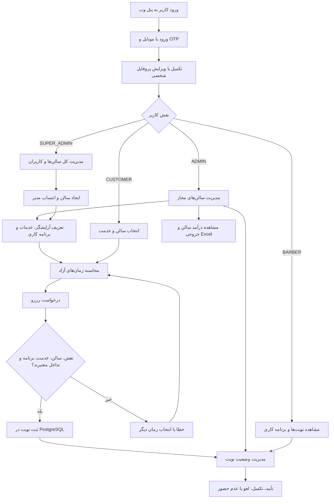
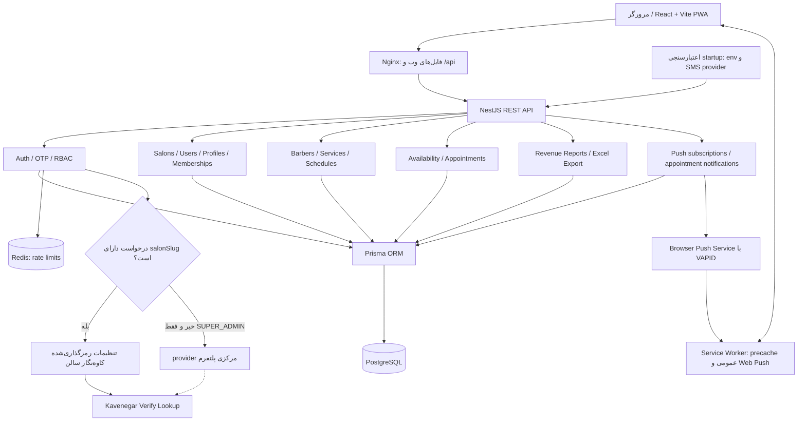
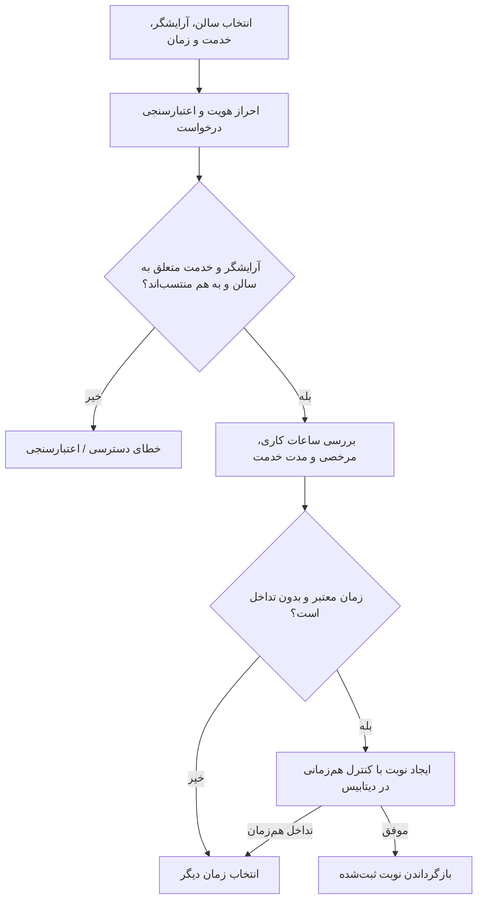
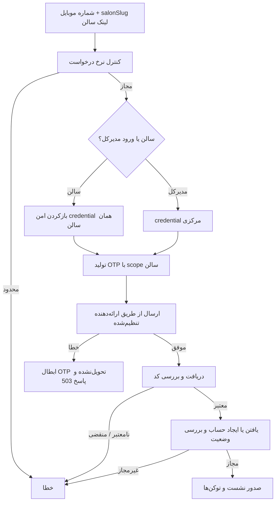
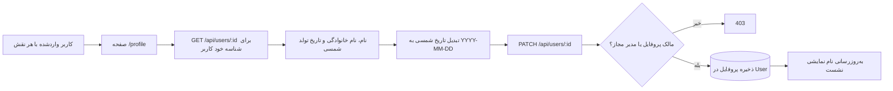
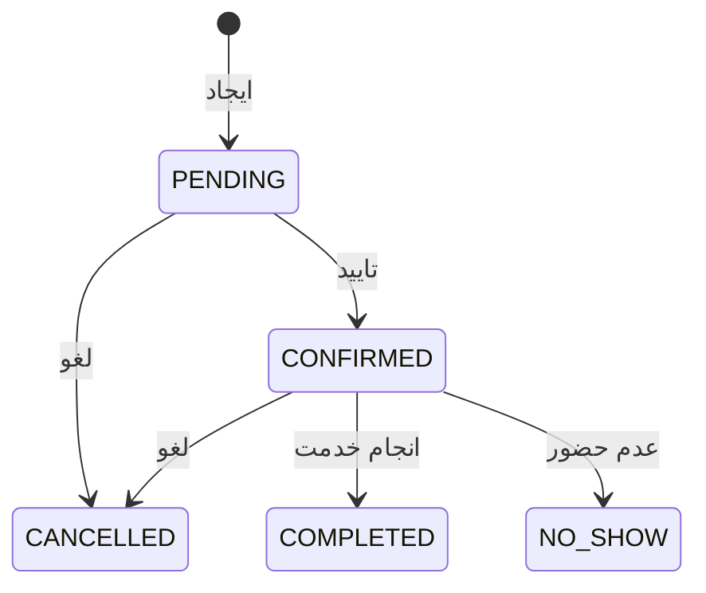
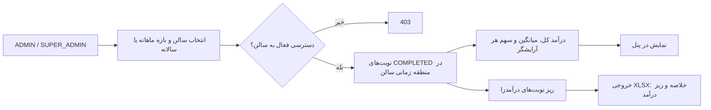
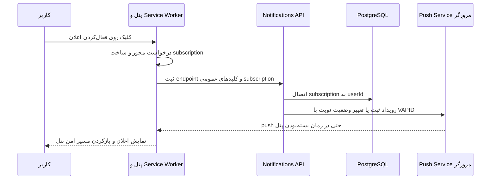

# نمای سریع سیستم — Barbershop

> سند زنده معماری و مسیرهای اصلی. با تغییر کدهای مرتبط، این فایل نیز در همان تغییر به‌روزرسانی می‌شود (طبق `AGENTS.md`). آخرین بازبینی: 2026-10-29.

## ۰. کل سیستم در یک نگاه

این نمودار نمای مفهومی نقش‌ها و مسیرهاست؛ دسترسی دقیق هر عملیات در سمت سرور تعیین می‌شود و همه مسیرهای نشان‌داده‌شده الزاماً در UI برای هر نقش در دسترس نیستند.

## ۱. معماری فنی

| جزء                 | وظیفه                                                 |
| ------------------- | ----------------------------------------------------- |
| React + Vite        | رابط کاربری و پنل                                     |
| Nginx               | ارائه وب و reverse proxy مسیر `/api`                  |
| NestJS              | اعتبارسنجی، مجوزها و منطق کسب‌وکار                    |
| Prisma + PostgreSQL | داده‌های پایدار کاربران، سالن‌ها، برنامه‌ها و نوبت‌ها |
| Redis               | داده‌های موقت و محدودسازی درخواست‌ها                  |
| SMS                 | ارسال OTP در صورت پیکربندی ارائه‌دهنده                |

API پیش از پذیرش ترافیک، تنظیمات SMS و کلید اصلی رمزگذاری را اعتبارسنجی
می‌کند. `mock` فقط در `development` و `test` مجاز است. هر سالن حساب کاوه‌نگار
خود را از پنل ادمین تنظیم می‌کند؛ API key با AES-256-GCM رمزگذاری می‌شود و در
پاسخ API برگردانده نمی‌شود. provider مرکزی فقط برای ورود `SUPER_ADMIN` بدون
لینک سالن و ورود اولیه ادمین فعال سالنی که هنوز credential ندارد استفاده
می‌شود؛ fallback ادمین پس از ثبت تنظیمات همان سالن دیگر انتخاب نمی‌شود.

## ۲. مسیر رزرو و کنترل هم‌زمانی

زمان نمایش‌داده‌شده تضمین رزرو نیست؛ هنگام ثبت، تداخل مجدداً بررسی می‌شود.

## ۳. ورود با OTP

### ۳.۱. تکمیل پروفایل شخصی

تاریخ تولد در دیتابیس به‌صورت `DATE` ذخیره می‌شود و زمان یا منطقه زمانی ندارد.
فرانت‌اند آن را به تقویم شمسی نمایش می‌دهد، اما API مقدار استاندارد
`YYYY-MM-DD` دریافت می‌کند. کاربر عادی فقط پروفایل خودش را می‌خواند و ویرایش
می‌کند؛ قواعد دسترسی مدیران همان محدوده فعال سالن را اعمال می‌کند.

## ۴. وضعیت‌های نوبت

این نمودار چرخه مفهومی است؛ انتقال‌های واقعی و نقش‌های مجاز باید با `src/appointments` تطبیق داده شوند.

## ۵. گزارش درآمد مدیر

مبنای درآمد، مبلغ snapshot ذخیره‌شده روی نوبت تکمیل‌شده است؛ تغییر بعدی قیمت
خدمت، گزارش تاریخی را تغییر نمی‌دهد. نوبت‌های در انتظار، تأییدشده، لغوشده و
عدم مراجعه درآمد محسوب نمی‌شوند. مدیر عادی فقط گزارش سالن دارای عضویت فعال خود
را می‌بیند و مدیرکل می‌تواند سالن موردنظر را انتخاب کند.

## ۶. PWA و اعلان نوبت

مجوز اعلان فقط با اقدام صریح کاربر درخواست می‌شود. کلید خصوصی VAPID در سرور
می‌ماند و endpoint منقضی‌شده حذف می‌شود. Service Worker پاسخ‌های `/api` را
precache نمی‌کند.

## ۷. نقشه کد و نگهداری سند

- `apps/web`: پنل وب
- `src/auth`, `src/otp`: ورود، نشست و SMS provider (راهنما: `docs/sms.md`)
- `src/salons`, `src/users`: مدیریت سالن و اعضا
- `src/barbers`, `src/services`, `src/barber-services`: آرایشگران و خدمات
- `src/schedules`, `src/availability`: برنامه کاری و زمان آزاد
- `src/appointments`: رزرو و وضعیت نوبت
- `src/reports`: گزارش درآمد سالن و ساخت فایل Excel
- `src/notifications`: subscriptionها و ارسال Web Push
- `prisma/schema.prisma`: مدل داده
- `docker-compose.yml`, `deploy/nginx`: زیرساخت استقرار

**قاعده نگهداری:** هر تغییر در نقش‌ها، API، فرایند رزرو، OTP، ساختار داده یا استقرار باید هم‌زمان در نمودار مرتبط و توضیحات این فایل بازتاب یابد. این کار با دستورالعمل `AGENTS.md` به فرایند توسعه اضافه شده و به‌صورت خودکار در پس‌زمینه اجرا نمی‌شود.
