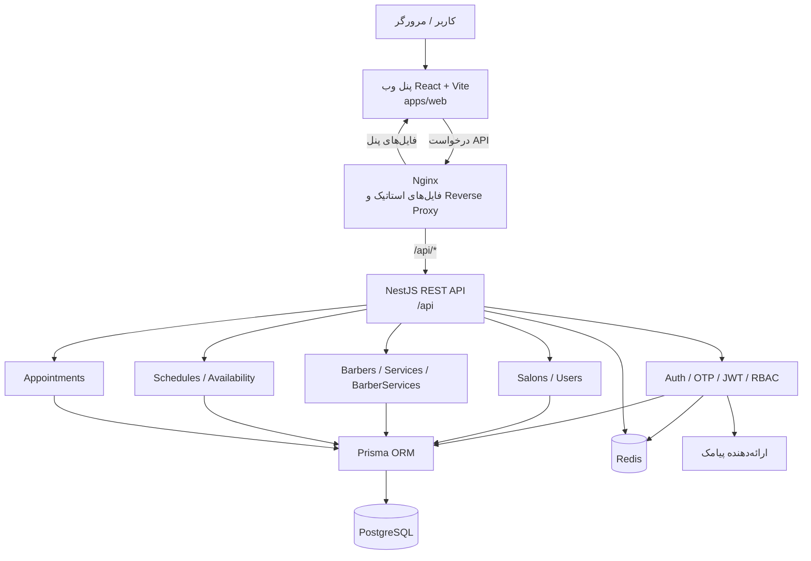
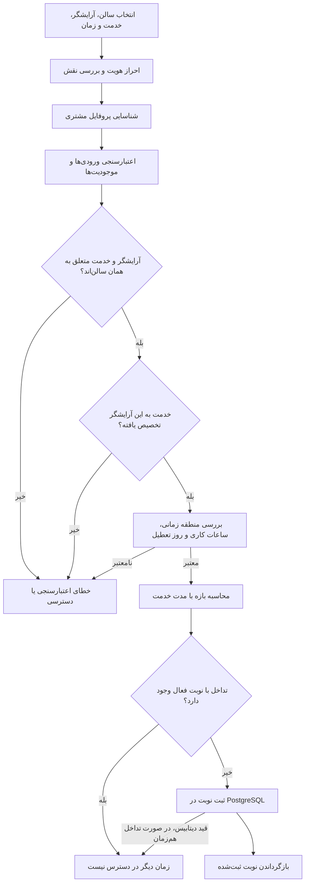
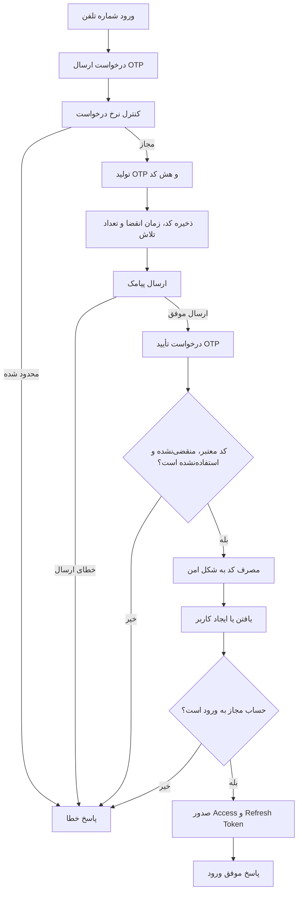
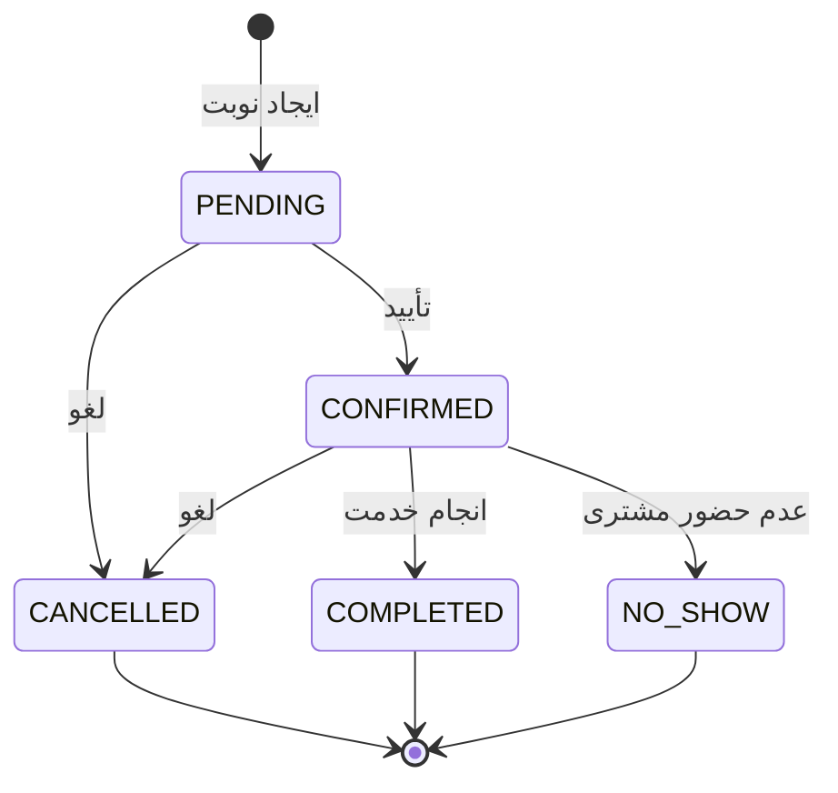

# معماری و جریان سیستم

این سند نمای سریع معماری سامانه رزرو آرایشگاه را ارائه می‌کند؛ از رابط کاربری تا API، احراز هویت، محاسبه زمان‌های آزاد و ثبت نوبت.

## ۱. معماری کلان

### مسئولیت اجزا

| جزء | مسئولیت |
| --- | --- |
| React + Vite | رابط کاربری و پنل مدیریت |
| Nginx | سرو فایل‌های فرانت‌اند و هدایت درخواست‌های `/api` به NestJS |
| NestJS | API، اعتبارسنجی ورودی‌ها، مجوزها و قوانین کسب‌وکار |
| Auth / OTP | ورود با شماره تلفن، تأیید OTP و چرخه توکن‌ها |
| Salons / Users | مدیریت کاربران، سالن‌ها و عضویت مدیران |
| Barbers / Services | مدیریت آرایشگران، خدمات و انتساب خدمات به آرایشگر |
| Schedules | ساعات کاری و روزهای تعطیل |
| Availability | محاسبه بازه‌های زمانی قابل رزرو |
| Appointments | ایجاد، مشاهده، لغو و تغییر وضعیت نوبت |
| Prisma + PostgreSQL | دسترسی به داده‌ها و نگهداری پایدار اطلاعات |
| Redis | عملیات موقت مانند محدودسازی نرخ درخواست و کش |
| SMS Provider | ارسال کد OTP در محیطی که ارائه‌دهنده پیامک تنظیم شده باشد |

## ۲. جریان رزرو نوبت

**نکته هم‌زمانی:** زمان‌های آزاد که به کاربر نمایش داده می‌شوند تضمین رزرو نیستند؛ ممکن است کاربر دیگری همان زمان را زودتر رزرو کند. بنابراین اعتبارسنجی باید هنگام ایجاد نوبت تکرار شود و قید دیتابیس نیز آخرین لایه جلوگیری از رزروهای متداخل است.

## ۳. جریان ورود با OTP

این نمودار جریان مفهومی OTP را نشان می‌دهد. جزئیات دقیق ذخیره‌سازی، تعداد تلاش‌ها، انقضا و ابطال توکن باید با پیاده‌سازی جاری ماژول‌های `otp` و `auth` تطبیق داده شود.

## ۴. چرخه وضعیت نوبت

قواعد انتقال وضعیت و اینکه کدام نقش مجاز به هر انتقال است باید از سرویس نوبت‌ها و گاردهای دسترسی پیروی کند.

## ۵. مسیرهای مهم برای مطالعه کد

- `apps/web`: برنامه فرانت‌اند React + Vite.
- `src/main.ts`: پیکربندی و راه‌اندازی NestJS و پیشوند API.
- `src/auth` و `src/otp`: ورود، توکن‌ها و تأیید شماره تلفن.
- `src/salons`, `src/barbers`, `src/services`, `src/barber-services`: اطلاعات سالن و خدمات.
- `src/schedules` و `src/availability`: برنامه کاری و زمان‌های آزاد.
- `src/appointments`: منطق رزرو و تغییر وضعیت نوبت.
- `src/prisma` و `prisma/schema.prisma`: دسترسی به دیتابیس و مدل داده.
- `src/redis`: اتصال و عملیات Redis.
- `docker-compose.yml`, `Dockerfile`, `deploy/nginx/default.conf`: اجرای کانتینری و مسیریابی درخواست‌ها.

## ۶. ملاحظات عملیاتی

- مسیرهای API با پیشوند `/api` ارائه می‌شوند.
- مجوز نقش و محدوده دسترسی به سالن باید در سمت سرور بررسی شود؛ پنهان کردن گزینه‌ها در UI به‌تنهایی کنترل دسترسی نیست.
- تنظیم منطقه زمانی سالن در محاسبه زمان‌های کاری و نوبت‌ها اهمیت دارد.
- در Production، برای ارسال OTP باید ارائه‌دهنده پیامک و متغیرهای دسترسی آن پیکربندی شوند.
- دسترسی عمومی Production باید با HTTPS محافظت شود؛ استفاده از IP و HTTP فقط برای توسعه یا تست محدود مناسب است.
