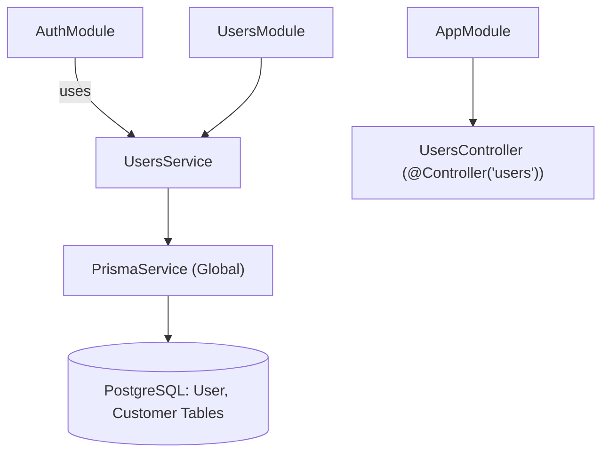
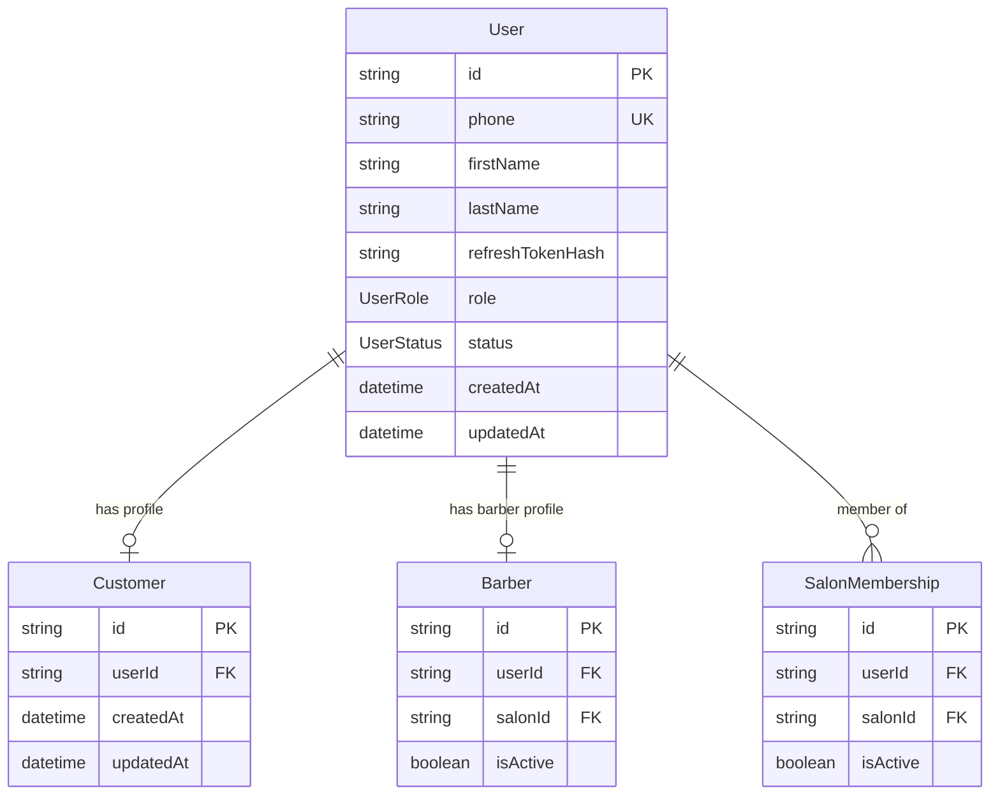

# ماژول کاربران (Users Module)

## معرفی

ماژول کاربران مسئولیت مدیریت هویت، ذخیره‌سازی و عملیات پایه‌ای موجودیت کاربر (User) را در سامانه بر عهده دارد.

در معماری فعلی سامانه، این ماژول به عنوان لایه پایدارسازی داده (Persistence Layer) عمل می‌کند و تعامل مستقیمی با پایگاه‌داده PostgreSQL از طریق Prisma دارد. تمرکز اصلی ماژول در حال حاضر بر پشتیبانی از فرایندهای احراز هویت، ثبت‌نام اولیه مشتریان، و مدیریت هش توکن‌های نوسازی (Refresh Token) است که توسط [`AuthModule`](file:///c:/Users/amoha/Documents/barbershop-api/src/auth/auth.module.ts) فراخوانی می‌شوند.

### مسئولیت‌های کلیدی
* جستجوی کاربر بر اساس شناسه یکتا (`id`).
* جستجوی کاربر بر اساس شماره تلفن همراه یکتا (`phone`).
* ایجاد حساب کاربری مشتری (`Customer`) جدید به همراه پروفایل مرتبط به صورت یک تراکنش اتمیک تودرتو.
* ذخیره و به‌روزرسانی هش رمزشده توکن‌های نوسازی (`refreshTokenHash`) و ابطال آن هنگام خروج از حساب (Logout).
* تفکیک هویت کاربر از نقش‌های تخصصی کسب‌وکار (نظیر `Customer`، `Barber`، و `SalonMembership`).

---

## ساختار و وابستگی‌های ماژول

ماژول کاربران در مسیر [`src/users/users.module.ts`](file:///c:/Users/amoha/Documents/barbershop-api/src/users/users.module.ts) تعریف شده است:

```typescript
import { Module } from '@nestjs/common';

import { UsersService } from './users.service.js';

@Module({
  providers: [UsersService],
  exports: [UsersService],
})
export class UsersModule {}
```

### نمودار معماری و جریان ارتباطی



* **وابستگی به [`PrismaModule`](file:///c:/Users/amoha/Documents/barbershop-api/src/prisma/prisma.module.ts)**: به صورت گلوبال در دسترس است و سرویس [`PrismaService`](file:///c:/Users/amoha/Documents/barbershop-api/src/prisma/prisma.service.ts) جهت ارتباط با پایگاه‌داده به [`UsersService`](file:///c:/Users/amoha/Documents/barbershop-api/src/users/users.service.ts) تزریق می‌شود.
* **صادرات سرویس**: [`UsersService`](file:///c:/Users/amoha/Documents/barbershop-api/src/users/users.service.ts) به عنوان خروجی ماژول اکسپورت شده تا ماژول‌های احراز هویت یا مدیریت سالن‌ها بتوانند از آن بهره گیرند.
* **ثبت در کنترلرهای برنامه**: کنترلر [`UsersController`](file:///c:/Users/amoha/Documents/barbershop-api/src/users/users.controller.ts) در [`AppModule`](file:///c:/Users/amoha/Documents/barbershop-api/src/app.module.ts#L59) ثبت شده است.

---

## اندپوینت‌ها (API Endpoints)

در پیاده‌سازی فعلی پروژه:

```typescript
// src/users/users.controller.ts
import { Controller } from '@nestjs/common';

@Controller('users')
export class UsersController {}
```

کنترلر [`UsersController`](file:///c:/Users/amoha/Documents/barbershop-api/src/users/users.controller.ts) با پیشوند مسیر `users` (تحت پیشوند سراسری `api`، یعنی `/api/users`) تعریف و در [`AppModule`](file:///c:/Users/amoha/Documents/barbershop-api/src/app.module.ts) ثبت شده است. در فاز فعلی توسعه، به منظور حفظ ایزولاسیون امنیتی، اندپوینت‌های عمومی CRUD کاربر باز نشده‌اند و تمام تعاملات با کاربران از طریق متدهای امن ماژول احراز هویت (`/api/auth/*`) انجام می‌شود.

### وضعیت اندپوینت‌ها در فاز فعلی و فازهای آینده:

| متد HTTP | مسیر | وضعیت فعلی | سطح دسترسی / گارد | شرح عملکرد |
| :--- | :--- | :--- | :--- | :--- |
| `GET` | `/api/auth/me` | **فعال** (در `AuthController`) | JWT Guard | دریافت مشخصات کاربر احراز هویت شده جاری |
| `GET` | `/api/users` | *طراحی شده برای فاز توسعه ادمین* | Admin / Super Admin | دریافت لیست کاربران سیستم با قابلیت فیلتر و صفحه‌بندی |
| `GET` | `/api/users/:id` | *طراحی شده برای فاز توسعه ادمین* | Admin / Super Admin | دریافت جزئیات یک کاربر بر اساس شناسه |
| `PATCH` | `/api/users/:id` | *طراحی شده برای فاز توسعه ادمین* | صاحب حساب یا ادمین | ویرایش اطلاعات کاربری (نام، نام خانوادگی) |
| `PATCH` | `/api/users/:id/status` | *طراحی شده برای فاز توسعه ادمین* | Super Admin | تغییر وضعیت کاربر (`ACTIVE`, `INACTIVE`, `BLOCKED`) |

#### نمونه درخواست و پاسخ دریافت اطلاعات کاربر جاری (`GET /api/auth/me`):

```http
GET /api/auth/me HTTP/1.1
Host: localhost:3000
Authorization: Bearer <ACCESS_TOKEN>
```

```http
HTTP/1.1 200 OK
Content-Type: application/json

{
  "sub": "e30e14c5-381a-45c1-8ce5-5a2307efea14",
  "phone": "09121234567",
  "role": "CUSTOMER"
}
```

---

## سرویس کاربران ([`UsersService`](file:///c:/Users/amoha/Documents/barbershop-api/src/users/users.service.ts))

سرویس [`UsersService`](file:///c:/Users/amoha/Documents/barbershop-api/src/users/users.service.ts) در مسیر `src/users/users.service.ts` قرار دارد. تمامی کوئری‌های این سرویس به وسیله متدهای تایپ‌سیف Prisma اجرا می‌شوند.

```typescript
@Injectable()
export class UsersService {
  constructor(private readonly prisma: PrismaService) {}
  ...
}
```

### متدهای سرویس:

#### ۱. `findById(id: string): Promise<User | null>`
جستجوی کاربر بر اساس شناسه یکتا (UUID).
* **ورودی**: `id` رشته‌ای حاوی UUID کاربر.
* **خروجی**: رکورد کاربر از مدل `User` یا مقدار `null` در صورت عدم وجود.
* **کاربرد**: در استراتژی JWT، متد `refresh` و بررسی وضعیت فعال بودن کاربر در هر نشست.

```typescript
async findById(id: string): Promise<User | null> {
  return this.prisma.user.findUnique({
    where: { id },
  });
}
```

---

#### ۲. `findByPhone(phone: string): Promise<User | null>`
جستجوی کاربر بر اساس شماره تلفن همراه.
* **ورودی**: `phone` رشته‌ای شامل شماره تلفن نرمال‌شده کاربر.
* **خروجی**: رکورد کاربر منطبق یا `null`.
* **کاربرد**: هنگام تأیید OTP برای تشخیص این که آیا کاربر از پیش ثبت‌نام کرده است یا کاربر جدید است.

```typescript
async findByPhone(phone: string): Promise<User | null> {
  return this.prisma.user.findUnique({
    where: { phone },
  });
}
```

---

#### ۳. `createCustomer(phone: string): Promise<User>`
ایجاد یک رکورد کاربر جدید با نقش مشتری و پروفایل متناظر آن به صورت همزمان (Nested Creation).
* **ورودی**: `phone` شماره تلفن نرمال‌شده.
* **مقادیر پیش‌فرض ثبت‌شده**:
  - `role`: مقدار انوم `'CUSTOMER'`.
  - `status`: مقدار انوم `'ACTIVE'`.
  - `customer`: ایجاد رکورد در جدول `Customer` با کلید خارجی `userId`.
* **ویژگی اتمیک**: در سطح Prisma با یک دستور SQL ترکیبی درج می‌شود تا ایجاد کاربر بدون پروفایل مشتری ناممکن باشد.

```typescript
async createCustomer(phone: string): Promise<User> {
  return this.prisma.user.create({
    data: {
      phone,
      role: 'CUSTOMER',
      status: 'ACTIVE',
      customer: {
        create: {},
      },
    },
  });
}
```

---

#### ۴. `updateRefreshToken(userId: string, refreshTokenHash: string | null): Promise<User>`
به‌روزرسانی یا پاک‌سازی هش توکن نوسازی کاربر.
* **ورودی**:
  - `userId`: شناسه یکتای کاربر.
  - `refreshTokenHash`: رشته هش‌شده توکن نوسازی با الگوریتم `bcrypt` یا مقدار `null` (جهت خروج از سامانه).
* **خروجی**: رکورد به‌روزرسانی‌شده کاربر.
* **کاربرد**:
  - پس از صدور موفق توکن‌های احراز هویت: ذخیره هش `refreshToken`.
  - در زمان خروج از حساب کاربری (`logout`): پاس دادن مقدار `null` جهت لغو اعتبار فوری تمام توکن‌های نوسازی قبلی.

```typescript
async updateRefreshToken(
  userId: string,
  refreshTokenHash: string | null,
): Promise<User> {
  return this.prisma.user.update({
    where: { id: userId },
    data: { refreshTokenHash },
  });
}
```

---

## مدل داده‌ای و انوم‌ها (Data Models & Enums)

مدل کاربر و ساختارهای وابسته در فایل [`prisma/schema.prisma`](file:///c:/Users/amoha/Documents/barbershop-api/prisma/schema.prisma#L41-L59) تعریف شده‌اند.

### ۱. مدل `User`

```prisma
model User {
  id               String     @id @default(uuid())
  phone            String     @unique
  firstName        String?
  lastName         String?
  refreshTokenHash String?
  role             UserRole   @default(CUSTOMER)
  status           UserStatus @default(ACTIVE)

  customer         Customer?
  barber           Barber?
  salonMemberships SalonMembership[]

  createdAt DateTime @default(now())
  updatedAt DateTime @updatedAt

  @@index([role])
  @@index([status])
}
```

#### مشخصات فیلدهای `User`:

| نام فیلد | نوع داده | کلید / خصوصیت | توضیحات |
| :--- | :--- | :--- | :--- |
| `id` | `String` | `@id @default(uuid())` | کلید اصلی یکتای کاربر در فرمت UUID |
| `phone` | `String` | `@unique` | شماره تلفن همراه یکتا (شناسه اصلی ورود) |
| `firstName` | `String?` | اختیاری | نام کوچک کاربر |
| `lastName` | `String?` | اختیاری | نام خانوادگی کاربر |
| `refreshTokenHash` | `String?` | اختیاری | هش ذخیره‌شده رفرش‌توکن جاری (محاسبه‌شده با Bcrypt) |
| `role` | `UserRole` | `@default(CUSTOMER)` | نقش کاربری در سامانه |
| `status` | `UserStatus` | `@default(ACTIVE)` | وضعیت حساب کاربری |
| `createdAt` | `DateTime` | `@default(now())` | تاریخ و زمان ایجاد حساب |
| `updatedAt` | `DateTime` | `@updatedAt` | تاریخ و زمان آخرین ویرایش |

#### ایندکس‌ها:
* `@@index([role])`: بهینه‌سازی سرعت جستجو و فیلتر کاربران بر اساس نقش.
* `@@index([status])`: افزایش سرعت فیلتر کاربران فعال/مسدودشده.

---

### ۲. انوم‌های مرتبط

#### نقش کاربر ([`UserRole`](file:///c:/Users/amoha/Documents/barbershop-api/prisma/schema.prisma#L10-L15)):
```prisma
enum UserRole {
  SUPER_ADMIN // مدیر ارشد کل سامانه با تمام دسترسی‌ها
  ADMIN       // مدیر سالن
  BARBER      // آرایشگر
  CUSTOMER    // مشتری عادی (نقش پیش‌فرض)
}
```

#### وضعیت کاربر ([`UserStatus`](file:///c:/Users/amoha/Documents/barbershop-api/prisma/schema.prisma#L17-L21)):
```prisma
enum UserStatus {
  ACTIVE   // فعال - مجاز به ورود و انجام عملیات
  INACTIVE // غیرفعال - ثبت‌نام‌شده اما معلق
  BLOCKED  // مسدودشده - دسترسی به سامانه مسدود است
}
```

---

### ۳. روابط با سایر مدل‌ها



1. **پروفایل مشتری ([`Customer`](file:///c:/Users/amoha/Documents/barbershop-api/prisma/schema.prisma#L115-L125))**: رابطه یک‌به‌یک اختیاری (`Customer?`). هر مشتری به نوبت‌های رزرو شده (`Appointment[]`) متصل است. حذف رکورد User باعث حذف آبشاری (`onDelete: Cascade`) پروفایل مشتری می‌شود.
2. **پروفایل آرایشگر ([`Barber`](file:///c:/Users/amoha/Documents/barbershop-api/prisma/schema.prisma#L127-L147))**: رابطه یک‌به‌یک اختیاری (`Barber?`). حاوی ارتباط با سالن، خدمات آرایشگر، ساعات کاری و روزهای مرخصی.
3. **عضویت در سالن‌ها ([`SalonMembership`](file:///c:/Users/amoha/Documents/barbershop-api/prisma/schema.prisma#L97-L113))**: رابطه یک‌به‌چند. جهت مدیریت دسترسی‌های مدیریتی یا پرسنلی کاربران در سالن‌های مختلف.

---

## نکات امنیتی ماژول کاربران

1. **امنیت توکن‌های نوسازی (Hashed Refresh Tokens)**:
   توکن‌های نوسازی به هیچ وجه به صورت خام در فیلد `refreshTokenHash` ذخیره نمی‌شوند؛ بلکه نسخه هش‌شده با `bcrypt` ذخیره می‌گردد. در صورت بروز هرگونه رخنه اطلاعاتی در دیتابیس، امکان سوءاستفاده از نشست‌های فعال کاربران وجود نخواهد داشت.
2. **یکتایی شماره تلفن**:
   قید `@unique` روی فیلد `phone` در سطح دیتابیس تضمین می‌کند که هیچ شماره تلفنی تکراری ثبت نگردد.
3. **کنترل وضعیت فعال بودن**:
   در تمام مراحل اعتبارسنجی توکن یا لاگین، وضعیت `user.status === 'ACTIVE'` بررسی می‌شود و در صورت غیرفعال یا مسدود بودن (`BLOCKED`)، خطای `401 Unauthorized` صادر می‌گردد.
